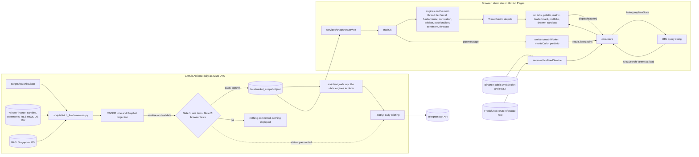
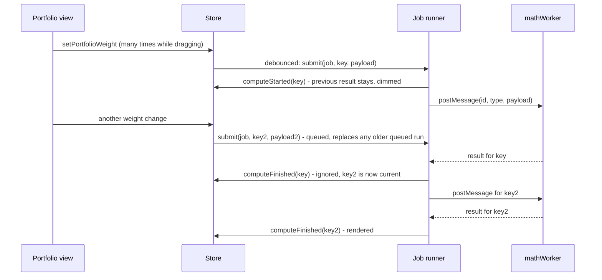
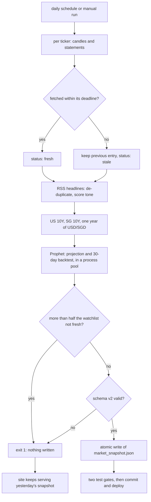
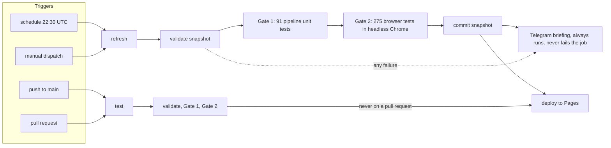
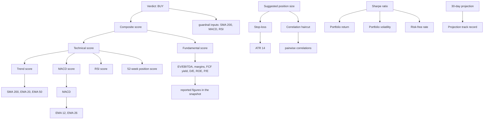

# QuantLens

**A multi-asset comparison workstation that shows its working.** Compare US and Singapore stocks, REITs, ETFs, market indices and crypto side by side, rank a watchlist, and test a portfolio allocation. Every indicator, score, ratio, verdict and position size can be opened to reveal the formula, the raw inputs and the arithmetic, step by step.

[](https://github.com/myc208/quantlens/actions/workflows/update-market-data.yml)

- **Site:** `https://myc208.github.io/quantlens/`
- **Tests:** `https://myc208.github.io/quantlens/tests/engines.test.html`
- **Cost to run:** zero. No server, no database, no API keys, no build step, no browser dependencies.

> QuantLens is an educational tool. Its verdicts, position sizes and portfolio statistics come from fixed, published rules so that they can be checked. They are not financial advice.

**What V2 adds:** three views (Compare, Leaderboard, Portfolio), a time-range slicer, a `Ctrl/Cmd + K` command palette, Modern Portfolio Theory maths in a Web Worker, de-duplicated news with headline tone, a 30-day Prophet projection that is always shown beside its own track record, 10-year government yields as the risk-free rate, a CI gate that runs the whole test suite in a headless browser before anything is deployed, and an optional daily briefing on Telegram.

---

## Contents

1. [What it does](#what-it-does)
2. [Quick start](#quick-start)
3. [Architecture](#architecture)
4. [Stateless by design](#stateless-by-design)
5. [Web Worker and portfolio maths](#web-worker-and-portfolio-maths)
6. [The time-range slicer](#the-time-range-slicer)
7. [The data pipeline](#the-data-pipeline)
8. [News de-duplication and headline tone](#news-de-duplication-and-headline-tone)
9. [Prophet forecasting and its limits](#prophet-forecasting-and-its-limits)
10. [CI/CD and the testing gates](#cicd-and-the-testing-gates)
11. [Daily Telegram briefing](#daily-telegram-briefing)
12. [Live feeds and their fallbacks](#live-feeds-and-their-fallbacks)
13. [The Derivation Tracer](#the-derivation-tracer)
14. [The mathematics](#the-mathematics)
15. [Numerical safety](#numerical-safety)
16. [Testing](#testing)
17. [Accessibility and responsive design](#accessibility-and-responsive-design)
18. [Deployment](#deployment)
19. [Changing the watchlist](#changing-the-watchlist)
20. [Design decisions and known limitations](#design-decisions-and-known-limitations)
21. [Interview talking points](#interview-talking-points)

---

## What it does

| Feature | What the user sees |
|---|---|
| **Compare** | Up to three assets in columns: verdict, live or last price, a price chart with a dotted 30-day projection, period statistics, technical indicators, fundamentals, recent headlines, correlation and suggested position size. |
| **Leaderboard** | The whole watchlist in one sortable table, ranked by Composite score by default. It respects the screener filters, and shows as many columns as its own width allows. |
| **Portfolio sandbox** | Up to eight assets with weight sliders. Annualised return, volatility, Sharpe ratio and diversification ratio, who carries the risk, and where the mix sits among 2,000 alternative mixes. |
| **Time range** | `1M` `3M` `6M` `1Y`. Slices the series behind the charts, period statistics, correlation, the simulation's volatility and the portfolio maths. It never changes the verdict. |
| **Command palette** | `Ctrl/Cmd + K` finds any asset by ticker, name or sector and runs any command: switch view, change range, currency or mode, open the risk sandbox, copy the share link. |
| **Screener** | Filter by asset class, market, sector and verdict; tick up to three assets. No market data is ever typed in. |
| **Sector-aware scoring** | Corporates, financial companies and REITs are each scored on the measures that apply to them. A bank is never judged on EV/EBITDA. ETFs, indices and crypto have no accounts, so their verdict rests on price behaviour alone. |
| **Derivation drawer** | Click any value to see its formula, raw inputs, numbered arithmetic and thresholds, then drill into the numbers it is built from. |
| **Guided and Pro modes** | Guided explains every metric in plain language. Pro is the same data at higher density, with extra rows. |
| **News and forecast** | Three recent, de-duplicated headlines per asset with the tone of their wording, and a 30-day trend projection with its measured miss rate. Context only: neither is part of the verdict. |
| **Risk sandbox** | Change account size, risk per trade, stop distance and position cap, and watch the position and a Monte Carlo fan of outcomes respond. |
| **Telemetry bar** | Live crypto ticks, USD/SGD, the US and Singapore 10-year yields and the age of the daily data, each labelled with its source and fallback state. |
| **Daily briefing** | Optional. After each scheduled refresh, a short Telegram message with the top BUY and SELL signals, notable shifts in headline tone, and whether the run passed its checks. |

The watchlist (23 assets, designed for up to about 30):

| Class | Tickers |
|---|---|
| Crypto | `BTC-USD` `ETH-USD` `AVAX-USD` |
| US equities | `BLK` `SNDK` `MU` `AMD` `ORCL` `BRK-B` `TSLA` `CCJ` |
| Singapore equities and REITs | `D05.SI` `U11.SI` `C6L.SI` `AJBU.SI` `A17U.SI` `J69U.SI` |
| ETFs | `VOO` (NYSE Arca) · `CSPX.L` (London, quoted in USD) |
| Indices | `^IXIC` `^GSPC` `^DJI` `^STI` |

The comparison opens on `AMD`, `D05.SI` and `BTC-USD`: one corporate, one bank, one coin.

---

## Quick start

The site is plain HTML, CSS and ES modules. It needs a web server only because browsers do not load modules or workers from `file://`.

```bash
python -m http.server 8000
```

Then open `http://localhost:8000` for the workstation and `http://localhost:8000/tests/engines.test.html` for the test suite.

To refresh the market data yourself (optional; the committed snapshot works out of the box):

```bash
pip install -r scripts/requirements.txt
```

```bash
python scripts/fetch_fundamentals.py
```

To preview the Telegram briefing without sending anything, leave the two `TELEGRAM_*` variables unset: the command does nothing and exits 0. With them set it sends one message.

```bash
python scripts/fetch_fundamentals.py --notify
```

To run the same two gates that CI runs:

```bash
python -m unittest discover -s scripts -p "test_*.py"
```

```bash
python scripts/run_browser_tests.py --min-tests 100
```

The second command needs Chrome, Chromium or Edge installed. It uses only the Python standard library.

---

## Architecture



### Principles

| Principle | How it is enforced |
|---|---|
| **One-way data flow** | UI events dispatch actions; a pure reducer produces the next state; subscribers re-render. UI modules never import each other. |
| **Engines are pure** | An engine takes a normalised asset and returns traced metrics. No DOM, no network, no clock, no global state. That is what lets the same file run on the main thread, in a worker and in the test page. |
| **Nothing is stored** | No `localStorage`, `sessionStorage`, cookies or IndexedDB. A reload starts from the URL plus the latest snapshot. A test asserts storage stays empty. |
| **Heavy maths stays off the main thread** | Monte Carlo and the portfolio calculations run in a Web Worker. A slider drag never blocks a frame. |
| **Every number is traceable** | Engines cannot return a bare number: every output is a `TracedMetric` with its derivation attached. |
| **No silent failure** | Missing data becomes an `N/A` badge with a reason. A failed feed degrades to the next source and says so in the telemetry bar. |
| **Models state their own record** | The projection is never shown without how far it missed in its last test. It is never coloured as good or bad. |

### Folder structure

```
.github/workflows/update-market-data.yml   refresh, two test gates, deploy to Pages
scripts/watchlist.json                     the assets to track
scripts/fetch_fundamentals.py              prices, statements, news, yields, forecasts -> validated JSON;
                                           --notify sends the Telegram briefing
scripts/signals.mjs                        runs the site's engines in Node.js for the briefing's signals
scripts/test_fetch_fundamentals.py         91 unit tests for the pipeline (Gate 1)
scripts/run_browser_tests.py               headless Chrome/Edge runner for the test page (Gate 2)
scripts/requirements.txt                   yfinance, vaderSentiment, prophet (pipeline only)
data/market_snapshot.json                  schema v2 snapshot (committed)
index.html
styles/    tokens.css  layout.css  components.css  guided.css
src/main.js                                composition root: URL sync, caches, worker jobs, view switching
src/core/      store.js  precisionMath.js  derivationTracer.js
src/services/  snapshotService.js  liveFeedService.js  glossaryService.js  workerService.js
src/workers/   mathWorker.js
src/engines/   technicalEngine.js  fundamentalEngine.js  correlationEngine.js  advisorEngine.js
               positionSizerEngine.js  monteCarloEngine.js  portfolioEngine.js
               sentimentEngine.js  forecastEngine.js
src/ui/        telemetryBar.js  appTabs.js  commandPalette.js  screenerPanel.js
               comparisonMatrix.js  leaderboardView.js  portfolioSandbox.js
               derivationDrawer.js  riskSandboxModal.js
tests/engines.test.html                    275 browser-run tests in 31 suites, zero dependencies
```

---

## Stateless by design

The page keeps **no state between visits**. There is no account, no cookie, no browser storage and no server session. Everything on screen is a pure function of two inputs:

```
view = f(URL query string, data/market_snapshot.json)
```

That one decision buys clean first loads, links that reproduce a view exactly, correct back/forward behaviour, nothing to migrate when the schema changes, and no privacy surface.

### What lives where

| State | Where it lives | Survives a reload? | In a shared link? |
|---|---|---|---|
| Compared tickers, filters, currency, mode | URL | yes | yes |
| Active view and time range | URL | yes | yes |
| Portfolio weights (percentages) | URL | yes | yes |
| Account size, risk per trade, stop distance, position cap | memory only | no | **never** |
| Live prices, worker results, open drawer | memory only | no | no |

### URL parameters

| Parameter | Meaning | Values | Default (omitted from the URL) |
|---|---|---|---|
| `t` | Compared tickers, comma-separated, at most 3 | any watchlist ticker (`^GSPC` may be written `%5EGSPC`) | `AMD,D05.SI,BTC-USD` |
| `ccy` | Display, account and portfolio base currency | `USD` `SGD` | `USD` |
| `mode` | Explanation level | `guided` `pro` | `guided` |
| `view` | Active tab | `compare` `leaderboard` `portfolio` | `compare` |
| `range` | Time range | `1m` `3m` `6m` `1y` | `1y` |
| `p` | Portfolio allocation as `TICKER:percent` pairs, at most 8 | `AMD:40,D05.SI:35,BTC-USD:25` | the compared assets at equal weights |
| `class` | Asset-class filter | `equity` `etf` `index` `crypto` | all |
| `mkt` | Market filter | `US` `SG` `UK` `CRYPTO` | all |
| `sector` | Sector filter | any sector in the snapshot | all |
| `verdict` | Verdict filter | `buy` `hold` `sell` | all |

Example: `?t=MU,AMD&ccy=SGD&mode=pro&view=portfolio&range=6m&p=MU:25,AMD:25,D05.SI:50`

How it works:

1. **Load.** `parseUrlState` reads `window.location.search` with `URLSearchParams` into the initial store state. Parsing is forgiving: values are case-insensitive, duplicates are removed, a fourth ticker is dropped, and anything malformed falls back to its default.
2. **Change.** After every view change the store calls `history.replaceState` with `serializeUrlState(state)`. Defaults are omitted, so the default view has no query string at all.
3. **Canonicalise.** Once the snapshot loads, tickers that are not on the watchlist are removed and the address bar is rewritten, so a stale or hand-edited link heals itself.
4. **Navigate.** A `popstate` listener re-reads the URL into the store.

Details worth noticing:

- `t` absent means "the default trio"; `t=` (empty) means "nothing selected". The two are distinguishable, so an emptied comparison survives a reload.
- **The portfolio is shared as percentages only.** `p=` can never reveal an amount of money, because no amount is ever entered: the maths needs only proportions.
- **Account size and risk settings are deliberately not in the URL.** A test asserts they are never serialised.
- Until a weight is changed, the portfolio simply follows the compared assets at equal weights and `p` stays out of the URL.

---

## Web Worker and portfolio maths

### Why a worker

A 1,000-path Monte Carlo run and a covariance matrix plus 2,000 sampled portfolios are tens of milliseconds each: fast, but not free when a slider fires them many times a second. Both run in `src/workers/mathWorker.js`, a module worker that imports the very same engine files the tests import.



| Concern | Handling |
|---|---|
| **Stale replies** | Every request has a key built from its inputs. The reducer accepts a result only if its key is still the current one: **latest wins**, by construction rather than by timing. |
| **Queue build-up** | One run in flight per job; a newer request replaces whatever is queued. Seven slider events in a row produce one calculation. |
| **No worker available** | The service waits for the worker's `ready` message. If it never arrives, the same `handleRequest` function is loaded on the main thread. Results are identical; the status line says which path ran. |
| **A hung calculation** | Each request has a timeout and rejects with a readable message, which the view shows instead of a spinner that never ends. |
| **Payload size** | The page sends only what the engine reads (tickers, currencies, sliced dates and closes), not whole asset records. |
| **Reproducibility** | The sample of alternative mixes is seeded from the assets and the time range, not from the weights, so the cloud stays put while a slider moves. |

### The mathematics (Modern Portfolio Theory)

Inputs: the assets' daily closes for the selected time range, the weights `w` (scaled to total 1), the base currency, and the risk-free rate.

1. **Align.** Keep only dates on which *every* asset has a close (stocks skip weekends and holidays, crypto does not).
2. **Convert.** Prices in another currency are converted at **each day's** USD/SGD rate (one year of daily rates is in the snapshot, forward-filled over market holidays), so currency moves are part of the return. If no history is available, today's rate is used throughout and the trace says that currency moves are *not* included.
3. **Returns.** Simple daily returns `rₜ = Pₜ ÷ Pₜ₋₁ − 1`. Simple returns, not log returns, because simple returns add across assets: `Rp = Σ wᵢrᵢ` is exact.
4. **Annualise.** `μ = mean(r) × 252` and `Σ = cov(r) × 252` (365 for a crypto-only portfolio).
5. **Portfolio return:** `Rp = wᵀμ`
6. **Portfolio volatility:** `σp = √(wᵀΣw)`
7. **Sharpe ratio:** `(Rp − Rf) ÷ σp`, where `Rf` is the 10-year government yield of the base currency.
8. **Share of risk** of asset *i*: `wᵢ(Σw)ᵢ ÷ σp²`. The shares total 1. An asset with a third of the money can carry two thirds of the risk.
9. **Diversification ratio:** `Σ wᵢσᵢ ÷ σp`. Exactly 1 when mixing brings no benefit.

At least 15 overlapping daily returns are required; below that every statistic is `N/A` with the count found and the count needed.

**Alternative mixes.** The scatter draws 2,000 random long-only portfolios of the same assets (weights uniform on the simplex, from normalised exponentials, plus every single-asset portfolio and the equal-weight one) and marks yours, the highest Sharpe and the lowest volatility. "Apply" copies a marked mix into the allocation as whole percentages that total exactly 100.

**What this is not.** It is a description of the past window, not an optimiser to trust. The highest-Sharpe mix is whichever random mix happened to do best in hindsight; it leans on whatever rose most and usually changes when the time range changes. The view says so next to the button. A perfectly hedged portfolio (volatility indistinguishable from zero) reports Sharpe as `N/A` rather than a number in the millions.

**Risk-free rate.** USD uses the US 10-year Treasury yield (`^TNX`). SGD uses the Singapore 10-year benchmark from MAS; if MAS cannot be read, the previous value is kept for up to 10 days and labelled `stale`, and after that the US yield stands in, labelled `proxy`. The label follows the number into the Sharpe ratio's trace.

---

## The time-range slicer

`1M` `3M` `6M` `1Y` cut each series to the last 30, 91, 182 or all calendar days before its final candle.

| Follows the range | Always uses the full year |
|---|---|
| Price chart and its projection overlay | RSI, MACD, SMA, EMA, ATR |
| Period return, period volatility, maximum drawdown, position in the period range | 52-week range position |
| Correlation between the compared assets | Technical, Fundamental and Composite scores |
| The correlation haircut in position sizing | **The verdict** |
| The volatility behind the Monte Carlo fan | Fundamentals |
| Every portfolio statistic | |

The split is deliberate. A 200-day moving average cannot be computed from 30 days, and an RSI seeded on a short window is a different number from the one everybody else quotes. So indicators keep their full warm-up and the verdict is stable, while the things that are genuinely *about a period* move with it.

One consequence worth knowing: because correlation follows the range, so does the correlation haircut, and therefore the suggested position sizes. A recent-window correlation is a legitimately different view of overlap, in the same way a risk model's answer depends on its look-back.

Short windows are allowed but labelled. Correlation needs 60 overlapping returns on the full year and 15 on a shorter range; volatility, the simulation and the portfolio also accept 15. Anything estimated from fewer than 40 observations says so in its trace ("a rough figure").

---

## The data pipeline

One Python script, run once a day by GitHub Actions, produces one JSON file. The browser never calls Yahoo Finance.



### Being a polite, bounded client

| Concern | Handling |
|---|---|
| **Rate limits** | A randomised 0.5 to 1.0 second pause between tickers. Three consecutive rate-limited tickers stop the run early; what remains is carried over from yesterday. |
| **A hung request** | Every request has a 10-second timeout and every ticker a hard 45-second deadline (prices and statements), 15 seconds for news, 30 for each macro series. |
| **A slow day** | A 12-minute time budget for the whole fetch. Past it, remaining tickers are carried over rather than risking the job's limit. |
| **Flaky source** | Up to 3 attempts per call with exponential backoff and jitter, never past the ticker's deadline. |
| **Partial failure** | A failed asset keeps its previous entry, marked `stale`. Failed news or a failed forecast keeps the previous block, marked `stale`. If more than half the watchlist is not fresh, or validation fails, nothing is written. |

A full run for the 23-asset watchlist takes about 60 seconds, of which the 46 model fits take about 12.

### Data hygiene

| Concern | Handling |
|---|---|
| **`NaN` and `Infinity`** | `clean_number` converts anything that is not a finite number to `null`. The JSON encoder runs with `allow_nan=False` as a backstop. |
| **In-progress sessions** | A candle dated today is kept only after that market's close, in the exchange's own time zone (New York 16:00, Singapore 17:00, London 16:30, plus 20 minutes); the current UTC day is always dropped for crypto. |
| **Assets without accounts** | ETFs, indices and crypto get no statements request at all (fewer calls, nothing to misread). Their fundamentals are `null`, except crypto's market cap and an ETF's trailing distribution yield, kept for context. |
| **Implausible Price-to-Book** | If Yahoo's P/B differs from market cap ÷ book equity by more than a factor of two (same currency only), the computed value is used and logged. Yahoo has reported Berkshire Hathaway B at 0.001; the check corrects it to about 1.6. |
| **Bad ticks** | High and low are repaired so that `high ≥ max(open, close)` and `low ≤ min(open, close)`; rows with missing prices are dropped. |
| **Period consistency** | Revenue, operating income, EBIT, EBITDA and net income are all taken from the *same* period. Trailing twelve months is preferred. |
| **Gaps in statements** | A TTM figure is summed only from contiguous quarters (or halves, for semi-annual reporters). A missing quarter is never mistaken for semi-annual reporting, and an implausible sum is rejected; the latest fiscal year is used instead and labelled, for example `FY2025`. |
| **Unit traps** | Dividend yield and Debt/Equity are computed from raw values because the provider's own fields change units between versions. |
| **Wrong definitions** | Free cash flow comes from the cash-flow statement (operating cash flow minus capex). The provider's "levered FCF" summary field is not used. |
| **Atomic write** | The file is written to a temporary path and renamed, so a crash cannot leave a half-written snapshot. |

### Snapshot schema v2 (`data/market_snapshot.json`)

```jsonc
{
  "schemaVersion": 2,
  "generatedAt": "2026-11-17T02:45:37Z",
  "fx": {
    "base": "USD", "quote": "SGD", "rate": 1.2891, "asOf": "2026-11-17",
    "series": [["2025-11-17", 1.29896]]            // one year of daily closes, for portfolio maths
  },
  "macro": {
    "riskFree": {
      "USD": { "name": "US 10-year Treasury yield", "symbol": "^TNX", "yield": 0.05121,
               "asOf": "2026-11-16", "source": "yahoo", "status": "fresh" },
      "SGD": { "name": "Singapore 10-year SGS benchmark yield", "symbol": null, "yield": 0.0234,
               "asOf": "2026-11-16", "source": "mas", "status": "fresh" }   // fresh | stale | proxy | unavailable
    }
  },
  "candleFields": ["date", "open", "high", "low", "close", "volume"],
  "forecastFields": ["date", "yhat", "lower", "upper"],
  "assets": [
    {
      "ticker": "AMD", "name": "Advanced Micro Devices, Inc.",
      "assetClass": "equity",            // equity | etf | index | crypto
      "market": "US",                    // US | SG | UK | CRYPTO
      "currency": "USD", "financialCurrency": "USD",
      "sector": "Technology", "industry": "Consumer Electronics",
      "scoringProfile": "CORPORATE",     // CORPORATE | FINANCIAL | REIT (equities) | ETF | INDEX | CRYPTO
      "lotSize": 1, "binanceSymbol": null,
      "status": "fresh", "statusNote": null,
      "fundamentalsPeriod": "TTM",       // TTM | FY2025
      "quote": { "lastClose": 352.78, "previousClose": 356.27, "asOf": "2026-11-16" },
      "fundamentals": { "marketCap": 0, "enterpriseValue": 0, "ebitda": null, "totalRevenue": 0 /* ... */ },
      "candles": [["2025-11-17", 54.1, 54.62, 53.88, 54.4, 3120400]],
      "news": {
        "status": "fresh",               // fresh | stale | unavailable
        "fetchedAt": "2026-11-17T02:45:37Z",
        "headlineCount": 15, "clusterCount": 15, "newestAt": "2026-11-16T23:09:00Z",
        "sentiment": { "compound": -0.0837, "label": "negative", "basis": 3 },
        "clusters": [
          { "title": "…", "link": "https://…", "publishedAt": "2026-11-16T23:09:00Z",
            "firstSeenAt": "2026-11-16T23:09:00Z", "duplicates": 0,
            "scores": { "compound": -0.2732, "pos": 0, "neu": 0.826, "neg": 0.174 }, "label": "negative" }
        ],
        "note": null
      },
      "forecast": {
        "status": "fresh",               // fresh | stale | unavailable
        "model": "prophet", "modelVersion": "1.5.0",
        "config": { "target": "log(close)", "weeklySeasonality": true, "yearlySeasonality": false,
                    "mcmcSamples": 0, "intervalWidth": 0.8, "uncertaintySamples": 300,
                    "changepointRange": 0.8, "anchor": "last close" },
        "trainedOn": { "from": "2025-11-17", "to": "2026-11-16", "observations": 251 },
        "horizon": { "calendarDays": 30, "points": 22, "weekdaysOnly": true },
        "backtest": { "holdoutDays": 30, "holdoutPoints": 21, "mape": 0.021883, "naiveMape": 0.01482,
                      "endError": 0.028085, "directionCorrect": true, "coverage": 0.9048 },
        "points": [["2026-11-17", 352.9327, 346.0277, 360.5324]],
        "note": null
      }
    }
  ]
}
```

Rules, enforced by the script and re-checked in the browser by `snapshotService.js`:

- A missing value is `null`. It is never `NaN`, `Infinity`, a string, or a stand-in `0`.
- `marketCap` and `enterpriseValue` are in the trading `currency`; statement items are in `financialCurrency`. Ratios, yields and errors are decimals (`0.171` is 17.1%).
- Candles are ascending, unique, split- and dividend-adjusted, completed sessions only, with at least 200 rows.
- The browser accepts schema v1 and v2. A v1 file simply has no news, forecast, yields or FX history, and everything that needs them reports `N/A` with the reason.
- An invalid asset is dropped with a visible warning and the rest still load. A malformed `news`, `forecast` or `macro` block is treated as unavailable without dropping the asset. An invalid document as a whole shows an error with a retry button.

---

## News de-duplication and headline tone

### The problem

A wire story is syndicated. The same headline can arrive from several outlets with a changed word or a different suffix, and a naive "three latest headlines" list ends up as one story three times, with its tone counted three times.

### The rule

For each ticker the script reads Yahoo Finance's public RSS feed, keeps the **15 most recent headlines**, and groups them into stories:

1. **Normalise** each title: lower-case, strip punctuation, collapse whitespace.
2. Walk the headlines **oldest first**.
3. A headline joins an existing story when **both** hold:
   - `difflib.SequenceMatcher(...).ratio() ≥ 0.85` against the story's *first* title, and
   - it was published **strictly less than 24 hours** after the story's most recent member.
4. Otherwise it starts a new story.
5. The **three most recent stories** are stored and scored. Each records how many syndicated copies were folded into it.

Why those two conditions:

- **Compare with the first title, not the latest.** Comparing with the latest lets a story drift: A resembles B, B resembles C, and soon A and D are "the same" with nothing in common. Anchoring to the first title stops that chain.
- **A rolling 24-hour window, measured from the latest member.** A story that keeps being re-syndicated stays one story; the same headline a week later ("Apple reports earnings") is a new event, not a duplicate.
- **Standard library only.** `difflib` needs no model download and gives the same answer on every runner.

The boundaries are tested exactly: a ratio of 0.85 merges and just under does not; 23 h 59 m merges and 24 h 00 m does not.

### Tone

Each stored story's headline is scored with **VADER** (`vaderSentiment` 3.3.2, pinned). The asset's *headline tone* is the mean compound score of its scored stories, labelled positive at `≥ +0.05`, negative at `≤ −0.05`, neutral in between. The browser recomputes the mean from the stored scores and shows the arithmetic.

### Limits, stated in the trace

- VADER is a general-purpose word list. It does not know that "beats estimates" is good or "cuts guidance" is bad, and many financial headlines score exactly zero.
- It reads headlines only, never article bodies, and three stories is a small sample.
- Coverage is uneven: US large caps have fresh news daily, some Singapore names have headlines that are weeks old. Those are marked `stale` (newest older than 7 days) and shown in neutral tone with "old headlines".
- Live feeds are mostly unique already. In the 20 November 2026 snapshot, 278 headlines formed 276 stories: one syndicated copy each was folded in for `BTC-USD` and `^DJI`. The boundaries themselves are established by tests rather than by the day's data.
- Two feeds are empty: Yahoo publishes no headlines for `^STI` or `CSPX.L`, so those assets show "no recent headlines" rather than borrowing another symbol's news.
- **Tone is context only. It is not an input to any score or to the verdict.**

Headlines are rendered as links only when they are `http(s)` URLs, open in a new tab with `rel="noopener noreferrer"`, and pass through the same HTML escaping as every other dynamic string.

---

## Prophet forecasting and its limits

### What is fitted

| Choice | Value | Why |
|---|---|---|
| Model | Prophet 1.5.0 (pinned) | Fits on a GitHub runner in a fraction of a second per series |
| Target | `log(close)` | Projections can never go negative, and moves are proportional |
| Training data | The asset's one year of daily closes | The same candles the indicators use |
| Seasonality | Weekly only; yearly off, daily off | One year of data cannot identify a yearly cycle. Fitting one would be inventing it |
| Uncertainty | `mcmc_samples = 0`, 300 simulated trend paths, 80% interval | MAP estimation keeps a full run in seconds rather than minutes |
| Changepoints | Default range (first 80% of history) | Tested against 0.95: no setting won across holdout windows, and 0.95 produced extreme projections |
| Horizon | **30 calendar days** for every asset | Stocks get the weekdays in that span (about 20 to 22 points), crypto gets all 30 |
| Anchoring | The projection starts at the last actual close | Removes the level gap between the fitted trend and today's price |
| Speed | A process pool of 2, per-fit timeout, overall budget | 24 fits in about 7 seconds; an unfinished fit keeps yesterday's projection, marked `stale` |

### Every forecast carries its own backtest

For each asset the script hides the last 30 calendar days, fits the same model on what is left, projects forward, and compares with what actually happened. Four numbers are stored beside the projection:

| Measure | Meaning |
|---|---|
| `mape` | The model's mean absolute percentage error over the hidden month: the **miss rate** shown in the matrix |
| `naiveMape` | The error of assuming the price would not move at all |
| `directionCorrect` | Whether the model called the direction of the month |
| `coverage` | The share of hidden days that fell inside the model's 80% band |

### What the backtests say

Measured across three separate 30-day holdout windows and all 12 assets while building the pipeline:

- Model mean error **about 5.3%**; "no change" mean error **about 4.4%**.

In the 12-asset snapshot of 17 November 2026: mean miss **6.6%** against **4.7%** for assuming no change; better than "no change" for **2 of 12** assets; direction right for **5 of 12**; the 80% band held on **58%** of days.

In the 23-asset snapshot of 20 November 2026, a month that included a broad sell-off:

- Mean miss **9.7%** against **7.8%** for assuming no change.
- The model beat "no change" for **7 of 23** assets.
- It called the direction correctly for **8 of 23**: worse than a coin.
- Its 80% band contained the actual price on **42%** of days. The band is far too narrow when markets turn.

**The honest summary: over one month, this model does not beat assuming the price stays where it is.** That is the expected result for a trend-extrapolating model on liquid assets, and it is why the feature is built the way it is:

- The projection is drawn as a **dotted** line inside a shaded band, visibly different from the solid price line, with a legend.
- The row beneath it is the **forecast miss rate**, with the "no change" error next to it and, when the model was worse, the words "the model added nothing".
- The projection is **never coloured** as good or bad and **never enters a score or the verdict**.
- The trace states that the model sees only past prices: no earnings, no news, no rates.

It earns its place as a teaching device: a visible, quantified example of why a confident-looking line on a chart deserves suspicion.

### Other limitations

- One year of history, one holdout window per day: the backtest itself is a small sample and moves from day to day.
- Prophet assumes smooth trend changes; it cannot represent gaps, earnings jumps or regime breaks.
- A projection can be up to a day old, and is marked `stale` when a refresh could not refit it.
- If Prophet cannot be installed the pipeline still completes: forecasts are simply `unavailable`, and the site says so.

---

## CI/CD and the testing gates

One workflow, three jobs: `.github/workflows/update-market-data.yml`.



| Job | Runs on | What it does |
|---|---|---|
| `refresh` | schedule, manual dispatch | Fetch → validate the schema → **Gate 1** → **Gate 2 against the new data** → commit → Telegram briefing. If any check fails, nothing is committed; the briefing still runs and reports the failure. |
| `test` | every push and pull request | Validate the committed snapshot → Gate 1 → Gate 2. |
| `deploy` | after a successful `refresh` or `test`, never on a pull request | Publish the static site to GitHub Pages. |

**Gate 1: pipeline unit tests** (`python -m unittest discover -s scripts -p "test_*.py"`). 91 tests of the Python side: number sanitisation, the trailing-twelve-month guards, de-duplication boundaries, RSS parsing, the MAS table parser, the risk-free fallback chain, deadlines and retries, forecast helpers including a real Prophet fit on a synthetic trend, snapshot validation, the asset-class and market rules (including the London close), the Price-to-Book check, and the whole Telegram briefing against a fake API.

**Gate 2: the browser suite, headless** (`python scripts/run_browser_tests.py --min-tests 100`). The runner starts a local web server, launches headless Chrome or Edge at `tests/engines.test.html`, and waits for the page to report its results to a one-time same-origin URL. It uses only the Python standard library.

| Exit code | Meaning |
|---|---|
| `0` | Every test passed, and at least `--min-tests` ran |
| `1` | A test failed. The failing test names and messages are printed |
| `2` | The suite could not run (no browser, page missing, timeout, a module failed to import) |

`--min-tests` guards against the quietest failure of all: a broken import that makes the page run *zero* tests and report zero failures.

Why the gate matters here in particular: **the data changes every day and the code does not.** A daily refresh is a daily deployment of new inputs. Gate 2 runs the engines over the *new* snapshot before it is committed, so a provider-side change that would produce a broken page is stopped at the gate and yesterday's site stays up.

Other properties:

- **Why the workflow deploys Pages itself.** A commit pushed with the built-in `GITHUB_TOKEN` does not start other workflows. Deploying in the same run guarantees a data commit is always published.
- **Least privilege.** The default token permission is read-only; `contents: write` is granted to the refresh job alone and `pages: write` to the deploy job alone.
- **Node.js 22** is set up in both the refresh and test jobs. It runs `scripts/signals.mjs` for the briefing, and Gate 1 tests that bridge over the committed snapshot.
- **Dependencies.** `prophet` and `vaderSentiment` are pinned because they define what stored numbers mean. `yfinance` has a lower bound only: when Yahoo changes an endpoint the fix ships in a new release, and the gates catch any drift in what it returns.
- **Self-sustaining.** GitHub disables scheduled workflows in repositories with no activity for 60 days; the daily data commit counts as activity. Scheduled runs are best-effort on GitHub's side, and manual dispatch covers a skipped day.

---

## Daily Telegram briefing

After each scheduled refresh, a short message arrives in a Telegram chat. It is optional and off until two repository secrets exist.

### Setup

1. Create a bot with [@BotFather](https://t.me/BotFather) and copy its token.
2. Send the bot one message, then find your chat id (for example from `https://api.telegram.org/bot<token>/getUpdates`).
3. In the repository: **Settings → Secrets and variables → Actions → New repository secret**, add `TELEGRAM_BOT_TOKEN` and `TELEGRAM_CHAT_ID`.

Nothing else is configured. The next scheduled or manually dispatched refresh sends the first briefing.

### What it says

```
QuantLens daily briefing
Fri 20 Nov 2026

✅ Every check passed. 23 assets, 23 fresh. The site redeploys with this data.

Top BUY signals
1. C6L.SI Singapore Airlines Limited · 70/100 · High confidence

Top SELL signals
1. ^STI Straits Times Index · 13/100 · Low confidence
2. BTC-USD Bitcoin · 14/100 · Low confidence
...

All verdicts: 1 BUY · 8 HOLD · 14 SELL

Headline tone shifts
• TSLA neutral → negative (+0.02 → −0.41)
   Tesla recalls ...

Open QuantLens · Run log
Rule-based signals for learning, not financial advice.
```

(The signals are the 20 November 2026 snapshot's; the tone shift is illustrative.)

| Part | Rule |
|---|---|
| **Signals** | Up to five BUYs by Composite score, best first, and up to five SELLs, worst first, with each verdict's confidence. Then the count of every verdict. |
| **Headline tone shifts** | Assets whose headline tone flipped between positive and negative, or whose mean VADER score moved by at least 0.25 since the previous snapshot. Fresh news only, largest move first, at most five, each with its newest headline. |
| **Status** | Which of the five steps (refresh, schema validation, Gate 1, Gate 2, commit) failed first, if any. A failed refresh reports the last good snapshot's signals and says so. A failed check withholds the signals entirely, because that data was not published. |

### How it is built

- **One source of truth for the signals.** The verdicts come from the site's own JavaScript engines, run in Node.js by `scripts/signals.mjs` over the same snapshot. Re-implementing the scoring in Python would create a second copy that could quietly disagree with the site.
- **No new dependencies.** The message is sent with Python's `urllib.request` to the Bot API's `sendMessage`, formatted as MarkdownV2 with every special character escaped. If Telegram rejects the formatting, the same content is resent as plain text.
- **The status is real.** The briefing is the last step of the refresh job and runs whatever happened before it (`if: always()`). Each earlier step's outcome is passed in as an environment variable, so the message reports the gates and the commit, not just the fetch.
- **Least exposure.** The two secrets are given to the briefing step only, not to the steps that run third-party data code. The token never appears in a log line: every warning is redacted.
- **It can never break the pipeline.** Missing secrets (local runs, pull requests, forks) skip it silently. An unreachable API, a bad token or an unexpected error is a warning; network errors and server errors get one retry. The command always exits 0, and the step is also marked `continue-on-error`, so the deployment never waits on Telegram.

---

## Live feeds and their fallbacks

Both feeds are public and need no key. Neither can break the page.

| Feed | Chain | What the user is told |
|---|---|---|
| **Crypto price** | Binance WebSocket → Binance REST every 20 s → last daily close from the snapshot | "Live · Binance", "Delayed · Binance REST", or "Offline · showing last close" |
| **USD/SGD** | `api.frankfurter.dev` → `api.frankfurter.app` → rate stored in the snapshot | "ECB reference · date" or "snapshot · date" |

- The WebSocket reconnects with exponential backoff and jitter, alternates between two hosts, restarts if silent for 20 seconds, and pauses while the tab is in the background.
- **Live ticks never feed an indicator.** RSI, MACD and every other indicator use completed daily candles, so a reading can always be reproduced. A live tick changes only the displayed price and the entry price used for sizing.
- Frankfurter serves the European Central Bank's daily reference rate. The interface labels it as a reference rate, not a live quote.
- `api.frankfurter.app` now redirects to `.dev` without CORS headers, so browsers block it. It is kept as the second attempt; `.dev` is tried first.

---

## The Derivation Tracer

Most dashboards output a number and ask for trust. QuantLens makes the derivation part of the data model: an engine cannot return a bare number.

### The contract

```jsonc
{
  "id": "rsi14",
  "label": "RSI (14)",
  "value": 60.9028,              // finite number, or a label such as "BUY", or null
  "unit": "index",               // index | ratio | pct | currency | score | shares | label | days
  "status": "ok",                // ok | na
  "naReason": null,              // plain-English reason when status is "na"
  "tone": "healthy",             // healthy | neutral | caution | risky | null
  "meta": {},
  "trace": {
    "formula": "RSI = 100 − 100 ÷ (1 + RS), RS = average gain ÷ average loss ...",
    "rawInputs": [
      { "name": "Previous average gain", "value": 2.6355, "unit": "USD",
        "source": "Wilder average up to the previous session", "asOf": "2026-11-12" }
    ],
    "steps": [
      { "n": 1, "description": "Today's price change", "expression": "356.27 − 354.88", "result": 1.39 },
      { "n": 6, "description": "Convert to the 0 – 100 index", "expression": "100 − 100 ÷ (1 + 1.5577)", "result": 60.9028 }
    ],
    "interpretation": {
      "summary": "Healthy upward momentum that is not yet overheated.",
      "thresholds": [{ "range": "70 – 80", "label": "Overbought", "tone": "caution" }],
      "caveat": "RSI can stay overbought for weeks in a strong uptrend."
    },
    "dependsOn": []                // ids of the metrics this one is built from
  }
}
```

### What the contract guarantees

1. **A non-finite value cannot reach the screen.** `traced()` converts `NaN`, `Infinity`, `null` or `undefined` into an `N/A` metric with a reason. There is no code path from bad arithmetic to the text "NaN".
2. **The steps use the real numbers.** Each step's `expression` is built from the values the engine actually used, so the arithmetic in the drawer can be redone on a calculator and will match.
3. **Every input names its source and date**, down to the snapshot field or the upstream metric.
4. **`N/A` is always explained.** "Not meaningful for banks: interest is their core business..." rather than a blank.
5. **The contract is machine-checked.** `validateTrace()` verifies the shape of a metric. The test suite runs it over every metric of every asset in the real snapshot, for every time range.
6. **It survives the worker boundary.** A traced metric is plain data, so one computed in the worker is cloned back and opens in the drawer like any other.

### Drill-down through `dependsOn`

`dependsOn` turns isolated explanations into a graph. The drawer renders each child as a link and keeps a breadcrumb, so a verdict can be followed down to raw closing prices:



The views and the drawer never reference each other. A view dispatches `openTrace(ticker, metricId)`; the drawer reads `store.drawer` and asks for the trace index. Any of them could be replaced without touching the others.

---

## The mathematics

All scores are 0 to 100. Thresholds are **anchor points with straight-line interpolation between them**, clamped at the ends, so a small change in an input never causes a cliff-edge change in a score.

### Technical indicators (completed daily candles, full year)

| Indicator | Formula |
|---|---|
| SMA(n) | mean of the last n closes (n = 50, 200) |
| EMA(n) | `k = 2 ÷ (n + 1)`; seed = SMA of the first n closes; `EMAₜ = Cₜ·k + EMAₜ₋₁·(1 − k)` |
| MACD | line = EMA12 − EMA26; signal = EMA9 of the line; histogram = line − signal |
| RSI(14) | Wilder smoothing: first averages are simple means of 14 changes, then `avg = (prev·13 + today) ÷ 14`; `RSI = 100 − 100 ÷ (1 + avgGain ÷ avgLoss)` |
| ATR(14) | `TR = max(H − L, |H − Cₜ₋₁|, |L − Cₜ₋₁|)`; first ATR = mean of 14 TRs, then Wilder smoothing |
| 52-week position | `(Close − Low₅₂) ÷ (High₅₂ − Low₅₂)` |

### Period statistics (the selected time range)

| Statistic | Formula |
|---|---|
| Period return | `Last close ÷ First close − 1` |
| Volatility | sample standard deviation of daily log returns × √252 (√365 for crypto); needs 10 returns |
| Maximum drawdown | the worst `Close ÷ running peak − 1`; the trace also gives the gain needed to recover, `1 ÷ (1 + drawdown) − 1` |
| Position in period range | `(Last close − Lowest close) ÷ (Highest close − Lowest close)` |

### Technical score

| Component | Weight | Sub-score |
|---|---|---|
| Trend | 40% | Close > SMA200: 40 pts · EMA20 > EMA50: 30 pts · Close > EMA50: 30 pts |
| MACD | 25% | line > signal: 50 pts · line > 0: 30 pts · histogram above its value 3 sessions ago: 20 pts |
| RSI | 20% | anchors (RSI → score): 0→30, 30→40, 50→60, 60→80, 70→60, 80→30, 100→10 |
| 52-week position | 15% | position × 100 |

Volatility is deliberately not scored: it already shrinks the position through the ATR stop, and counting it twice would double the penalty.

### Fundamental score: one profile per kind of business

**Corporate** (every sector except the two below)

| Metric | Weight | Anchors (value → score) |
|---|---|---|
| EV/EBITDA | 25% | ≤8→100, 15→60, 25→25, ≥40→0 |
| Operating margin | 20% | ≤0%→0, 10%→50, ≥30%→100 |
| FCF yield | 20% | ≤0%→0, 2%→40, 5%→80, ≥8%→100 |
| Debt/Equity | 15% | ≤0.3→100, 1.0→60, 2.0→20, ≥3.0→0 |
| ROE | 10% | ≤0%→0, 10%→50, ≥25%→100 |
| Forward P/E | 10% | ≤12→100, 20→60, 35→20, ≥50→0 |

**Financial** (sector = Financial Services: banks, insurers and asset managers such as `BLK` and `BRK-B`)

| Metric | Weight | Anchors |
|---|---|---|
| ROE | 35% | ≤5%→0, 10%→50, ≥16%→100 |
| Price-to-Book | 30% | ≤0.8→100, 1.5→60, 2.5→20, ≥3.5→0 |
| Net margin | 20% | ≤10%→0, 20%→50, ≥35%→100 |
| Trailing P/E | 15% | ≤8→100, 12→70, 18→30, ≥25→0 |

EV/EBITDA, operating margin, FCF yield and Debt/Equity are not used for financial companies, with the reason shown: for banks and insurers, deposits, borrowings and reserves are raw material, and interest is part of the business rather than a financing cost.

**REIT** (sector = Real Estate)

| Metric | Weight | Anchors |
|---|---|---|
| Price-to-Book (P/NAV) | 35% | ≤0.8→100, 1.0→70, 1.3→30, ≥1.6→0 |
| Dividend yield (TTM) | 30% | ≤2%→0, 4%→50, ≥6%→100 |
| Gearing (debt ÷ assets) | 25% | ≤30%→100, 40%→50, ≥50%→0 (50% is the MAS leverage cap) |
| Operating margin | 10% | ≤30%→0, ≥65%→100 |

**ETF**, **Index** and **Crypto** have no accounts of their own, so they have no fundamental score, and every company measure is `N/A` with a reason that names the asset class. An ETF is a basket of companies (its trailing distribution yield is shown for context); an index is a calculated level; crypto has no earnings, balance sheet or cash flow (its market cap is shown for context).

Rules common to all profiles:

- A zero or negative denominator (EBITDA ≤ 0, equity ≤ 0, negative P/E) gives `N/A` with a reason, never a score.
- A missing metric is dropped and the remaining weights are renormalised. Below 50% coverage the score is `N/A`.
- If the trading and reporting currencies differ, ratios that mix them are converted (USD/SGD) or reported as `N/A`.

### Verdict

- **Composite:** stocks and REITs `0.5 × Technical + 0.5 × Fundamental`; ETFs, indices, crypto, or a stock with no fundamental score, Technical only.
- **Bands:** ≥ 65 BUY · 45 to < 65 HOLD · < 45 SELL.
- **Guardrails** (each caps a BUY at HOLD and appears as a step in the trace): close below SMA200 while MACD is below its signal; RSI above 80; Fundamental score below 30.
- **Confidence:** High when the two scores are within 20 points and data coverage is at least 80%; Medium within 35 points; Low otherwise, and always Low for a Technical-only verdict.
- **Not inputs:** headline tone, the projection, the time range and the portfolio statistics.

### Position sizing

Inputs: account equity `A`, risk per trade `r`, entry `E`, ATR multiple `m`.

1. `Stop = E − m × ATR(14)`
2. `R = E − Stop` (risk per unit, "1R")
3. `B = A × r` (risk budget, converted into the asset's currency)
4. `Raw units = B ÷ R`
5. `Haircut = 1 ÷ √(1 + (n − 1) × max(0, ρ̄))`
6. Verdict multiplier: BUY 1.0, HOLD 0.5, SELL 0
7. `Units = raw × haircut × multiplier`, rounded **down** to the lot size (100 on SGX, 1 in the US, 0.000001 for crypto)
8. Cap: position value ≤ maximum position % of the account
9. Outputs: units, position value, amount at risk, 2R target (`E + 2R`)

An **index** is never sized: it cannot be bought directly, and the sizing table says so and points to a fund that tracks it. ETFs are sized in shares, like stocks.

**Why the haircut has that shape.** Take `n` equally sized positions, each with risk `σ`, and average pairwise correlation `ρ̄`. Their combined variance is `σ²(n + n(n − 1)ρ̄)`, against `σ²n` if they were independent. Scaling each position by `1 ÷ √(1 + (n − 1)ρ̄)` brings the combined variance back to `σ²n`. Three assets at `ρ̄ = 0.8` are each cut to 62% of their size. Negative correlation is floored at zero: a hedge never increases a position.

### Correlation

Pearson correlation of daily log returns, computed only on dates when both assets traded (stocks skip weekends, crypto does not, and US and Singapore holidays differ), over the selected time range. `|ρ| ≥ 0.80` raises a red alert and `0.60 – 0.80` an amber one.

### Monte Carlo

Geometric Brownian motion on daily steps: `Sₜ₊₁ = Sₜ × exp(d + σZ)`, with `σ` the standard deviation of the daily log returns in the selected time range. It runs in the Web Worker.

- **Default drift is zero in expectation:** `d = −σ² ÷ 2`. A year of returns is far too noisy to extrapolate a trend from, so the model assumes none. Pro mode can switch to the historical mean log return.
- 1,000 paths over 21, 63 and 126 trading days, reported as the 5th, 25th, 50th, 75th and 95th percentiles.
- **Seeded and reproducible.** The generator is seeded from the ticker and the snapshot date, so the same data always draws the same fan.
- **Self-checking.** The trace shows the simulated percentiles next to the exact lognormal values `S·exp(d·T ± 1.645·σ·√T)`.

Portfolio mathematics is described under [Web Worker and portfolio maths](#web-worker-and-portfolio-maths).

---

## Numerical safety

`src/core/precisionMath.js` is the only place arithmetic is allowed to fail, and it fails by returning `null`:

| Hazard | Guard |
|---|---|
| Division by zero or by a denominator below `1e-12` | `safeDiv` returns `null` |
| `NaN`, `Infinity`, strings or `undefined` as operands | every `safe*` function returns `null` |
| `sqrt` of a negative, `ln` of zero or a negative | `null` |
| Overflow (for example `1e200 × 1e200`) | `null` |
| Binary rounding drift (`1.005` rounding to `1.00`) | `roundTo` nudges by one ulp: `1.005 → 1.01` |
| Rounding a stake *up* past the risk budget | `floorToStep` always rounds down to a tradable lot |
| Statistics on empty or contaminated arrays | `null` |
| A perfectly hedged portfolio whose volatility is rounding noise | Volatility is judged relative to the assets' own; Sharpe and the diversification ratio become `N/A` |
| Printing a missing value | formatters return `"N/A"` |

`null` then propagates upward until a tracer turns it into an `N/A` metric with a reason.

---

## Testing

Two suites, both run in CI as deployment gates.

**`tests/engines.test.html`: 275 tests in 31 suites**, a zero-dependency test page. Open it in a browser and it runs in about five seconds, reporting through the page, the tab title and a small report object that the headless runner collects.

**`scripts/test_fetch_fundamentals.py`: 91 tests** of the Python pipeline, standard-library `unittest`.

Every formula is verified against an independent source of truth:

| Method | Examples |
|---|---|
| **Hand-computed values** | SMA, EMA and ATR on four-to-five-point series; a full corporate score of 76.238 from six sub-scores; closes of 100, 120, 90, 108 giving a +8% return, a −25% drawdown and a 60% range position |
| **Published worked example** | The 14-period RSI example used in most tutorials: 70.53, 66.32, 66.55, 69.41 |
| **Closed-form results** | Monte Carlo percentiles against the lognormal formula; a driftless price reaching a 2R target before its stop one time in three; portfolio volatility against a hand-computed `wᵀΣw` with its covariance term |
| **Algebraic identities** | The correlation haircut restores combined variance to `n`; risk shares total exactly 1; a currency move enters the return as `(1 + r)(1 + fx) − 1` |
| **Invariants over a grid** | Across 108 combinations of account, risk, ATR and lot size, the amount at risk never exceeds the budget, the cap is never breached and units are whole lots |
| **Independent recomputation** | SMA, EMA and MACD recomputed from raw candles for every real asset; headline tone recomputed from the stored story scores |
| **Contract checks on real data** | Every metric of every asset in the committed snapshot, for every time range, passes `validateTrace`, contains no `NaN` or `Infinity`, and has a Guided-mode explainer |
| **Exact boundaries** | De-duplication at a similarity of 0.85 and at 24 hours; 15 against 14 overlapping returns; the lower correlation minimum on short ranges |
| **Concurrency** | The job runner with a fake worker whose replies arrive out of order: the stale reply is dropped, queued requests coalesce, a timeout surfaces as an error, and the main-thread fallback gives identical results |
| **Failure injection** | Corrupted candles, `NaN` strings, a wrong schema version, malformed news and forecast blocks, HTTP errors, invalid JSON, timeouts, a dead WebSocket, a missing MAS table |
| **Pure view helpers** | Command-palette ranking (title over keyword, every word must match), leaderboard ordering (missing values last in both directions), and rounding a suggested mix to whole percentages that total 100 |

The suite also asserts architectural promises: the default view has an empty query string, account size is never serialised, and the page writes nothing to browser storage.

---

## Accessibility and responsive design

- **Semantics.** Real tables with row and column headers, native `<dialog>` for both modals (focus trap, Escape and focus return handled by the browser), `<fieldset>` radio groups for the switches and the time range, and every value a real `<button>` with a spoken label such as "RSI (14) for AMD: 60.9, healthy. Show how it is calculated."
- **Tabs.** The view switcher is a WAI-ARIA tablist with automatic activation: arrow keys, Home and End move between tabs, and each tab controls a labelled tab panel.
- **Command palette.** The combobox pattern with a listbox popup. Focus never leaves the text box; the highlighted option is exposed through `aria-activedescendant`, results are grouped and labelled, and the number of results is announced in a polite live region. There is exactly one tab stop.
- **Sortable table.** Column headers are buttons and the current order is exposed with `aria-sort`.
- **Never colour alone.** Tone is a shape plus a colour (circle, ring, triangle, diamond) with a text equivalent. The projection is dotted as well as labelled. Every chart has a text summary; the fan chart and the scatter have table or text twins.
- **Keyboard.** Focus moves into the drawer on open and returns to the triggering cell on close. The simulation chart can be read with the arrow keys.
- **Motion and contrast.** `prefers-reduced-motion` is respected; light and dark themes follow the operating system; a `forced-colors` block supports Windows High Contrast.

| Width | Layout |
|---|---|
| ≥ 1280px | Screener, workspace, and a drawer that pushes the workspace so the columns stay visible |
| 1024 – 1279px | Screener and workspace; the drawer slides over |
| 768 – 1023px | Screener collapses into a panel above the workspace |
| < 768px | Telemetry becomes a scrolling strip; the tab bar scrolls with the page; a sticky label column plus three value columns with no horizontal scroll; the drawer becomes an 85%-height bottom sheet; the palette becomes a top sheet |

The leaderboard and the portfolio sandbox adapt to **their own width** with CSS container queries, not the viewport's. With the screener beside it and the drawer open, a 1440px window can leave the leaderboard under 700px; it shows the columns that fit and folds the rest into a details row instead of scrolling sideways.

---

## Deployment

1. Push the repository to GitHub.
2. **Settings → Pages → Build and deployment → Source: GitHub Actions.**
3. Run the workflow once from the Actions tab (or push to `main`). From then on it refreshes the data, runs both gates and redeploys every day.

No secrets, tokens or environment variables are needed.

---

## Changing the watchlist

Edit `scripts/watchlist.json` and run the workflow. Each entry needs:

```json
{ "ticker": "V", "name": "Visa Inc.", "assetClass": "equity", "market": "US",
  "currency": "USD", "lotSize": 1, "binanceSymbol": null, "scoringProfile": null }
```

- `assetClass` is `equity` (stocks and REITs), `etf`, `index` or `crypto`. `market` is `US`, `SG`, `UK` or `CRYPTO`; it decides when a day's candle counts as complete.
- For equities, `scoringProfile: null` lets the script choose from the sector (`CORPORATE`, `FINANCIAL` or `REIT`); set one of those to override. ETFs, indices and crypto always use `ETF`, `INDEX` and `CRYPTO`.
- Crypto assets also need a `binanceSymbol` for the live feed (for example `AVAXUSDT`).
- Index symbols keep Yahoo's leading caret (`^GSPC`). London listings end in `.L`; use one quoted in USD or SGD (`CSPX.L` is in USD), because other currencies cannot be converted.
- Assets need at least 200 completed daily candles and must trade in a three-letter ISO currency. Display and portfolio conversion support USD and SGD.
- Keep the list to about 30 tickers. Each one costs a pause, a handful of requests and two model fits; 30 stays comfortably inside the time budget.

---

## Design decisions and known limitations

Stated plainly, because knowing where a model stops is part of the engineering.

| Decision or limitation | Reasoning |
|---|---|
| **The scores are heuristics, not a backtested strategy.** | Weights and thresholds are reasoned rules of thumb. The project's claim is transparency and correctness of calculation, not predictive power. |
| **The projection does not beat "no change".** | Measured, stored and shown beside every projection. It is context and a teaching device, never an input. See [Prophet forecasting and its limits](#prophet-forecasting-and-its-limits). |
| **Headline tone is a blunt instrument.** | A general-purpose word list over three headlines. Shown with its arithmetic and its caveat, and never scored. |
| **Portfolio statistics describe the past.** | One year at most, and a short window annualises a few good weeks into a very large number. The trace says how many days it rests on, and the "best" mix is labelled as hindsight. |
| **The frontier is a random sample, not an optimum.** | 2,000 long-only mixes show the shape of the opportunity set honestly. A solver would add a dependency and imply a precision the inputs do not have. |
| **The Singapore risk-free rate can be a US proxy.** | MAS publishes through a form-driven page that can change. Resilience was chosen over purity: stale for up to 10 days, then the US yield, always labelled, and the label reaches the Sharpe trace. |
| **Position sizes change with the time range.** | The haircut uses the same correlation the card displays. Two different correlations on one screen would be worse. |
| **Fundamental thresholds are absolute and lean towards value.** | With a small watchlist there is no meaningful peer group for relative scoring. Fast-growing companies score low on valuation, and the trace says so. |
| **The weak-business guardrail cannot fire under 50/50 weights.** | A Fundamental score below 30 caps the composite just under 65, so it can never be a BUY anyway. The rule is kept as a safety net if the weights change, and a test documents this. |
| **Cross-market correlations are understated.** | US, London and Singapore closes are hours apart. `VOO` and `CSPX.L` hold the same index, yet their daily closes correlate at 0.71 over the year, against 0.998 for `VOO` and `^GSPC`. The trace flags these pairs as a lower bound rather than applying an unprincipled adjustment. |
| **Index levels are shown in their quote currency.** | Yahoo quotes `^GSPC` in USD and `^STI` in SGD, so an index level is labelled and converted like a price. It is a level, not something you can pay, which is why indices are never sized. |
| **Financial companies share one profile.** | Yahoo's "Financial Services" sector covers banks, insurers and asset managers, so `BLK` is scored like `D05.SI`. That is reasonable on ROE, P/B, net margin and P/E, but an asset manager does report a meaningful EBITDA that the profile leaves out. The watchlist can override the profile per ticker. |
| **Some companies report in a third currency.** | `CCJ` trades in USD but reports in CAD. Ratios that mix market value with statement figures need a conversion that does not exist here, so they are `N/A` with that reason. |
| **The briefing needs Node.js.** | Running the site's engines guarantees the message matches the site. If Node is missing the briefing still goes out, with its status and tone shifts but without signals, and says so. |
| **Stocks are end-of-day only.** | No free, key-less, CORS-enabled intraday equity feed exists. Rather than fake it, the interface labels stock prices as the last daily close. |
| **Crypto is quoted against USDT.** | Binance's public feed uses USDT, which normally trades within a fraction of a percent of the US dollar. The price trace states this. |
| **Yahoo Finance is an unofficial source.** | It can rate-limit or change shape. Polite pacing, deadlines, keep-last-good, schema validation and the two gates mean the site degrades to slightly older data instead of breaking. |
| **Leaderboard sort order is not in the URL.** | It resets to Composite on reload. Everything that changes *what* is shown is in the URL; the order of one table was judged not worth another parameter. |
| **ES modules with no build step.** | Nothing to install, nothing to go stale, and the deployed code is the code in the repository. The cost is more HTTP requests, which HTTP/2 on Pages absorbs. |
| **Rendering by template strings.** | A framework would add a build and a dependency. All dynamic text, including third-party headlines, passes through one escape function. |
| **Only USD and SGD are converted.** | These are the two trading currencies of the watchlist. Any other pair returns `N/A` rather than a guess. |
| **Manual browser testing was done in Chromium-based browsers.** | Desktop and phone widths, with the suite also run headlessly in Edge and in Chrome on CI. The code uses widely supported standards (`<dialog>`, `inert`, `color-mix`, container queries, module workers), but Safari and Firefox were not exercised. |

---

## Interview talking points

**Why no backend?** The data changes once a day, so a scheduled job that commits a JSON file is the right shape. It gives versioned data (every snapshot is a git commit), free hosting, zero attack surface and nothing to keep running.

**How does state work without persistence?** The URL is the only state that outlives a page load. The store parses it at start-up, writes it back on every change, and deliberately excludes account size. The portfolio is shared as percentages, so a link can never leak an amount.

**Why a Web Worker for maths that takes 10 ms?** Because the cost is not one run, it is a slider firing sixty. The interesting part is not the worker but the concurrency rule around it: requests are keyed by their inputs and the reducer drops any reply whose key is no longer current. Correctness comes from the data model, not from timing. And because the engines are pure, the worker, the main-thread fallback and the tests all import the same file.

**How do you know the numbers are right?** Three layers. Guarded arithmetic that cannot emit `NaN`. A tracer contract that attaches the derivation to every value and is machine-checked on real data. And 366 tests comparing engines with hand calculations, a published example, closed-form results and independent recomputation.

**Tell me about the forecast.** I measured it before I drew it. Across three holdout windows the model's error was about 5.3% against 4.4% for assuming no change, so it does not earn a place in the verdict. The interesting engineering decision was to ship it anyway *with its record attached*: dotted line, never coloured, miss rate in the next row. A feature that reports its own failure is more useful than one that hides it.

**What was the hardest correctness problem?** Data, not formulas. Summing four quarters into a trailing figure is wrong if one quarter is missing, and the provider silently omits them. A unit test written for V2 found that a missing quarter was being read as semi-annual reporting; the fix was backported to the live V1 branch the same day.

**What does the CI gate actually protect?** The code is static but the inputs change daily, so every refresh is effectively a deployment. The headless run executes all the engines over the *new* snapshot before it is committed. A provider-side change that would break the page fails the gate, nothing is committed, and yesterday's site stays up.

**What is an example of domain logic changing the design?** Banks. EV/EBITDA and Debt/Equity are meaningless for a bank, so scoring became profile-driven, with weights and anchors as data rather than code. Adding the REIT profile was then a table, not a rewrite.

**How do you add notifications without making them a liability?** Make them the last step, give them the secrets alone, and make failure impossible to propagate: missing credentials do nothing, API errors are warnings, the command always exits 0, and the step is `continue-on-error`. And never compute the content twice: the briefing runs the site's own engines in Node rather than a Python copy of the scoring.

**What would you do next?** Walk-forward backtests of the scoring rules; peer-relative valuation as the watchlist grows; a proper mean-variance solver with constraints, shown next to the random sample so its sensitivity is visible; and a service worker so the last snapshot works offline.

---

## Disclaimer

QuantLens is a learning and portfolio project. Its outputs are produced by fixed rules applied to delayed, third-party data that may be incomplete or wrong. The projection is a trend extrapolation that has not beaten a no-change assumption in testing. Nothing here is a recommendation to buy or sell any asset. Do your own research and consider your own circumstances before investing.
