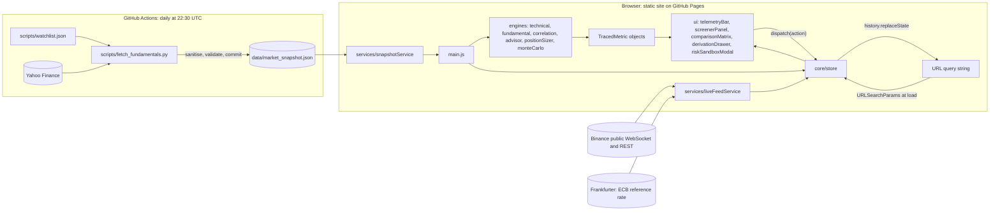
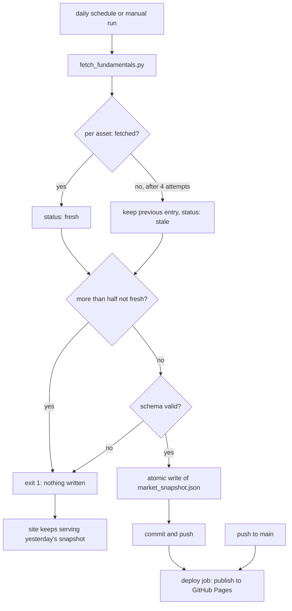
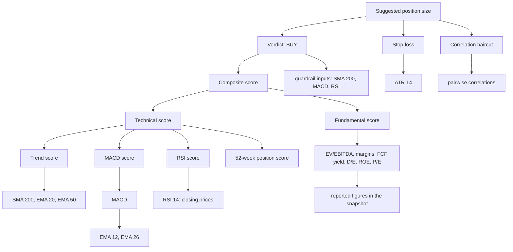

# QuantLens

**A multi-asset comparison workstation that shows its working.** Compare up to three US stocks, Singapore stocks and crypto assets side by side. Every indicator, score, verdict and position size can be opened to reveal the formula, the raw inputs and the arithmetic, step by step.

[](https://github.com/myc208/quantlens/actions/workflows/update-market-data.yml)

- **Site:** `https://myc208.github.io/quantlens/` (once GitHub Pages is enabled, see [Deployment](#deployment))
- **Tests:** `https://myc208.github.io/quantlens/tests/engines.test.html`
- **Cost to run:** zero. No server, no database, no API keys, no build step, no dependencies.

> QuantLens is an educational tool. Its verdicts and position sizes come from fixed, published rules so that they can be checked. They are not financial advice.

---

## Contents

1. [What it does](#what-it-does)
2. [Quick start](#quick-start)
3. [Architecture](#architecture)
4. [Stateless URL routing](#stateless-url-routing)
5. [The automated data pipeline](#the-automated-data-pipeline)
6. [Live feeds and their fallbacks](#live-feeds-and-their-fallbacks)
7. [The Derivation Tracer](#the-derivation-tracer)
8. [The mathematics](#the-mathematics)
9. [Numerical safety](#numerical-safety)
10. [Testing](#testing)
11. [Accessibility and responsive design](#accessibility-and-responsive-design)
12. [Deployment](#deployment)
13. [Changing the watchlist](#changing-the-watchlist)
14. [Design decisions and known limitations](#design-decisions-and-known-limitations)
15. [Interview talking points](#interview-talking-points)

---

## What it does

| Feature | What the user sees |
|---|---|
| **Screener** | Filter the watchlist by asset class, market, sector and verdict; tick up to three assets. No market data is ever typed in. |
| **Comparison matrix** | One column per asset: verdict, live or last price, one-year chart, technical indicators, fundamentals, correlation and suggested position size. |
| **Sector-aware scoring** | Corporates, banks and REITs are each scored on the measures that apply to them. A bank is never judged on EV/EBITDA. |
| **Derivation drawer** | Click any value to see its formula, raw inputs, numbered arithmetic and thresholds, then drill into the numbers it is built from. |
| **Guided and Pro modes** | Guided explains every metric in plain language (what it measures, why it matters, healthy and risky readings). Pro is the same data at higher density. |
| **Correlation alert** | A 3×3 return-correlation matrix warns when the chosen assets behave like a single bet, and position sizes are cut to compensate. |
| **Risk sandbox** | Change account size, risk per trade, stop distance and position cap, and watch the position and a Monte Carlo fan of outcomes respond. |
| **Telemetry bar** | Live crypto ticks, the USD/SGD reference rate and the age of the daily data, each labelled with its source and fallback state. |

The default watchlist: `AAPL` `NVDA` `MSFT` `GOOGL` `AMZN` `JPM` `D05.SI` `O39.SI` `Z74.SI` `C38U.SI` `BTC-USD` `ETH-USD`.

---

## Quick start

The site is plain HTML, CSS and ES modules. It needs a web server only because browsers do not load modules from `file://`.

```bash
python -m http.server 8000
```

Then open `http://localhost:8000` for the workstation and `http://localhost:8000/tests/engines.test.html` for the test suite.

To refresh the market data yourself (optional; the committed snapshot works out of the box):

```bash
pip install yfinance
python scripts/fetch_fundamentals.py
python scripts/fetch_fundamentals.py --validate-only
```

---

## Architecture



### Principles

| Principle | How it is enforced |
|---|---|
| **One-way data flow** | UI events dispatch actions; a pure reducer produces the next state; subscribers re-render. UI modules never import each other. |
| **Engines are pure** | An engine takes a normalised asset and returns traced metrics. No DOM, no network, no clock, no global state. That is what makes them testable. |
| **Nothing is stored** | No `localStorage`, `sessionStorage`, cookies or IndexedDB. A reload starts from the URL plus the latest snapshot. A test asserts storage stays empty. |
| **Every number is traceable** | Engines cannot return a bare number: every output is a `TracedMetric` with its derivation attached. |
| **No silent failure** | Missing data becomes an `N/A` badge with a reason. A failed feed degrades to the next source and says so in the telemetry bar. |

### Folder structure

```
.github/workflows/update-market-data.yml   daily refresh, then deploy to Pages
scripts/watchlist.json                     the assets to track
scripts/fetch_fundamentals.py              Yahoo Finance to validated JSON
data/market_snapshot.json                  candles and fundamentals (committed)
index.html
styles/    tokens.css  layout.css  components.css  guided.css
src/main.js                                composition root, URL sync, analysis cache
src/core/      store.js  precisionMath.js  derivationTracer.js
src/services/  snapshotService.js  liveFeedService.js  glossaryService.js
src/engines/   technicalEngine.js  fundamentalEngine.js  correlationEngine.js
               advisorEngine.js  positionSizerEngine.js  monteCarloEngine.js
src/ui/        telemetryBar.js  screenerPanel.js  comparisonMatrix.js
               derivationDrawer.js  riskSandboxModal.js
tests/engines.test.html                    149 browser-run tests, zero dependencies
```

---

## Stateless URL routing

The view is a pure function of the URL and the snapshot. That gives clean first loads, shareable links and correct back/forward behaviour without any persistence.

| Parameter | Meaning | Values | Default (omitted from the URL) |
|---|---|---|---|
| `t` | Compared tickers, comma-separated, at most 3 | any watchlist ticker | `AAPL,D05.SI,BTC-USD` |
| `ccy` | Display and account currency | `USD` `SGD` | `USD` |
| `mode` | Explanation level | `guided` `pro` | `guided` |
| `class` | Asset-class filter | `equity` `crypto` | all |
| `mkt` | Market filter | `US` `SG` `CRYPTO` | all |
| `sector` | Sector filter | any sector in the snapshot | all |
| `verdict` | Verdict filter | `buy` `hold` `sell` | all |

Example: `?t=D05.SI,O39.SI,JPM&ccy=SGD&mode=pro&verdict=hold`

How it works:

1. **Load.** `parseUrlState` reads `window.location.search` with `URLSearchParams` into the initial store state. Parsing is forgiving: values are case-insensitive, duplicates are removed, a fourth ticker is dropped, and anything malformed falls back to its default.
2. **Change.** After every view change the store calls `history.replaceState` with `serializeUrlState(state)`. Defaults are omitted, so the default view has no query string at all.
3. **Canonicalise.** Once the snapshot loads, tickers that are not in the watchlist are removed and the address bar is rewritten, so a stale or hand-edited link heals itself.
4. **Navigate.** A `popstate` listener re-reads the URL into the store.

Two details worth noticing:

- `t` absent means "the default trio"; `t=` (empty) means "nothing selected". The two states are distinguishable, so an emptied comparison survives a reload.
- **Account size and risk settings are deliberately not in the URL.** They live in memory only, so sharing a link can never reveal how much money you trade with. A test asserts they are never serialised.

---

## The automated data pipeline



### The workflow (`.github/workflows/update-market-data.yml`)

- **Triggers:** daily at 22:30 UTC (after the US close in both EST and EDT, and long after the SGX close; it also runs at weekends for crypto), manual dispatch, and every push to `main`.
- **Two jobs.** `refresh` fetches, validates and commits the snapshot. `deploy` publishes the site and runs after a successful refresh or directly on a push.
- **Why the workflow deploys Pages itself.** A commit pushed with the built-in `GITHUB_TOKEN` does not start other workflows. Deploying in the same run guarantees that a data commit is always published.
- **Least privilege.** The default token permission is read-only; `contents: write` is granted to the refresh job alone and `pages: write` to the deploy job alone.
- **Self-sustaining.** GitHub disables scheduled workflows in repositories with no activity for 60 days. The daily data commit counts as activity.

### The script (`scripts/fetch_fundamentals.py`)

| Concern | Handling |
|---|---|
| **Flaky source** | Every network call is retried up to 4 times with exponential backoff (×3) and jitter, with a pause between tickers. |
| **`NaN` and `Infinity`** | `clean_number` converts anything that is not a finite number to `null`. The JSON encoder runs with `allow_nan=False` as a backstop. |
| **In-progress sessions** | A candle dated today is kept only after that market's close; the current UTC day is always dropped for crypto. |
| **Bad ticks** | High and low are repaired so that `high ≥ max(open, close)` and `low ≤ min(open, close)`; rows with missing prices are dropped. |
| **Period consistency** | Revenue, operating income, EBIT, EBITDA and net income are all taken from the *same* period. Trailing twelve months is preferred. |
| **Gaps in statements** | A TTM figure is summed only from contiguous quarters (or halves, for semi-annual reporters). If one is missing, the latest fiscal year is used and labelled, for example `FY2025`. |
| **Unit traps** | Dividend yield and Debt/Equity are computed from raw values because the provider's own fields change units between versions. |
| **Wrong definitions** | Free cash flow comes from the cash-flow statement (operating cash flow minus capex). The provider's "levered FCF" summary field is not used. |
| **Partial failure** | A failed asset keeps its previous entry, marked `stale`. If more than half the watchlist is not fresh, or validation fails, nothing is written. |
| **Atomic write** | The file is written to a temporary path and renamed, so a crash cannot leave a half-written snapshot. |

### Snapshot schema (`data/market_snapshot.json`)

```jsonc
{
  "schemaVersion": 1,
  "generatedAt": "2026-11-16T12:26:11Z",
  "fx": { "base": "USD", "quote": "SGD", "rate": 1.28868, "asOf": "2026-11-16" },
  "candleFields": ["date", "open", "high", "low", "close", "volume"],
  "assets": [
    {
      "ticker": "D05.SI",
      "name": "DBS Group Holdings Ltd",
      "assetClass": "equity",            // equity | crypto
      "market": "SG",                    // US | SG | CRYPTO
      "currency": "SGD",                 // trading currency
      "financialCurrency": "SGD",        // reporting currency
      "sector": "Financial Services",
      "industry": "Banks - Regional",
      "scoringProfile": "FINANCIAL",     // CORPORATE | FINANCIAL | REIT | CRYPTO
      "lotSize": 100,                    // SGX board lot; 1 for US; 0.000001 for crypto
      "binanceSymbol": null,             // "BTCUSDT" for BTC-USD
      "status": "fresh",                 // fresh | stale
      "statusNote": null,
      "fundamentalsPeriod": "TTM",       // TTM | FY2025
      "quote": { "lastClose": 69.3, "previousClose": 69.9, "asOf": "2026-11-16" },
      "fundamentals": {
        "marketCap": 0, "enterpriseValue": 0, "ebit": null, "ebitda": null, "operatingIncome": null,
        "totalRevenue": 0, "netIncome": 0, "freeCashFlow": 0, "totalDebt": 0, "totalCash": 0,
        "totalEquity": 0, "totalAssets": 0, "trailingPE": 0, "forwardPE": 0, "priceToBook": 0,
        "returnOnEquity": null, "dividendYieldTTM": 0
      },
      "candles": [["2025-11-17", 54.1, 54.62, 53.88, 54.4, 3120400]]
    }
  ]
}
```

Rules, enforced by the script and re-checked in the browser by `snapshotService.js`:

- A missing value is `null`. It is never `NaN`, `Infinity`, a string, or a stand-in `0`.
- `marketCap` and `enterpriseValue` are in the trading `currency`; statement items are in `financialCurrency`. Ratios and yields are decimals (`0.171` is 17.1%).
- Candles are ascending, unique, split- and dividend-adjusted, completed sessions only, with at least 200 rows.
- In the browser an invalid asset is dropped with a visible warning; the rest still load. An invalid document as a whole shows an error with a retry button.

---

## Live feeds and their fallbacks

Both feeds are public and need no key. Neither can break the page.

| Feed | Chain | What the user is told |
|---|---|---|
| **Crypto price** | Binance WebSocket → Binance REST every 20 s → last daily close from the snapshot | "Live · Binance", "Delayed · Binance REST", or "Offline · showing last close" |
| **USD/SGD** | `api.frankfurter.dev` → `api.frankfurter.app` → rate stored in the snapshot | "ECB reference · date" or "snapshot · date" |

- The WebSocket reconnects with exponential backoff and jitter, alternates between two hosts, restarts if silent for 20 seconds, and pauses while the tab is in the background.
- **Live ticks never feed an indicator.** RSI, MACD and every other indicator use completed daily candles, so a reading can always be reproduced. A live tick changes only the displayed price and the entry price used for sizing.
- Frankfurter serves the European Central Bank's daily reference rate. The interface labels it as a reference rate, not a live quote.
- `api.frankfurter.app` now redirects to `.dev` without CORS headers, so browsers block it. It is kept as the second attempt; `.dev` is tried first.

---

## The Derivation Tracer

Most dashboards output a number and ask for trust. QuantLens makes the derivation part of the data model: an engine cannot return a bare number.

### The contract

```jsonc
{
  "id": "rsi14",
  "label": "RSI (14)",
  "value": 60.9028,              // finite number, or a label such as "BUY", or null
  "unit": "index",               // index | ratio | pct | currency | score | shares | label
  "status": "ok",                // ok | na
  "naReason": null,              // plain-English reason when status is "na"
  "tone": "healthy",             // healthy | neutral | caution | risky | null
  "meta": {},
  "trace": {
    "formula": "RSI = 100 − 100 ÷ (1 + RS), RS = average gain ÷ average loss ...",
    "rawInputs": [
      { "name": "Previous average gain", "value": 2.6355, "unit": "USD",
        "source": "Wilder average up to the previous session", "asOf": "2026-11-12" }
    ],
    "steps": [
      { "n": 1, "description": "Today's price change", "expression": "356.27 − 354.88", "result": 1.39 },
      { "n": 4, "description": "New average loss (Wilder smoothing)", "expression": "(1.7605 × 13 + 0) ÷ 14", "result": 1.6348 },
      { "n": 6, "description": "Convert to the 0 – 100 index", "expression": "100 − 100 ÷ (1 + 1.5577)", "result": 60.9028 }
    ],
    "interpretation": {
      "summary": "Healthy upward momentum that is not yet overheated.",
      "thresholds": [{ "range": "70 – 80", "label": "Overbought", "tone": "caution" }],
      "caveat": "RSI can stay overbought for weeks in a strong uptrend."
    },
    "dependsOn": []                // ids of the metrics this one is built from
  }
}
```

### What the contract guarantees

1. **A non-finite value cannot reach the screen.** `traced()` converts `NaN`, `Infinity`, `null` or `undefined` into an `N/A` metric with a reason. There is no code path from bad arithmetic to the text "NaN".
2. **The steps use the real numbers.** Each step's `expression` is built from the values the engine actually used, so the arithmetic in the drawer can be redone on a calculator and will match.
3. **Every input names its source and date**, down to the snapshot field or the upstream metric.
4. **`N/A` is always explained.** "Not meaningful for banks: interest is their core business..." rather than a blank.
5. **The contract is machine-checked.** `validateTrace()` verifies the shape of a metric. The test suite runs it over every metric of every asset in the real snapshot.

### Drill-down through `dependsOn`

`dependsOn` turns isolated explanations into a graph. The drawer renders each child as a link and keeps a breadcrumb, so a verdict can be followed down to raw closing prices:



The matrix and the drawer never reference each other. The matrix dispatches `openTrace(ticker, metricId)`; the drawer reads `store.drawer` and asks for the trace index. Either could be replaced without touching the other.

---

## The mathematics

All scores are 0 to 100. Thresholds are **anchor points with straight-line interpolation between them**, clamped at the ends, so a small change in an input never causes a cliff-edge change in a score.

### Technical indicators (completed daily candles)

| Indicator | Formula |
|---|---|
| SMA(n) | mean of the last n closes (n = 50, 200) |
| EMA(n) | `k = 2 ÷ (n + 1)`; seed = SMA of the first n closes; `EMAₜ = Cₜ·k + EMAₜ₋₁·(1 − k)` |
| MACD | line = EMA12 − EMA26; signal = EMA9 of the line; histogram = line − signal |
| RSI(14) | Wilder smoothing: first averages are simple means of 14 changes, then `avg = (prev·13 + today) ÷ 14`; `RSI = 100 − 100 ÷ (1 + avgGain ÷ avgLoss)` |
| ATR(14) | `TR = max(H − L, |H − Cₜ₋₁|, |L − Cₜ₋₁|)`; first ATR = mean of 14 TRs, then Wilder smoothing |
| Volatility | sample standard deviation of daily log returns × √252 (√365 for crypto) |
| 52-week position | `(Close − Low₅₂) ÷ (High₅₂ − Low₅₂)` |

### Technical score

| Component | Weight | Sub-score |
|---|---|---|
| Trend | 40% | Close > SMA200: 40 pts · EMA20 > EMA50: 30 pts · Close > EMA50: 30 pts |
| MACD | 25% | line > signal: 50 pts · line > 0: 30 pts · histogram above its value 3 sessions ago: 20 pts |
| RSI | 20% | anchors (RSI → score): 0→30, 30→40, 50→60, 60→80, 70→60, 80→30, 100→10 |
| 52-week position | 15% | position × 100 |

Volatility is deliberately not scored: it already shrinks the position through the ATR stop, and counting it twice would double the penalty.

### Fundamental score: one profile per kind of business

**Corporate** (every sector except the two below)

| Metric | Weight | Anchors (value → score) |
|---|---|---|
| EV/EBITDA | 25% | ≤8→100, 15→60, 25→25, ≥40→0 |
| Operating margin | 20% | ≤0%→0, 10%→50, ≥30%→100 |
| FCF yield | 20% | ≤0%→0, 2%→40, 5%→80, ≥8%→100 |
| Debt/Equity | 15% | ≤0.3→100, 1.0→60, 2.0→20, ≥3.0→0 |
| ROE | 10% | ≤0%→0, 10%→50, ≥25%→100 |
| Forward P/E | 10% | ≤12→100, 20→60, 35→20, ≥50→0 |

**Bank / financial** (sector = Financial Services)

| Metric | Weight | Anchors |
|---|---|---|
| ROE | 35% | ≤5%→0, 10%→50, ≥16%→100 |
| Price-to-Book | 30% | ≤0.8→100, 1.5→60, 2.5→20, ≥3.5→0 |
| Net margin | 20% | ≤10%→0, 20%→50, ≥35%→100 |
| Trailing P/E | 15% | ≤8→100, 12→70, 18→30, ≥25→0 |

EV/EBITDA, operating margin, FCF yield and Debt/Equity are `N/A` for banks, with the reason shown: deposits and borrowings are a bank's raw material, and interest is its core business rather than a financing cost.

**REIT** (sector = Real Estate)

| Metric | Weight | Anchors |
|---|---|---|
| Price-to-Book (P/NAV) | 35% | ≤0.8→100, 1.0→70, 1.3→30, ≥1.6→0 |
| Dividend yield (TTM) | 30% | ≤2%→0, 4%→50, ≥6%→100 |
| Gearing (debt ÷ assets) | 25% | ≤30%→100, 40%→50, ≥50%→0 (50% is the MAS leverage cap) |
| Operating margin | 10% | ≤30%→0, ≥65%→100 |

**Crypto** has no earnings, balance sheet or cash flow, so it has no fundamental score.

Rules common to all profiles:

- A zero or negative denominator (EBITDA ≤ 0, equity ≤ 0, negative P/E) gives `N/A` with a reason, never a score.
- A missing metric is dropped and the remaining weights are renormalised. Below 50% coverage the score is `N/A`.
- If the trading and reporting currencies differ, ratios that mix them are converted (USD/SGD) or reported as `N/A`.

### Verdict

- **Composite:** stocks `0.5 × Technical + 0.5 × Fundamental`; crypto, or a stock with no fundamental score, Technical only.
- **Bands:** ≥ 65 BUY · 45 to < 65 HOLD · < 45 SELL.
- **Guardrails** (each caps a BUY at HOLD and appears as a step in the trace): close below SMA200 while MACD is below its signal; RSI above 80; Fundamental score below 30.
- **Confidence:** High when the two scores are within 20 points and data coverage is at least 80%; Medium within 35 points; Low otherwise, and always Low for a Technical-only verdict.

### Position sizing

Inputs: account equity `A`, risk per trade `r`, entry `E`, ATR multiple `m`.

1. `Stop = E − m × ATR(14)`
2. `R = E − Stop` (risk per unit, "1R")
3. `B = A × r` (risk budget, converted into the asset's currency)
4. `Raw units = B ÷ R`
5. `Haircut = 1 ÷ √(1 + (n − 1) × max(0, ρ̄))`
6. Verdict multiplier: BUY 1.0, HOLD 0.5, SELL 0
7. `Units = raw × haircut × multiplier`, rounded **down** to the lot size (100 on SGX, 1 in the US, 0.000001 for crypto)
8. Cap: position value ≤ maximum position % of the account
9. Outputs: units, position value, amount at risk, 2R target (`E + 2R`)

**Why the haircut has that shape.** Take `n` equally sized positions, each with risk `σ`, and average pairwise correlation `ρ̄`. Their combined variance is `σ²(n + n(n − 1)ρ̄)`, against `σ²n` if they were independent. Scaling each position by `1 ÷ √(1 + (n − 1)ρ̄)` brings the combined variance back to `σ²n`. Three assets at `ρ̄ = 0.8` are each cut to 62% of their size. Negative correlation is floored at zero: a hedge never increases a position.

### Correlation

Pearson correlation of daily log returns, computed only on dates when both assets traded (stocks skip weekends, crypto does not, and US and Singapore holidays differ). At least 60 overlapping returns are required. `|ρ| ≥ 0.80` raises a red alert and `0.60 – 0.80` an amber one.

### Monte Carlo

Geometric Brownian motion on daily steps: `Sₜ₊₁ = Sₜ × exp(d + σZ)`, with `σ` the standard deviation of one year of daily log returns.

- **Default drift is zero in expectation:** `d = −σ² ÷ 2`. One year of returns is far too noisy to extrapolate a trend from, so the model assumes none. Pro mode can switch to the historical mean log return.
- 1,000 paths over 21, 63 and 126 trading days, reported as the 5th, 25th, 50th, 75th and 95th percentiles.
- **Seeded and reproducible.** The generator is seeded from the ticker and the snapshot date, so the same data always draws the same fan.
- **Self-checking.** The trace shows the simulated percentiles next to the exact lognormal values `S·exp(d·T ± 1.645·σ·√T)`.

---

## Numerical safety

`src/core/precisionMath.js` is the only place arithmetic is allowed to fail, and it fails by returning `null`:

| Hazard | Guard |
|---|---|
| Division by zero or by a denominator below `1e-12` | `safeDiv` returns `null` |
| `NaN`, `Infinity`, strings or `undefined` as operands | every `safe*` function returns `null` |
| `sqrt` of a negative, `ln` of zero or a negative | `null` |
| Overflow (for example `1e200 × 1e200`) | `null` |
| Binary rounding drift (`1.005` rounding to `1.00`) | `roundTo` nudges by one ulp: `1.005 → 1.01` |
| Rounding a stake *up* past the risk budget | `floorToStep` always rounds down to a tradable lot |
| Statistics on empty or contaminated arrays | `null` |
| Printing a missing value | formatters return `"N/A"` |

`null` then propagates upward until a tracer turns it into an `N/A` metric with a reason.

---

## Testing

`tests/engines.test.html` is a zero-dependency test page: open it in a browser and it runs **149 tests in 16 suites** in a few seconds. It reports through the page, the tab title (`✓ 149 passed`) and `window.__QUANTLENS_TESTS__` for automation.

Every formula is verified against an independent source of truth:

| Method | Examples |
|---|---|
| **Hand-computed values** | SMA, EMA and ATR on four-to-five-point series; RSI with period 2 (100, 50, 75); a full corporate score of 76.238 from six sub-scores; a position of 20 units from a 10,000 account |
| **Published worked example** | The 14-period RSI example used in most tutorials: 70.53, 66.32, 66.55, 69.41 |
| **Closed-form results** | Monte Carlo percentiles against the lognormal formula; a driftless price reaching a 2R target before its stop one time in three (a martingale property); an EMA lagging a straight line by `(n − 1) ÷ 2` |
| **Algebraic identities** | The correlation haircut restores combined variance to `n`; the loss at the stop equals the amount at risk and the gain at the target is exactly twice it |
| **Invariants over a grid** | Across 108 combinations of account, risk, ATR and lot size, the amount at risk never exceeds the budget, the cap is never breached and units are whole lots |
| **Independent recomputation** | SMA, EMA and MACD recomputed from raw candles for every real asset and compared with the engine |
| **Contract checks on real data** | Every metric of every asset in the committed snapshot passes `validateTrace`, contains no `NaN` or `Infinity`, and has a Guided-mode explainer |
| **Failure injection** | Corrupted candles, `NaN` strings, a wrong schema version, HTTP errors, invalid JSON, timeouts, a dead WebSocket and a dead REST endpoint, all with fake network objects |

The suite also asserts architectural promises: the default view has an empty query string, account size is never serialised, and the page writes nothing to browser storage.

---

## Accessibility and responsive design

- **Semantics.** Real tables with row and column headers, native `<dialog>` for the modal (focus trap and Escape handled by the browser), `<fieldset>` radio groups for the switches, and every value a real `<button>` with a spoken label such as "RSI (14) for AAPL: 60.9, healthy. Show how it is calculated."
- **Never colour alone.** Tone is a shape plus a colour (circle, ring, triangle, diamond) with a text equivalent. Charts have text summaries and a table twin.
- **Keyboard.** Focus moves into the drawer on open and returns to the triggering cell on close. The simulation chart can be read with the arrow keys.
- **Motion and contrast.** `prefers-reduced-motion` is respected; light and dark themes follow the operating system; a `forced-colors` block supports Windows High Contrast.

| Width | Layout |
|---|---|
| ≥ 1280px | Screener, matrix, and a drawer that pushes the matrix so all three columns stay visible |
| 1024 – 1279px | Screener and matrix; the drawer slides over |
| 768 – 1023px | Screener collapses into a panel above the matrix |
| < 768px | Telemetry becomes a scrolling strip; a sticky label column plus three value columns with no horizontal scroll; the drawer becomes an 85%-height bottom sheet; explainers open on tap |

---

## Deployment

1. Push the repository to GitHub.
2. **Settings → Pages → Build and deployment → Source: GitHub Actions.**
3. Run the workflow once from the Actions tab (or push to `main`). From then on it refreshes the data and redeploys every day.

No secrets, tokens or environment variables are needed.

---

## Changing the watchlist

Edit `scripts/watchlist.json` and run the workflow. Each entry needs:

```json
{ "ticker": "V", "name": "Visa Inc.", "assetClass": "equity", "market": "US",
  "currency": "USD", "lotSize": 1, "binanceSymbol": null, "scoringProfile": null }
```

- `scoringProfile: null` lets the script choose from the sector. Set it to override.
- Crypto assets need `assetClass: "crypto"`, `market: "CRYPTO"`, `scoringProfile: "CRYPTO"` and a `binanceSymbol`.
- Assets need at least 200 completed daily candles and must trade in a three-letter ISO currency. Display conversion supports USD and SGD.

---

## Design decisions and known limitations

Stated plainly, because knowing where a model stops is part of the engineering.

| Decision or limitation | Reasoning |
|---|---|
| **The scores are heuristics, not a backtested strategy.** | Weights and thresholds are reasoned rules of thumb. The project's claim is transparency and correctness of calculation, not predictive power. |
| **Fundamental thresholds are absolute and lean towards value.** | With twelve assets there is no meaningful peer group for relative scoring. Fast-growing companies score low on valuation, and the trace says so. |
| **The weak-business guardrail cannot fire under 50/50 weights.** | A Fundamental score below 30 caps the composite just under 65, so it can never be a BUY anyway. The rule is kept as a safety net if the weights change, and a test documents this. |
| **Cross-market correlations are understated.** | US and Singapore closes are hours apart. The trace flags these pairs as a lower bound rather than applying an unprincipled adjustment. |
| **Stocks are end-of-day only.** | No free, key-less, CORS-enabled intraday equity feed exists. Rather than fake it, the interface labels stock prices as the last daily close. |
| **Crypto is quoted against USDT.** | Binance's public feed uses USDT, which normally trades within a fraction of a percent of the US dollar. The price trace states this. |
| **Yahoo Finance is an unofficial source.** | It can rate-limit or change shape. Retries, keep-last-good and schema validation mean the site degrades to slightly older data instead of breaking. |
| **ES modules with no build step.** | Nothing to install, nothing to go stale, and the deployed code is the code in the repository. The cost is more HTTP requests, which HTTP/2 on Pages absorbs. |
| **Rendering by template strings.** | A framework would add a build and a dependency for a single-screen application. All dynamic text passes through one escape function. |
| **Only USD and SGD are converted.** | These are the two currencies of the watchlist. Any other pair returns `N/A` rather than a guess. |
| **Manual browser testing was done in Chromium.** | The code uses only widely supported standards (`<dialog>`, `inert`, `color-mix`, ES modules), but Safari and Firefox were not exercised. |

---

## Interview talking points

**Why no backend?** The data changes once a day, so a scheduled job that commits a JSON file is the right shape. It gives versioned data (every snapshot is a git commit), free hosting, zero attack surface and nothing to keep running.

**How do you know the numbers are right?** Three layers. Guarded arithmetic that cannot emit `NaN`. A tracer contract that attaches the derivation to every value and is machine-checked. And 149 tests that compare engines with hand calculations, a published example, closed-form results and independent recomputation on real data.

**What was the hardest correctness problem?** Data, not formulas. Summing four quarters into a trailing figure is wrong if one quarter is missing, and the provider silently omits them. The script checks that periods are contiguous and falls back to the fiscal year with a label. It caught a real gap in Amazon's statements on the first run.

**What is an example of domain logic changing the design?** Banks. EV/EBITDA and Debt/Equity are meaningless for a bank, so scoring became profile-driven, with weights and anchors as data rather than code. Adding the REIT profile was then a table, not a rewrite.

**How does state work without persistence?** The URL is the only state that outlives a page load. The store parses it at start-up, writes it back on every view change, and deliberately excludes account size so a shared link cannot leak it.

**What did testing catch?** A browser check found that one FX host had started redirecting without CORS headers, which a Node test could not see. Writing the feed tests exposed reconnect jitter that ignored the configured backoff. Writing the advisor tests showed that one guardrail is unreachable under the current weights.

**What would you do next?** Backtest the scoring rules, add peer-relative valuation as the watchlist grows, run the test page headlessly in the workflow as a deployment gate, and add a service worker so the last snapshot works offline.

---

## Disclaimer

QuantLens is a learning and portfolio project. Its outputs are produced by fixed rules applied to delayed, third-party data that may be incomplete or wrong. Nothing here is a recommendation to buy or sell any asset. Do your own research and consider your own circumstances before investing.
