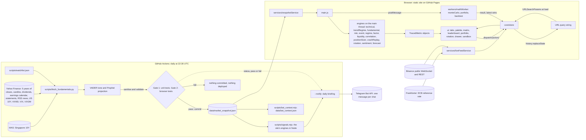
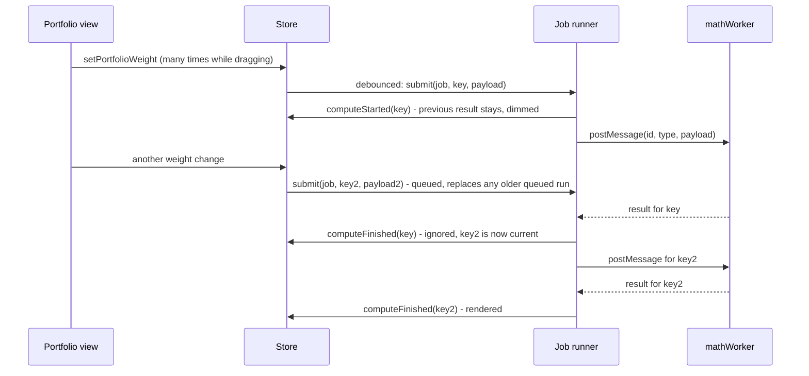
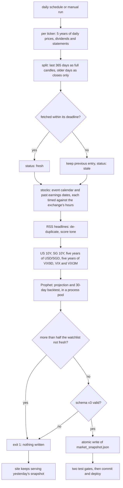
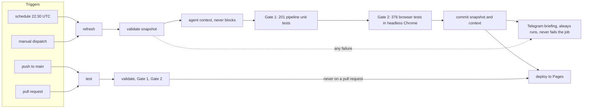
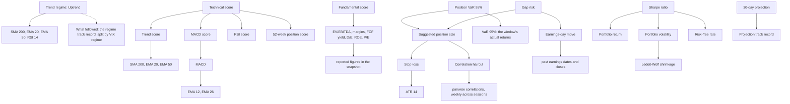

# QuantLens

**A multi-asset comparison workstation that shows its working.** Compare US and Singapore stocks, REITs, ETFs, market indices and crypto side by side, rank a 30-asset watchlist, test a portfolio allocation, and see what the tail of each asset's returns, its next earnings release, its market, its liquidity and four past crashes could do to a position. Every indicator, score, ratio, risk figure, trend regime and position size can be opened to reveal the formula, the raw inputs and the arithmetic, step by step.

[](https://github.com/myc208/quantlens/actions/workflows/update-market-data.yml)

- **Site:** `https://myc208.github.io/quantlens/`
- **Tests:** `https://myc208.github.io/quantlens/tests/engines.test.html`
- **Cost to run:** zero. No server, no database, no API keys, no build step, no browser dependencies.

> QuantLens is an educational tool. Its trend regimes, scores, position sizes, risk figures and portfolio statistics come from fixed, published rules so that they can be checked. They describe the past, do not predict returns, and are not financial advice.

**What V3.4 adds:** less hand upkeep and sharper alerts. A monthly workflow refreshes the macro calendar from the Fed's FOMC page, FRED's CPI dates, `exchange_calendars` and data.gov.sg, and proposes the result as a pull request after both test gates; SGX half days (12:00 noon on the eves of Chinese New Year, Christmas and New Year) end the Singapore session early, like US half days. The briefing's big-move trigger also fires on a 10% day (15% crypto, 5% ETFs), so a crash cannot hide behind a sell-off's inflated volatility, and a new trigger reports trend flips across the 200-day average or the 20/50-day EMA cross once they have held for a second close. The ongoing crash replay caps itself when the S&P 500 recovers. And every run now publishes `data/bot_context.json`, a 29 KB summary of the snapshot from the site's own engines and trigger rules, the groundwork for a question-answering bot. No new requests in the daily run.

**V3.3 added** the honest consequence of the backtest. A five-year test of the Technical score and three textbook price-only signals, split by VIX regime, found no predictive edge on this watchlist, so **BUY / HOLD / SELL, the Composite score and Confidence are gone.** Each asset now shows its **trend regime** (Uptrend, Extended, Pullback, Recovering or Downtrend) beside what followed each regime, overall and within normal, elevated and stressed markets, and position sizing is pure risk control. The Portfolio sandbox **replays your weights through four S&P 500 sell-offs** (2022, August 2024, the 2025 tariff shock and autumn 2026) against the index in your currency; a new **Rotation** tab plots 1-month against 3-month relative strength for the 26 tradable assets and 11 groups; and the daily candle cutoff knows the US half days. No new requests.

**V3.2 added** a risk-first Telegram briefing (the regime first; a ⚡ block that appears only when something happened, with the Singapore time of any FOMC or CPI release within 48 hours; tradable assets in US / Global, SGX and Crypto buckets; the next 30 days; a one-line status) with a week-ahead edition at weekends; and a hand-kept macro calendar of FOMC decisions, CPI releases and NYSE and SGX holidays, shown on the site and used to make trading-day counts exact.

**V3.1 added** a market regime read from the VIX term structure (normal, elevated or stressed when the curve inverts), shown as a pill, a banner and the first line of the Telegram briefing; beta, R², idiosyncratic volatility and relative strength against each asset's natural benchmark; the portfolio's beta to the S&P 500 and a crowding check that names holdings that are one bet in disguise; and liquidity from the stored candles (traded value, Amihud illiquidity, the tick-floor spread) with a volume cap and a spread cost in position sizing. Three extra requests a day; everything else comes from data already in the snapshot.

**V3 added** a 30-asset watchlist with seven macro bellwethers; five years of history and a `5Y` range; a risk model built from the returns that actually happened (EWMA volatility, historical VaR and CVaR, a filtered block-bootstrap Monte Carlo, Ledoit-Wolf covariance shrinkage, weekly returns across time zones); an event layer with earnings dates, each stock's typical earnings-day move and the gap risk of a sized position; a five-year backtest of the then BUY / HOLD / SELL verdict, shown in the interface with its result, which was not flattering (V3.3 acted on it); and a Telegram briefing that can go to several chats.

**V2 added** the Compare, Leaderboard and Portfolio views, the time-range slicer, the `Ctrl/Cmd + K` command palette, Modern Portfolio Theory in a Web Worker, de-duplicated news with headline tone, a Prophet projection shown beside its own track record, government yields as the risk-free rate, and a CI gate that runs the whole browser suite before anything is deployed.

---

## Contents

1. [What it does](#what-it-does)
2. [Quick start](#quick-start)
3. [Architecture](#architecture)
4. [Stateless by design](#stateless-by-design)
5. [Web Worker and portfolio maths](#web-worker-and-portfolio-maths)
6. [The time-range slicer](#the-time-range-slicer)
7. [The data pipeline](#the-data-pipeline)
8. [The risk model](#the-risk-model)
9. [Event risk](#event-risk)
10. [The market regime](#the-market-regime)
11. [Market sensitivity and crowding](#market-sensitivity-and-crowding)
12. [Liquidity and tradability](#liquidity-and-tradability)
13. [Trend regimes and their track record](#trend-regimes-and-their-track-record)
14. [Crash replays](#crash-replays)
15. [Sector rotation](#sector-rotation)
16. [News de-duplication and headline tone](#news-de-duplication-and-headline-tone)
17. [Prophet forecasting and its limits](#prophet-forecasting-and-its-limits)
18. [CI/CD and the testing gates](#cicd-and-the-testing-gates)
19. [Daily Telegram briefing](#daily-telegram-briefing)
20. [Agent-ready export](#agent-ready-export)
21. [Live feeds and their fallbacks](#live-feeds-and-their-fallbacks)
22. [The Derivation Tracer](#the-derivation-tracer)
23. [The mathematics](#the-mathematics)
24. [Numerical safety](#numerical-safety)
25. [Testing](#testing)
26. [Accessibility and responsive design](#accessibility-and-responsive-design)
27. [Deployment](#deployment)
28. [Changing the watchlist](#changing-the-watchlist)
29. [Design decisions and known limitations](#design-decisions-and-known-limitations)
30. [Interview talking points](#interview-talking-points)

---

## What it does

| Feature | What the user sees |
|---|---|
| **Compare** | Up to three assets in columns: trend regime and what followed it over four years, live or last price, a price chart with a dotted 30-day projection, period statistics, tail risk, market sensitivity, liquidity, upcoming events, technical indicators, fundamentals, recent headlines, correlation and suggested position size. |
| **Leaderboard** | The whole watchlist in one sortable table, ranked by trend regime and then 3-month relative strength by default, with the Technical and Fundamental scores as separate columns, Beta and traded value, an `Earnings 23d` chip on any stock reporting within 30 days and the watchlist-wide regime track record in its header. It respects the screener filters, and shows as many columns as its own width allows. |
| **Portfolio sandbox** | Up to eight assets with weight sliders. Annualised return, volatility, Sharpe ratio and diversification ratio, beta to the S&P 500, concentration and the effective number of bets, who carries the risk, and where the mix sits among 2,000 alternative mixes. A banner names holdings that are one crowded bet. **Crash replays** buy the mix at four S&P 500 highs and hold it to the lows, in your currency, against the index. |
| **Rotation** | The 26 tradable assets, or 11 groups at their median member, plotted by 3-month (across) and 1-month (up) relative strength: Leading, Weakening, Lagging or Improving. Against the S&P 500 in USD by default, or each asset's own market; a table twin lists every value. |
| **Market regime** | Normal, elevated or stressed, read from the VIX term structure, in the top bar and, while the curve is inverted, as a banner over every view. Context only: it changes no score, trend regime or position size. |
| **Market sensitivity** | Beta, R², idiosyncratic volatility, and 1- and 3-month relative strength against each asset's benchmark: `^GSPC` for US and London listings, `^STI` for Singapore, `BTC-USD` for other coins. |
| **Liquidity** | 20-day average volume and traded value, Amihud illiquidity, and the spread floor set by the exchange's tick size. Position sizing caps a position at 5% of daily volume, flags anything above 1%, and shows the round-trip spread cost. |
| **Time range** | `1M` `3M` `6M` `1Y` `5Y`. Slices the series behind the charts, period statistics, tail risk, correlation, the simulation and the portfolio maths. It never changes the trend regime or the scores. |
| **Risk** | EWMA volatility next to the equal-weighted figure, and historical-simulation VaR and CVaR at 95% and 99%, one day and ten days, read straight from the asset's own worst days. |
| **Events** | The next earnings date and how many trading days away it is, the stock's typical and worst earnings-day move, the next ex-dividend date, and the loss a sized position would take if the price gapped by that worst move. |
| **Command palette** | `Ctrl/Cmd + K` finds any asset by ticker, name or sector and runs any command: switch view, change range, currency or mode, open the risk sandbox, copy the share link. |
| **Screener** | Filter by asset class, market, sector and trend regime; tick up to three assets. No market data is ever typed in. |
| **Sector-aware scoring** | Corporates, financial companies and REITs are each scored on the measures that apply to them. A bank is never judged on EV/EBITDA. ETFs, indices and crypto have no accounts, so they have a trend regime and a Technical score but no Fundamental score. |
| **Derivation drawer** | Click any value to see its formula, raw inputs, numbered arithmetic and thresholds, then drill into the numbers it is built from. |
| **Guided and Pro modes** | Guided explains every metric in plain language. Pro is the same data at higher density, with extra rows (99% CVaR, the ten-day tail, the risk budget). |
| **News and forecast** | Three recent, de-duplicated headlines per asset with the tone of their wording, and a 30-day trend projection with its measured miss rate. Context only: neither moves a score. |
| **Risk sandbox** | Change account size, risk per trade, stop distance and position cap, and watch the position and a Monte Carlo fan respond. The fan resamples the asset's real days at today's volatility, and warns when an earnings release falls inside it. |
| **Telemetry bar** | Live crypto ticks, the market regime, USD/SGD, the US and Singapore 10-year yields and the age of the daily data, each labelled with its source and fallback state. |
| **Daily briefing** | Optional. After each scheduled refresh, a short Telegram message to one chat or several: the market regime, a ⚡ block only when something happened, each bucket's trend-regime tally with its Uptrend and Downtrend names by 3-month relative strength, the next 30 days, and whether the run passed its checks. |
| **Agent-ready export** | `data/bot_context.json` on every run: each asset's trend regime, scores, relative strength, beta, EWMA volatility, latest move in σ, spread and Amihud, the regime, the next 30 days and the day's triggers, under 50 KB, every number from the site's engines and every gap with its reason. |

The watchlist (30 assets):

| Class | Tickers |
|---|---|
| Crypto | `BTC-USD` `ETH-USD` `AVAX-USD` |
| US equities | `BLK` `SNDK` `MU` `AMD` `ORCL` `BRK-B` `TSLA` `CCJ` |
| Macro bellwethers (US-listed) | `XOM` oil · `NEM` gold mining · `WPM` precious-metals streaming · `BHP` (ADR) industrial metals · `WMT` the US consumer · `LLY` healthcare · `CAT` the industrial cycle |
| Singapore equities and REITs | `D05.SI` `U11.SI` `C6L.SI` `AJBU.SI` `A17U.SI` `J69U.SI` |
| ETFs | `VOO` (NYSE Arca) · `CSPX.L` (London, quoted in USD) |
| Indices | `^IXIC` `^GSPC` `^DJI` `^STI` |

The bellwethers were chosen so that the watchlist covers what the technology and Singapore names do not: energy, gold, metals, the consumer, defensive healthcare and capital spending. The comparison opens on `AMD`, `D05.SI` and `BTC-USD`: one corporate, one bank, one coin.

---

## Quick start

The site is plain HTML, CSS and ES modules. It needs a web server only because browsers do not load modules or workers from `file://`.

```bash
python -m http.server 8000
```

Then open `http://localhost:8000` for the workstation and `http://localhost:8000/tests/engines.test.html` for the test suite.

To refresh the market data yourself (optional; the committed snapshot works out of the box):

```bash
pip install -r scripts/requirements.txt
```

```bash
python scripts/fetch_fundamentals.py
```

To preview the Telegram briefing without sending anything, leave the two `TELEGRAM_*` variables unset: the command does nothing and exits 0. With them set it sends one message to each chat listed in `TELEGRAM_CHAT_ID`.

```bash
python scripts/fetch_fundamentals.py --notify
```

To run the same two gates that CI runs:

```bash
python -m unittest discover -s scripts -p "test_*.py"
```

```bash
python scripts/run_browser_tests.py --min-tests 100
```

The second command needs Chrome, Chromium or Edge installed. It uses only the Python standard library.

---

## Architecture



### Principles

| Principle | How it is enforced |
|---|---|
| **One-way data flow** | UI events dispatch actions; a pure reducer produces the next state; subscribers re-render. UI modules never import each other. |
| **Engines are pure** | An engine takes a normalised asset and returns traced metrics. No DOM, no network, no clock, no global state (the event engine is given "now" as an argument). That is what lets the same file run on the main thread, in a worker, in Node for the briefing, and in the test page. |
| **Nothing is stored** | No `localStorage`, `sessionStorage`, cookies or IndexedDB. A reload starts from the URL plus the latest snapshot. A test asserts storage stays empty. Even the backtest is recomputed in the browser rather than saved. |
| **Heavy maths stays off the main thread** | Monte Carlo, the portfolio calculations and the five-year backtest run in a Web Worker. A slider drag never blocks a frame. |
| **Every number is traceable** | Engines cannot return a bare number: every output is a `TracedMetric` with its derivation attached. |
| **No silent failure** | Missing data becomes an `N/A` badge with a reason. A failed feed degrades to the next source and says so in the telemetry bar. |
| **Models state their own record** | The projection is never shown without how far it missed in its last test, and the trend regime is never shown without what followed it over the last four years. Neither is coloured as good or bad. |

### Folder structure

```
.github/workflows/update-market-data.yml   refresh, two test gates, deploy to Pages, Telegram briefing
scripts/watchlist.json                     the 30 assets to track
.github/workflows/sync-macro-calendar.yml  monthly: refresh the macro calendar, run both gates, open a pull request
scripts/macro_calendar.json                FOMC decisions and minutes, US CPI releases, NYSE and SGX holidays and half days
scripts/sync_macro_calendar.py             the monthly calendar sync (Fed page, FRED, exchange_calendars, data.gov.sg)
scripts/fetch_fundamentals.py              prices, history, dividends, events, statements, news, yields,
                                           forecasts -> validated JSON; --notify sends the Telegram briefing;
                                           --bot-context writes data/bot_context.json
scripts/signals.mjs                        runs the site's engines in Node.js for the briefing's signals
scripts/bot_context.mjs                    runs the site's engines in Node.js for the agent-ready export
scripts/test_fetch_fundamentals.py         176 unit tests for the pipeline (Gate 1)
scripts/test_sync_macro_calendar.py        25 unit tests for the calendar sync, offline (Gate 1)
scripts/run_browser_tests.py               headless Chrome/Edge runner for the test page (Gate 2)
scripts/requirements.txt                   yfinance, vaderSentiment, prophet (pipeline only)
scripts/requirements-calendar.txt          exchange_calendars, pinned (the monthly sync only)
data/market_snapshot.json                  schema v3 snapshot (committed)
data/bot_context.json                      compact agent-ready summary of the snapshot (committed with it)
index.html
styles/    tokens.css  layout.css  components.css  guided.css
src/main.js                                composition root: URL sync, caches, worker jobs, view switching
src/core/      store.js  precisionMath.js  derivationTracer.js
src/services/  snapshotService.js  liveFeedService.js  glossaryService.js  workerService.js
src/workers/   mathWorker.js
src/engines/   technicalEngine.js  trendRegimeEngine.js  fundamentalEngine.js  correlationEngine.js
               positionSizerEngine.js  monteCarloEngine.js  portfolioEngine.js  crashReplayEngine.js
               riskEngine.js  eventEngine.js  backtestEngine.js  macroCalendarEngine.js
               regimeEngine.js  factorEngine.js  liquidityEngine.js  rotationEngine.js
               sentimentEngine.js  forecastEngine.js
src/ui/        telemetryBar.js  appTabs.js  commandPalette.js  screenerPanel.js
               comparisonMatrix.js  leaderboardView.js  portfolioSandbox.js  rotationView.js
               derivationDrawer.js  riskSandboxModal.js  regimeBanner.js
tests/engines.test.html                    376 browser-run tests in 55 suites, zero dependencies
```

---

## Stateless by design

The page keeps **no state between visits**. There is no account, no cookie, no browser storage and no server session. Everything on screen is a pure function of two inputs:

```
view = f(URL query string, data/market_snapshot.json)
```

That one decision buys clean first loads, links that reproduce a view exactly, correct back/forward behaviour, nothing to migrate when the schema changes, and no privacy surface. It also shaped V3: the backtest is not stored in the snapshot or anywhere else. It is a deterministic function of the snapshot, so the worker recomputes it in about two seconds after each load.

### What lives where

| State | Where it lives | Survives a reload? | In a shared link? |
|---|---|---|---|
| Compared tickers, filters, currency, mode | URL | yes | yes |
| Active view, time range and rotation benchmark | URL | yes | yes |
| Portfolio weights (percentages) | URL | yes | yes |
| Account size, risk per trade, stop distance, position cap | memory only | no | **never** |
| Live prices, worker results (including the backtest), open drawer | memory only | no | no |

### URL parameters

| Parameter | Meaning | Values | Default (omitted from the URL) |
|---|---|---|---|
| `t` | Compared tickers, comma-separated, at most 3 | any watchlist ticker (`^GSPC` may be written `%5EGSPC`) | `AMD,D05.SI,BTC-USD` |
| `ccy` | Display, account and portfolio base currency | `USD` `SGD` | `USD` |
| `mode` | Explanation level | `guided` `pro` | `guided` |
| `view` | Active tab | `compare` `leaderboard` `portfolio` `rotation` | `compare` |
| `range` | Time range | `1m` `3m` `6m` `1y` `5y` | `1y` |
| `p` | Portfolio allocation as `TICKER:percent` pairs, at most 8 | `AMD:40,D05.SI:35,BTC-USD:25` | the compared assets at equal weights |
| `class` | Asset-class filter | `equity` `etf` `index` `crypto` | all |
| `mkt` | Market filter | `US` `SG` `UK` `CRYPTO` | all |
| `sector` | Sector filter | any sector in the snapshot | all |
| `trend` | Trend-regime filter | `uptrend` `extended` `pullback` `recovering` `downtrend` | all |
| `rs` | Rotation benchmark | `spx` (the S&P 500 in USD) `own` (each asset's own market) | `spx` |

A link from before V3.3 may carry `verdict=buy`: it is ignored, and the rest of the view loads as it was.

Example: `?t=MU,AMD&ccy=SGD&mode=pro&view=portfolio&range=5y&p=MU:25,AMD:25,D05.SI:50`

How it works:

1. **Load.** `parseUrlState` reads `window.location.search` with `URLSearchParams` into the initial store state. Parsing is forgiving: values are case-insensitive, duplicates are removed, a fourth ticker is dropped, and anything malformed falls back to its default.
2. **Change.** After every view change the store calls `history.replaceState` with `serializeUrlState(state)`. Defaults are omitted, so the default view has no query string at all.
3. **Canonicalise.** Once the snapshot loads, tickers that are not on the watchlist are removed and the address bar is rewritten, so a stale or hand-edited link heals itself.
4. **Navigate.** A `popstate` listener re-reads the URL into the store.

Details worth noticing:

- `t` absent means "the default trio"; `t=` (empty) means "nothing selected". The two are distinguishable, so an emptied comparison survives a reload.
- **The portfolio is shared as percentages only.** `p=` can never reveal an amount of money, because no amount is ever entered: the maths needs only proportions.
- **Account size and risk settings are deliberately not in the URL.** A test asserts they are never serialised.
- Until a weight is changed, the portfolio simply follows the compared assets at equal weights and `p` stays out of the URL.

---

## Web Worker and portfolio maths

### Why a worker

A 1,000-path Monte Carlo run and a covariance matrix plus 2,000 sampled portfolios are tens of milliseconds each: fast, but not free when a slider fires them many times a second. Replaying the Technical score and the trend regime over five years for 30 assets is about two seconds of work. All three run in `src/workers/mathWorker.js`, a module worker that imports the very same engine files the tests import.



| Concern | Handling |
|---|---|
| **Stale replies** | Every request has a key built from its inputs. The reducer accepts a result only if its key is still the current one: **latest wins**, by construction rather than by timing. |
| **Queue build-up** | One run in flight per job; a newer request replaces whatever is queued. Seven slider events in a row produce one calculation. |
| **No worker available** | The service waits for the worker's `ready` message. If it never arrives, the same `handleRequest` function is loaded on the main thread. Results are identical; the status line says which path ran. |
| **A hung calculation** | Each request has a timeout and rejects with a readable message, which the view shows instead of a spinner that never ends. |
| **Payload size** | The page sends only what the engine reads (tickers, currencies, markets, sliced dates and closes), not whole asset records. |
| **Reproducibility** | The sample of alternative mixes is seeded from the assets and the time range, not from the weights, so the cloud stays put while a slider moves. |
| **The backtest** | Submitted once per snapshot, keyed by its `generatedAt`. Until it arrives the track-record row says it is being computed; it never blocks the rest of the page. |

### The mathematics (Modern Portfolio Theory)

Inputs: the assets' closes for the selected time range, the weights `w` (scaled to total 1), the base currency, and the risk-free rate.

1. **Choose the frequency.** If every asset trades in the same session, daily closes are used. If they close at different times (US, Singapore, London, crypto), **weekly closes** are used instead, Friday to Friday (see [weekly returns](#weekly-returns-across-time-zones)). A portfolio of `AMD`, `D05.SI` and `BTC-USD` is therefore weekly.
2. **Align.** Keep only dates (or weeks) on which *every* asset has a close.
3. **Convert.** Prices in another currency are converted at **each day's** USD/SGD rate (five years of daily rates are in the snapshot, forward-filled over market holidays), so currency moves are part of the return. If no history is available, today's rate is used throughout and the trace says that currency moves are *not* included.
4. **Returns.** Simple returns `rₜ = Pₜ ÷ Pₜ₋₁ − 1`. Simple returns, not log returns, because simple returns add across assets: `Rp = Σ wᵢrᵢ` is exact.
5. **Shrink.** The sample covariance matrix `S` is pulled toward a constant-correlation target `F` (**Ledoit-Wolf**): `Σ = δF + (1 − δ)S`, with `δ` estimated from the data. See [the risk model](#ledoit-wolf-shrinkage).
6. **Annualise.** `μ = mean(r) × k` and `Σ × k`, with `k` = 252 for daily returns (365 for a crypto-only portfolio) and 52 for weekly returns.
7. **Portfolio return:** `Rp = wᵀμ`
8. **Portfolio volatility:** `σp = √(wᵀΣw)`
9. **Sharpe ratio:** `(Rp − Rf) ÷ σp`, where `Rf` is the 10-year government yield of the base currency.
10. **Share of risk** of asset *i*: `wᵢ(Σw)ᵢ ÷ σp²`. The shares total 1. An asset with a third of the money can carry two thirds of the risk.
11. **Diversification ratio:** `Σ wᵢσᵢ ÷ σp`. Exactly 1 when mixing brings no benefit.

At least 15 overlapping returns are required; below that every statistic is `N/A` with the count found and the count needed. On `1M` and `3M` a mixed-session portfolio has too few weeks, so it falls back to daily returns and the trace says the cross-session correlations are understated.

**Alternative mixes.** The scatter draws 2,000 random long-only portfolios of the same assets (weights uniform on the simplex, from normalised exponentials, plus every single-asset portfolio and the equal-weight one) and marks yours, the highest Sharpe and the lowest volatility. "Apply" copies a marked mix into the allocation as whole percentages that total exactly 100.

**What this is not.** It is a description of the past window, not an optimiser to trust. The highest-Sharpe mix is whichever random mix happened to do best in hindsight; it leans on whatever rose most and usually changes when the time range changes. The view says so next to the button. A perfectly hedged portfolio (volatility indistinguishable from zero) reports Sharpe as `N/A` rather than a number in the millions.

**Risk-free rate.** USD uses the US 10-year Treasury yield (`^TNX`). SGD uses the Singapore 10-year benchmark from MAS; if MAS cannot be read, the previous value is kept for up to 10 days and labelled `stale`, and after that the US yield stands in, labelled `proxy`. The label follows the number into the Sharpe ratio's trace.

---

## The time-range slicer

`1M` `3M` `6M` `1Y` cut each series to the last 30, 91, 182 or 365 calendar days before its final candle. `5Y` reads the five-year close-only history instead: the last year of full candles joined to four older years of closes (about 1,255 sessions for a stock, 1,826 days for a coin; less for an asset listed more recently, such as `SNDK` since February 2025).

| Follows the range | Always uses the full year of candles |
|---|---|
| Price chart and its projection overlay | RSI, MACD, SMA, EMA, ATR |
| Period return, period volatility, maximum drawdown, position in the period range | 52-week range position |
| EWMA volatility, VaR and CVaR, and the position's VaR | Technical and Fundamental scores |
| Correlation between the compared assets, and the correlation haircut in position sizing | **The trend regime** |
| The volatility and the resampled days behind the Monte Carlo fan | Fundamentals |
| Every portfolio statistic | Events (they are dated, not windowed); crash replays and rotation (fixed windows) |

The split is deliberate. A 200-day moving average cannot be computed from 30 days, and an RSI seeded on a short window is a different number from the one everybody else quotes. So indicators keep their full warm-up and the trend regime is stable, while the things that are genuinely *about a period* move with it. And there is no OHLC data before the last year, so nothing that needs a high and a low (ATR, the stop) can use `5Y`.

One consequence worth knowing: because correlation follows the range, so does the correlation haircut, and therefore the suggested position sizes. A recent-window correlation is a legitimately different view of overlap, in the same way a risk model's answer depends on its look-back.

Short windows are allowed but labelled. Correlation needs 60 overlapping returns on `1Y` and `5Y` and 15 on a shorter range (15 weekly returns for a cross-session pair); volatility, the simulation and the portfolio also accept 15. A 95% VaR needs 100 returns and a 99% VaR 250, so on `1M` and `3M` they are `N/A` with that reason, and the 99% figures need `1Y` or `5Y`. Anything estimated from fewer than 40 observations says so in its trace ("a rough figure").

---

## The data pipeline

One Python script, run once a day by GitHub Actions, produces one JSON file. The browser never calls Yahoo Finance.



### Being a polite, bounded client

| Concern | Handling |
|---|---|
| **Rate limits** | A randomised 0.5 to 1.0 second pause between tickers. Three consecutive rate-limited tickers stop the run early; what remains is carried over from yesterday. |
| **A hung request** | Every request has a 10-second timeout and every ticker a hard 45-second deadline (prices and statements), 15 seconds for news, 15 for a stock's event calendar, 30 for each macro series. |
| **A slow day** | A 12-minute time budget for the whole fetch. Past it, remaining tickers are carried over rather than risking the job's limit. |
| **Flaky source** | Up to 3 attempts per call with exponential backoff and jitter, never past the ticker's deadline. |
| **Partial failure** | A failed asset keeps its previous entry, marked `stale`. Failed news, a failed event calendar or a failed forecast keeps the previous block, marked `stale`. If more than half the watchlist is not fresh, or validation fails, nothing is written. |
| **Fewer calls than it looks** | Five years of prices and the dividend history come from **one** history request per ticker; the candles, the older closes and the dividends are all cut from it. ETFs, indices and crypto skip the statements and the event calendar. |

A full run for the 30-asset watchlist takes about two minutes, most of it network time; the 60 model fits (a projection and a backtest per asset) take about 15 seconds. The snapshot is 1.8 MB, 0.46 MB gzipped as GitHub Pages serves it; the five years of VIX history add about 50 KB.

### Data hygiene

| Concern | Handling |
|---|---|
| **`NaN` and `Infinity`** | `clean_number` converts anything that is not a finite number to `null`. The JSON encoder runs with `allow_nan=False` as a backstop. |
| **In-progress sessions** | A candle dated today is kept only after that market's close, in the exchange's own time zone (New York 16:00, or 13:00 on the US half days in the macro calendar; Singapore 17:00, or 12:00 on SGX half days; London 16:30; plus 20 minutes). The VIX closes follow the same rule; the current UTC day is always dropped for crypto. |
| **Assets without accounts** | ETFs, indices and crypto get no statements request at all (fewer calls, nothing to misread). Their fundamentals are `null`, except crypto's market cap and an ETF's trailing distribution yield, kept for context. |
| **Implausible Price-to-Book** | If Yahoo's P/B differs from market cap ÷ book equity by more than a factor of two (same currency only), the computed value is used and logged. Yahoo has reported Berkshire Hathaway B at 0.001; the check corrects it to about 1.6. |
| **Bad ticks** | High and low are repaired so that `high ≥ max(open, close)` and `low ≤ min(open, close)`; rows with missing prices are dropped. |
| **Period consistency** | Revenue, operating income, EBIT, EBITDA and net income are all taken from the *same* period. Trailing twelve months is preferred. |
| **Gaps in statements** | A TTM figure is summed only from contiguous quarters (or halves, for semi-annual reporters). A missing quarter is never mistaken for semi-annual reporting, and an implausible sum is rejected; the latest fiscal year is used instead and labelled, for example `FY2025`. |
| **Unit traps** | Dividend yield and Debt/Equity are computed from raw values because the provider's own fields change units between versions. |
| **Wrong definitions** | Free cash flow comes from the cash-flow statement (operating cash flow minus capex). The provider's "levered FCF" summary field is not used. |
| **A broken join** | The older closes must end before the first candle, with no gap of more than 10 days at the join, so a provider hiccup cannot glue two unrelated stretches of history together. |
| **Earnings times** | Yahoo stamps releases in New York time. Each one is converted to the exchange's own time zone and classified against its session (US 9:30 to 16:00, SGX 9:00 to 17:00, London 8:00 to 16:30) as `before-open`, `during-session` or `after-close`. A stamp of exactly midnight means Yahoo does not know the time, and is stored as `unknown` rather than guessed. |
| **Atomic write** | The file is written to a temporary path and renamed, so a crash cannot leave a half-written snapshot. |

### Snapshot schema v3 (`data/market_snapshot.json`)

```jsonc
{
  "schemaVersion": 3,
  "generatedAt": "2026-11-21T11:18:28Z",
  "fx": {
    "base": "USD", "quote": "SGD", "rate": 1.29, "asOf": "2026-11-21",
    "series": [["2021-11-22", 1.36219]]            // five years of daily closes, for portfolio maths
  },
  "macro": {
    "riskFree": {
      "USD": { "name": "US 10-year Treasury yield", "symbol": "^TNX", "yield": 0.04912,
               "asOf": "2026-11-20", "source": "yahoo", "status": "fresh" },
      "SGD": { "name": "Singapore 10-year SGS benchmark yield", "symbol": null, "yield": 0.0227,
               "asOf": "2026-11-20", "source": "mas", "status": "fresh" }   // fresh | stale | proxy | unavailable
    },
    "regime": {                          // V3.1, optional: the VIX term structure
      "status": "fresh",                 // fresh | stale (kept up to 5 days) | unavailable
      "asOf": "2026-11-20", "source": "yahoo",
      "symbols": { "short": "^VIX9D", "mid": "^VIX", "long": "^VIX3M" },
      "levels": { "vix9d": 40.72, "vix": 35.89, "vix3m": 30.94 },
      "slope": -4.95,                    // VIX3M − VIX, points: negative means inverted
      "ratio": 1.159987,                 // VIX ÷ VIX3M
      "frontRatio": 1.134578,            // VIX9D ÷ VIX
      "state": "stressed",               // normal | elevated | stressed
      "inverted": true, "invertedStreak": 4,
      "rules": { "elevatedLevel": 20.0, "elevatedRatio": 0.95, "invertedRatio": 1.0 },
      "historyFields": ["date", "vix9d", "vix", "vix3m"],
      "history": [["2021-11-22", 16.06, 19.17, 22.63]],   // five years of daily closes, about 1,255 rows
      "note": null
    }
  },
  "candleFields": ["date", "open", "high", "low", "close", "volume"],
  "historyFields": ["date", "close"],
  "forecastFields": ["date", "yhat", "lower", "upper"],
  "assets": [
    {
      "ticker": "AMD", "name": "Advanced Micro Devices, Inc.",
      "assetClass": "equity",            // equity | etf | index | crypto
      "market": "US",                    // US | SG | UK | CRYPTO
      "currency": "USD", "financialCurrency": "USD",
      "sector": "Technology", "industry": "Semiconductors",
      "scoringProfile": "CORPORATE",     // CORPORATE | FINANCIAL | REIT (equities) | ETF | INDEX | CRYPTO
      "lotSize": 1, "binanceSymbol": null,
      "status": "fresh", "statusNote": null,
      "fundamentalsPeriod": "TTM",       // TTM | FY2025
      "quote": { "lastClose": 424.39, "previousClose": 489.19, "asOf": "2026-11-20" },
      "fundamentals": { "marketCap": 0, "enterpriseValue": 0, "ebitda": null, "totalRevenue": 0 /* ... */ },
      "candles": [["2025-11-21", 208.81, 208.83, 195.0, 203.78, 67421100]],   // the last 365 days
      "history": [["2021-11-22", 152.52]],                                     // older closes, up to 2,000 rows
      "dividends": [],                   // [exDate, amount] per payment, e.g. D05.SI: ["2026-11-13", 0.81]
      "events": {
        "status": "fresh",               // fresh | stale | unavailable (ETFs, indices, crypto)
        "fetchedAt": "2026-11-21T11:18:28Z",
        "nextEarnings": { "date": "2027-02-02", "dateTo": "2027-02-03", "timing": "after-close" },
        "nextExDividend": null,          // { "date": "…" } when Yahoo lists one
        "earnings": [{ "date": "2026-11-03", "timing": "after-close" }],     // newest first, up to 30
        "note": null
      },
      "news": {
        "status": "fresh",               // fresh | stale | unavailable
        "fetchedAt": "2026-11-21T11:18:28Z",
        "headlineCount": 15, "clusterCount": 15, "newestAt": "2026-11-21T10:07:29Z",
        "sentiment": { "compound": 0.1204, "label": "positive", "basis": 3 },
        "clusters": [                    // the three most recent stories, each scored
          { "title": "…", "link": "https://…", "publishedAt": "2026-11-21T10:07:29Z",
            "firstSeenAt": "2026-11-21T10:07:29Z", "duplicates": 0,
            "scores": { "compound": -0.2732, "pos": 0, "neu": 0.826, "neg": 0.174 }, "label": "negative" }
        ],
        "note": null
      },
      "forecast": {
        "status": "fresh",               // fresh | stale | unavailable
        "model": "prophet", "modelVersion": "1.5.0",
        "config": { "target": "log(close)", "weeklySeasonality": true, "yearlySeasonality": false,
                    "mcmcSamples": 0, "intervalWidth": 0.8, "uncertaintySamples": 300,
                    "changepointRange": 0.8, "anchor": "last close" },
        "trainedOn": { "from": "2025-11-21", "to": "2026-11-20", "observations": 251 },
        "horizon": { "calendarDays": 30, "points": 20, "weekdaysOnly": true },
        "backtest": { "holdoutDays": 30, "holdoutPoints": 22, "mape": 0.174445, "naiveMape": 0.106779,
                      "endError": 0.480428, "directionCorrect": false, "coverage": 0.2727 },
        "points": [["2026-11-23", 425.0254, 386.0707, 466.3971]],
        "note": null
      }
    }
  ]
}
```

Rules, enforced by the script and re-checked in the browser by `snapshotService.js`:

- A missing value is `null`. It is never `NaN`, `Infinity`, a string, or a stand-in `0`.
- `marketCap` and `enterpriseValue` are in the trading `currency`; statement items are in `financialCurrency`. Ratios, yields and errors are decimals (`0.171` is 17.1%).
- Candles and history are ascending, unique, split- and dividend-adjusted, completed sessions only. Candles cover the last 365 days (at least 200 rows); history holds the older closes, at most 2,000 rows, and ends before the first candle with no gap over 10 days.
- Dividends are ascending `[exDate, amount]` pairs with positive amounts. Event dates are ISO dates; `timing` is one of the four classes above.
- The browser accepts schema v1, v2 and v3. An older file simply has no history, dividends, events, news, forecast, yields or FX history (depending on its version), and everything that needs them reports `N/A` with the reason.
- `macro.regime` is an optional V3.1 block, so a snapshot written before it still validates. When present it must add up: the ratios must follow from the levels, the history must end with them, and the state must be what the stored rules give for those levels.
- An invalid asset is dropped with a visible warning and the rest still load. A malformed `history`, `dividends`, `events`, `news`, `forecast` or `macro` block is treated as unavailable without dropping the asset. An invalid document as a whole shows an error with a retry button.

---

## The risk model

V2's risk figures assumed returns were normally distributed with a constant volatility. Neither is true: markets have fat tails and calm and stormy spells. V3 replaces each assumption with something measured from the asset's own returns, and keeps every piece traceable. All of it lives in `src/engines/riskEngine.js`, except the simulation, which stays in `monteCarloEngine.js`.

### EWMA volatility

`σ²ₜ = λ·σ²ₜ₋₁ + (1 − λ)·r²ₜ₋₁`, with `λ = 0.94` (the RiskMetrics value), seeded with the mean of the first 20 squared daily returns and annualised by √252 (√365 for crypto). It needs 30 returns. Today's squared return carries 6% of the weight and the weights halve about every 11 days, so the figure reacts to a storm within days, where an equal-weighted standard deviation over a year barely moves.

The matrix shows it next to the equal-weighted volatility of the same window, and the trace calls it rising when it is more than 15% above that figure and falling when more than 15% below. On 21 November 2026, a day after a sharp sell-off in chip stocks:

| Asset | EWMA volatility | Equal-weighted, same year | Reading |
|---|---|---|---|
| `AMD` | 118.5% | 75.1% | Rising sharply: it fell 13% on 20 November |
| `MU` | 105.1% | 84.5% | Rising |
| `VOO` | 24.4% | 14.2% | Rising: even the broad market is in a stormier spell than its year suggests |
| `D05.SI` | 18.4% | 15.7% | Slightly elevated |

### Historical VaR and CVaR

No distribution is assumed: the window's actual daily returns are sorted, and the tail is read straight off them.

- **VaR** at level `c` is the loss at the `(1 − c)` percentile, interpolated linearly between neighbouring observations.
- **CVaR** (expected shortfall) is the average of every return at or below that percentile: how bad the bad days were, not just where they start.
- **Levels and horizons:** 95% and 99% for one day, and 95% for ten days from overlapping 10-day returns (the trace notes that overlapping windows are not independent).
- **Minimum data:** 100 returns for a 95% figure (the tail is then 5 days) and 250 for a 99% figure (2 to 3 days). Below that the metric is `N/A` and says which range to choose. A tail resting on fewer than five observations is flagged as fragile.

| `VOO`, 1-day | 1 year | 5 years |
|---|---|---|
| VaR 95% | 1.49% | 1.67% |
| CVaR 95% | 2.13% | 2.52% |
| VaR 99% | 2.32% | 3.11% |
| CVaR 99% | 3.46% | 3.93% |

The five-year figures are larger because the window contains 2022. That is the point of offering `5Y`: a calm year understates what a storm costs.

**At the position level**, the sizing section adds `Position VaR 95%` and (in Pro mode) `Position CVaR 95%`: the position value times the one-day tail loss, in the account currency, so the planned 1R loss can be compared with what one bad day has actually cost.

### Monte Carlo: a filtered block bootstrap

The simulation no longer draws from a bell curve. By default it **resamples the asset's own days**, rescaled to today's volatility:

1. **Filter.** Each daily log return is divided by the EWMA volatility known the day before: `zₜ = rₜ ÷ σₜ`. The residuals keep the shape of the asset's moves (fat tails, skew) without the volatility regime they happened in.
2. **Standardise and rescale.** The residuals are set to mean 0 and variance 1, then multiplied by **today's** EWMA volatility.
3. **Resample in blocks.** Paths are built from blocks of 10 consecutive days, drawn with a circular bootstrap, so volatility clustering and short-run dependence survive inside each block.
4. **No trend.** Every step is shifted by `c = ln(mean(exp(moves)))`, so the expected price at every horizon equals today's. The trace shows the correction. (Pro mode can still switch to the historical mean return.)
5. **Fallback.** With fewer than 60 residuals (the `1M` range, and `3M` for stocks) there is too little to resample, so that run uses the normal model and says why.

The difference is not cosmetic. Over 21 trading days from the 21 November close:

| Asset | Bootstrap, 5th to 95th percentile | Normal model, same window |
|---|---|---|
| `AMD` | 0.56× to 1.68× today's price | 0.69× to 1.38× |
| `BTC-USD` | 0.77× to 1.32× | 0.83× to 1.18× |

Two things widen the bootstrap fan: today's volatility is far above the year's average, and the real days have fatter tails than a normal distribution. The paths still contain **no earnings jump**; when a release falls inside the simulated horizon, the sandbox says so above the chart (see [Event risk](#event-risk)).

The normal model stays in the engine as the fallback, and is still tested against the exact lognormal percentiles `S·exp(d·T ± 1.645·σ·√T)`.

### Ledoit-Wolf shrinkage

A sample covariance matrix estimated from a year of returns is noisy, and portfolio maths amplifies the noise: the "best" mix leans on whichever correlation happened to come out lowest. Ledoit and Wolf's estimator (2004, constant-correlation target) blends the sample matrix `S` with a structured target `F` that keeps every variance but sets every correlation to their average:

`Σ = δ·F + (1 − δ)·S`, with `δ = max(0, min(1, κ ÷ T))`, where `κ` measures how much of `S`'s distance from `F` is estimation error, and `T` is the number of returns.

- **Two assets are never shrunk:** with one correlation, the target equals the sample.
- **Three assets often shrink fully.** For `AMD`, `MU` and `VOO` over a year, the sample correlations are 0.658, 0.660 and 0.564. The estimator judges the gap between them to be within estimation noise and sets `δ = 1`: all three become 0.627.
- **More assets, less shrinkage.** Eight US stocks over the same year gave `δ = 0.04`: with 28 pairwise correlations, the sample carries real information about which pairs differ.

The portfolio trace shows `δ`, the average correlation and the unshrunk statistics. The implementation is tested against an independent NumPy port of the authors' published code.

### Weekly returns across time zones

US, London and Singapore close hours apart, and crypto never closes. A daily correlation between two such assets pairs moves that happened at different times, and understates how closely they really move. V2 flagged this; V3 fixes it:

- **Correlation.** A pair that trades in different sessions is measured on **weekly** log returns, Friday close to Friday close (a weekend day maps to the following Friday), once at least 15 weekly returns overlap (about four months). On `1M` and `3M` there are too few weeks, so the daily figure is shown and labelled as a lower bound.
- **Portfolio.** A mix of sessions uses weekly returns throughout, annualised by 52.

| Pair | V2: daily closes | V3 |
|---|---|---|
| `VOO` / `CSPX.L` (the same index, New York and London) | 0.71 | **0.954** weekly |
| `VOO` / `^GSPC` (same session) | 0.998 | 0.998 daily, unchanged |

---

## Event risk

A stop-loss assumes the price passes through it. An earnings release can gap the price straight past it, and the ATR stop, the simulation and the projection all ignore scheduled events. V3 puts them on the screen. The engine is `src/engines/eventEngine.js`; the data comes from the pipeline's event calendar.

| Metric | What it shows | How |
|---|---|---|
| **Next earnings** | The date (and a second date when Yahoo's calendar and its list of earnings dates disagree), the release time if known, calendar days and trading days away | Flags whether it falls inside the sizing horizon (21 trading days), each simulation horizon (21, 63, 126) and the 30-day projection |
| **Earnings-day move** | The typical move and the worst fall | The median absolute reaction over the stock's past releases, measured from its own closes. Needs at least 4 releases |
| **Next ex-dividend** | The date, whether it is Yahoo's or estimated, and the expected price drop | Drop ≈ last dividend ÷ last close |
| **Loss in an earnings gap** (gap risk, in the sizing section) | What the suggested position would lose if the price gapped down by the worst earnings-day fall on record, against the planned amount at risk | `position value × |worst fall|` |

**Measuring the reaction.** The reaction day depends on when the company reported:

| Release timing | Reaction measured as |
|---|---|
| `before-open`, `during-session` | close of the release day ÷ close of the session before |
| `after-close` | close of the next session ÷ close of the release day |
| `unknown` | close of the session after ÷ close of the session before: two sessions, so the move is captured either way |

**Estimating the ex-dividend date.** Yahoo lists a future ex-date for few stocks (5 of the 18 payers on 21 November 2026). Otherwise the date is estimated as the last ex-date plus the median gap between the last nine payments (gaps outside 20 to 400 days are ignored), rolled forward at most twice, and labelled as an estimate. Trading days are counted as weekdays less the market's holidays from the macro calendar (NYSE for US listings, SGX for Singapore); London's holidays are not listed, so a count for `CSPX.L` can run a day long.

What the 21 November 2026 snapshot shows:

- **Coverage.** 17 of the 21 stocks have at least four dated releases. `BHP`, `AJBU.SI`, `A17U.SI` and `J69U.SI` have too few in Yahoo's list, and say so. ETFs, indices and crypto have no earnings: their event metrics are `N/A` with that reason, except an ETF's estimated ex-dividend date.
- **Size.** Typical earnings-day moves range from 1.2% (`U11.SI`) to 9.8% (`ORCL`). The worst falls on record include −17.3% for `AMD` and −16.2% for `MU`.
- **What it means for sizing.** The gap matters most where the stop is tight compared with the stock's earnings history. With the default stop of 2 × ATR, `WMT`'s worst earnings-day fall (−11.4%) is 2.5 times its stop distance, `C6L.SI`'s (−9.5%) 2.4 times and `LLY`'s (−14.1%) 2.2 times: a repeat would cost more than twice the planned 1R loss, because a gap does not stop at the stop. At the other end, `MU`'s worst fall (−16.2%) is 0.8 times its stop distance: after its recent swings, its ATR stop is already wider than its worst earnings gap. The gap-risk row puts the number next to the planned loss either way.
- **Inside the sizing horizon.** `MU` (around 17 December, after the close) and `ORCL` (around 14 December) report within the next 21 trading days, so their sizing rows, simulation and projection all carry the warning.

### The macro calendar: FOMC, CPI and market holidays

Company events are not the only scheduled gaps. `scripts/macro_calendar.json` holds the Federal Reserve's rate decisions and minutes, the US CPI releases, and the weekday closures of the NYSE and SGX, from the Fed, BLS (through FRED), NYSE and Ministry of Manpower sources it links to. Since V3.4 a monthly workflow refreshes it and proposes the result as a pull request (see [the monthly sync](#the-monthly-calendar-sync)); the daily run only reads it, copying it into an optional `macro.calendar` block of the snapshot (the last 30 days and everything ahead).

```jsonc
{ "type": "fomc-decision", "date": "2026-12-09", "at": "2026-12-09T14:00:00-05:00", "meeting": "2026-12-08/09", "projections": true }
{ "type": "cpi",           "date": "2026-12-10", "at": "2026-12-10T08:30:00-05:00", "period": "2026-11" }
{ "type": "fomc-meeting",  "date": "2027-10-27", "meeting": "2027-10-26/27", "decision": false }
{ "type": "market-holiday", "date": "2026-11-26", "market": "US", "name": "Thanksgiving Day" }
```

- **Times carry their UTC offset**, so nothing downstream does daylight-saving arithmetic. Gate 1 checks every offset against New York's rules, every CPI at 8:30 a.m., every decision on the second day of its meeting, and every derived minutes date at three weeks after its decision.
- **What is in it and what is not.** Projections are marked only where the Fed's calendar shows them (December 2026); the 2027 meetings are not marked until it does. The Fed's revised 2027 schedule has no December meeting, and its October meeting is a strategy meeting with no policy decision, so it is listed but never treated as market-moving. 2027 minutes dates follow the Fed's stated rule and are flagged `derived` until the calendar lists them.
- **It never fails a run.** An unreadable or invalid file gives an unavailable block and a warning. Coverage is checked against the file's own `updated` date, not today's, so the tests do not start failing as time passes; when the calendar is within 60 days of running out, the step summary and the explanation view say so.
- **On the site:** a **Next macro** pill in the top bar (amber within 48 hours) opens the next FOMC decision or CPI release with its time in New York and Singapore, the US trading days until then and what else is due in the next 7 days. The Events section repeats it for each compared asset and says when it falls inside the 21-day sizing horizon, and the risk sandbox notes when the first simulated horizon contains it.
- **Holidays make trading-day counts exact.** Thanksgiving week has four US sessions, not five, which matters for "earnings within 5 trading days".
- **Half days end the session early.** The `market-early-close` entries move the US close to 13:00 New York (the day after Thanksgiving, Christmas Eve) and, since V3.4, the SGX close to 12:00 noon Singapore (the eves of Chinese New Year, Christmas and New Year when they fall on a trading day: 24 and 31 December 2026, 5 February 2027, 24 and 31 December 2027). Each market gets only its own half days, so a half-day candle is kept from 13:20 New York or 12:20 Singapore rather than thrown away until the next run, and validation checks each market's half-day time.
- Context only, like the regime: it changes no score, trend regime or position size.

### The monthly calendar sync

`scripts/sync_macro_calendar.py`, run on the 1st of each month by `.github/workflows/sync-macro-calendar.yml`:

| Part | Source | If the source fails |
|---|---|---|
| FOMC decisions, strategy meetings, minutes | The Fed's FOMC calendar page: a `*` marks projections, "Strategy Meeting" means no decision, "Released …" gives past minutes; later minutes are a date already confirmed in the file, or decision + 21 days marked `derived`; the page's note on next year's first meeting is read too | the existing entries stay |
| CPI releases | FRED's release dates for release 10, at 8:30 a.m. New York, each covering the month before (a recorded period is kept, for a delayed release). Needs the `FRED_API_KEY` repository secret; the BLS site refuses scripted requests | the existing entries stay, and the pull request says why |
| US closures and half days | `exchange_calendars` (XNYS), pinned | the existing entries stay |
| SG closures | data.gov.sg, the Ministry of Manpower's gazetted holidays, with a back-off when it rate-limits | the existing entries stay |
| SGX half days | by rule from the SG holidays: the eves above, when they are weekdays and not holidays | with the SG holidays |

- **The window** runs from the first day of last month (so the 30-day look-back is always covered) to 18 months ahead; **coverage ends where the shortest source does** (today: 31 December 2027, because the Fed, FRED and MOM have published through 2027), and it keeps its old start when a source failed.
- **Nothing unchecked is proposed.** The merged file must pass the pipeline's own calendar validation, or nothing is written and the job fails. Otherwise the workflow runs Gate 1 and Gate 2 and opens (or updates) one pull request from `automation/macro-calendar`, whose description lists every added, removed and changed date by source. A month in which nothing changes from today on opens no pull request.
- **The file stays readable.** The writer reproduces the committed layout byte for byte, one event per line in a fixed order, so a pull request shows one line per change.
- **Verified against the hand-kept file.** A live dry run on 22 November 2026 (the Fed page, data.gov.sg and `exchange_calendars`) reproduced the calendar with zero changes, including every SGX half day and the October 2027 strategy meeting.
- **One-time setup:** add the `FRED_API_KEY` secret (free from FRED), and tick *Settings → Actions → General → Allow GitHub Actions to create and approve pull requests*. A pull request opened with the workflow's token does not start the Test workflow by itself; both gates have already run in the sync job, and closing and reopening the pull request runs them again.

Where it appears: an **Events** section in the comparison, a **gap-risk** row in sizing, a warning on the projection when earnings fall inside its 30 days, a banner above the Monte Carlo fan when a release falls inside the simulated horizon, an `Earnings 23d` chip on the leaderboard, and an earnings section in the Telegram briefing.

---

## The market regime

Every risk figure on the site is measured from past days, so it catches up with a change in the market only after the fact. Option prices do not: the VIX curve shows what protection costs today. V3.1 reads it once a day.

| Index | What it prices |
|---|---|
| `^VIX9D` | Implied volatility of the S&P 500 over the next 9 days |
| `^VIX` | Over the next 30 days |
| `^VIX3M` | Over the next 3 months |

Normally the curve slopes up (contango): more time, more uncertainty. When the 30-day level reaches the 3-month one the curve is inverted, which means traders pay more for protection now than later. That is what stress looks like in option prices.

| State | Rule | Share of sessions, Nov 2021 to Nov 2026 |
|---|---|---|
| **Normal** | VIX below 20 and VIX ÷ VIX3M below 0.95 | 63% |
| **Elevated** | anything in between: VIX at 20 or more, or a flat curve | 31% |
| **Stressed** | VIX ÷ VIX3M at 1.00 or more: the curve is inverted | 6% (71 sessions; 18 in the last year) |

- **One rule, two readers.** The pipeline classifies the regime for the Telegram briefing and stores the thresholds in the block. The browser applies the same rules to the same stored levels for its explanation views, and a test checks that the two agree on the committed snapshot.
- **What it shows.** A pill in the top bar opens the derivation: the state, VIX with the daily move it implies (`VIX ÷ √252`) and where it ranks in the last year and in five years, `VIX ÷ VIX3M` with the run of inverted sessions, and `VIX9D ÷ VIX` for the front of the curve. While the curve is inverted a banner over every view says what that means, and can be hidden until the next visit.
- **Context only.** The regime is not an input to any score, trend regime or position size. V3.3 uses the five years of stored history to split the backtest by regime (see [Trend regimes and their track record](#trend-regimes-and-their-track-record)): no regime turned the score into a forecast, so gating anything on it would be curve-fitting.
- **On 21 November 2026** the regime was stressed: VIX 35.89 above VIX3M 30.94 (a ratio of 1.16), the 4th inverted session in a row, with VIX at its highest close of the year and VIX9D at 40.72.

## Market sensitivity and crowding

### Beta, R² and relative strength

Each asset is measured against its natural benchmark, which is already in the snapshot. No new requests are needed.

| Asset | Benchmark | Returns |
|---|---|---|
| US stocks and ETFs, US indices, `BHP` (a US-listed ADR) | `^GSPC` | daily |
| `CSPX.L` (London) | `^GSPC` | weekly: London and New York close hours apart |
| Singapore stocks and REITs | `^STI` | daily |
| `ETH-USD`, `AVAX-USD` | `BTC-USD` | daily (every day: crypto never closes) |
| `^GSPC`, `^STI`, `BTC-USD` | none: each is a benchmark | |

| Metric | Formula |
|---|---|
| **Beta** | `β = cov(rₐ, r_b) ÷ var(r_b)` on simple returns over the selected range, with a rough `β ± 2 × standard error` band |
| **R²** | `ρ²`: the share of the asset's variance the benchmark explains |
| **Idiosyncratic volatility** | standard deviation of the residuals `εₜ = rₐ − α − β·r_b` (dividing by n − 2), annualised |
| **Relative strength, 1M and 3M** | `(1 + asset return) ÷ (1 + benchmark return) − 1` over 30 and 91 calendar days, whatever the range |

Beta, R² and idiosyncratic volatility follow the time range, like correlation. A cross-session pair on `1M` or `3M` has too few weeks for weekly returns, so its beta is `N/A` with "choose 6M or longer" rather than a figure biased toward zero. Relative strength is a description, not a signal; its explanation says that stock closes include dividends while indices do not, which flatters a high-yield stock by roughly its dividends over the period.

On 21 November 2026, over the year: `VOO` had a beta of 0.99 with an R² of 99.6%, as a fund holding the index should. `MU` had a beta of 3.36 but an R² of only 32%, so most of its movement is its own (idiosyncratic volatility 70% a year). `CSPX.L`, measured weekly, had a beta of 0.83 and an R² of 91%.

### The portfolio's beta

The portfolio is measured against the S&P 500, converted into the portfolio currency so that currency moves are part of both sides. The comparison is daily when every holding trades in the US session and weekly otherwise. Each holding's beta is measured on the same dates, so `βp = Σ wᵢβᵢ` holds exactly and each holding's share is shown. Beta times 100% of capital is the **beta-adjusted exposure**: an equal mix of `MU`, `AMD`, `SNDK` and `ORCL` had a beta of 3.24, like holding 324% of the money in the index.

Weekly returns matter here too. Measured daily, the Singapore banks and REITs come out with a beta of 0.00 to the S&P 500, an artefact of closing twelve hours apart; weekly, it is 0.30.

### Concentration: one bet in disguise

The diversification ratio says how much mixing reduced volatility. It does not say whether several holdings are really the same bet. The concentration check does, from an eigen-decomposition of the portfolio's covariance matrix (Jacobi rotations, exact for these sizes):

- **Share of the largest common driver:** `λ₁ (v₁ · w)² ÷ wᵀSw`, the part of the portfolio's variance that comes from its first principal component.
- **Each holding's tie to that driver:** `corr(rᵢ, f₁) = v₁ᵢ √λ₁ ÷ σᵢ`, with the component oriented so that the portfolio is long it: a hedge shows a negative correlation.
- **Effective number of bets** (Pro mode): `exp(−Σ pₖ ln pₖ)`, where `pₖ` is each component's share of the variance (Meucci).
- **One crowded bet** when the driver explains at least 60% of the variance *and* at least two holdings correlate 0.8 or more with it. One holding alone is reported as carrying most of the risk instead. A first component on its own is a poor flag: it mostly measures which holding is the most volatile. `VOO`, `D05.SI`, `NEM`, `WMT` and `BTC-USD` score 87% with an average correlation of 0.13.

The check uses the **sample** covariance, not the Ledoit-Wolf one behind portfolio volatility: shrinkage pulls every correlation toward the average, which erases exactly the structure this check looks for.

| Portfolio, equal weights, 21 Nov 2026 | Driver's share | Result | Effective bets |
|---|---|---|---|
| `MU` `AMD` `SNDK` `ORCL` | 97% | **crowded:** `MU` and `SNDK` (0.92, 0.95); `AMD` 0.76 and `ORCL` 0.47 fall short | 1.15 |
| `BTC-USD` `ETH-USD` `AVAX-USD` | 100% | **crowded:** all three | 1.03 |
| `D05.SI` `U11.SI` `A17U.SI` `AJBU.SI` | 77% | **crowded:** the two banks | 1.73 |
| `XOM` `LLY` `WMT` `NEM` `CAT` `BRK-B` `CCJ` `WPM` | 86% | **crowded:** the miners, `NEM`, `CCJ` and `WPM` | 1.69 |
| `AMD` `D05.SI` `BTC-USD` | 87% | `AMD` carries most of the risk | 1.54 |
| `VOO` `XOM` `NEM` `WMT` `LLY` | 55% | diversified | 2.97 |

## Liquidity and tradability

From the last 20 completed sessions of the stored candles, whatever the time range. Yahoo's bid and ask are not used: outside market hours they are stale or empty.

| Metric | Formula |
|---|---|
| **Average volume** | mean of the last 20 daily volumes (crypto: Yahoo's volume is already in US dollars, so units are volume ÷ close) |
| **Average traded value** | mean of `closeₜ × volumeₜ` (crypto: the volume itself), shown with its US-dollar equivalent |
| **Amihud illiquidity** | `mean(|rₜ| ÷ traded valueₜ in USD)`, in basis points of price move per US$1 million traded |
| **Bid-ask spread (minimum)** | one tick ÷ the last close. SGX: S$0.001 below S$0.20, S$0.005 below S$1.00, S$0.01 from S$1.00. US: US$0.01 |
| **Range-based spread** (Pro mode) | Corwin–Schultz (2012) from daily highs and lows, for reference only |

**Why the spread is the tick floor, not Corwin–Schultz.** The plan was a Corwin–Schultz estimate floored at one tick. On real data that estimate was not credible. It assumes a day's range is volatility plus the spread, and in a volatile month it reads volatility as spread: 0.25% for `VOO`, 1.38% for `MU` (818 times its one-cent tick) and 1.0% for Bitcoin. Its median version and the Abdi–Ranaldo estimator swung between 0% and about 1% for the same large names. The tick floor, by contrast, is exact: no trade can happen between two price steps. So costs use the tick floor where the price grid is known (SGX and US), the range-based estimate is shown beside it with that explanation, and London and crypto have no spread figure rather than a misleading one.

What it shows on 21 November 2026:

- **For SGX REITs the price grid is the cost.** At S$2.12, one S$0.01 tick is 0.47% of the price, against about 0.002% for a US$400 stock. On the default US$10,000 account, the suggested 800 units of `J69U.SI` cost at least US$6.21 to buy and later sell, 14% of the amount the stop risks.
- **At retail size, volume is not the constraint.** Even the least traded asset on the watchlist, `J69U.SI`, trades about US$14.5 million a day. 1% of its average volume is about 88,000 units, roughly S$186,000.
- **Price impact differs a thousandfold.** Amihud illiquidity was 7.0 bp per US$1 million traded for `J69U.SI` against 0.02 bp for `MU`.

**In position sizing**, an eighth step caps the position at 5% of the 20-day average volume, rounded down to a whole lot. A position above 1% is flagged as large enough to move the price, and the explanation gives the days needed to exit at a fifth of each day's volume. The sizing table also gets a **spread cost** row: position value × minimum spread, set against the amount at risk.

---

## Trend regimes and their track record

V3 backtested the BUY / HOLD / SELL verdict and found it did not predict. V3.3 asked the follow-up question properly, with a rule agreed before looking: **if the Technical score, or any simple price-only alternative, had a real edge in some market regime, upgrade the score to it; if not, stop calling a description a recommendation.**

### The research (21 November 2026 snapshot)

The 26 tradable assets, every day from November 2022 to October 2026 with a full year of history behind it (26,656 asset-days), against the return over the next 21 and 63 sessions. Four candidate signals:

| Signal | Time-series rank IC, 21 sessions | First half · second half | 63 sessions | Cross-sectional IC, 63 sessions (t) |
|---|---|---|---|---|
| Technical score | −0.068 (positive for 7 of 26) | −0.158 · −0.045 | −0.141 | −0.105 (−1.36) |
| Distance from the 200-day average | −0.128 (3 of 26) | −0.257 · −0.140 | −0.218 | −0.113 (−1.29) |
| 12-1 momentum (12 months, skipping the last) | −0.080 (5 of 26) | −0.094 · −0.112 | −0.158 | +0.005 (0.05) |
| Volatility-adjusted 6-month momentum | −0.134 (3 of 26) | −0.225 · −0.155 | −0.172 | −0.074 (−0.96) |

- **Every signal pointed the wrong way, in both halves, at both horizons.** The only individually significant assets (|t| ≥ 2, counting overlapping windows once) were negative. Across assets, no signal reached |t| of 1.4.
- **The trend filter as a rule:** days above the 200-day average were followed by +1.99% over 21 sessions (56% up); days below it by **+3.31%** (61% up). A period that rewarded buying dips punished trend following.
- **Split by VIX regime,** the score's mean IC was −0.03 in normal markets, −0.16 in elevated ones and −0.005 in stressed ones (where only 3 assets had the 60 days needed). Stressed markets were 49 sessions in 18 short episodes: far too few to build a rule on.

**The decision:** no price-only edge, so no upgrade. The verdict, the Composite score and Confidence were retired, and the platform now says what the trend *is* rather than what to do about it.

### The five regimes

`src/engines/trendRegimeEngine.js` labels every asset, and every replayed day, from the indicators the site already computes:

| Regime | Rule |
|---|---|
| **Uptrend** | close ≥ SMA200 and EMA20 ≥ EMA50 |
| **Extended** | close ≥ SMA200 and RSI(14) > 70 (checked before the EMAs) |
| **Pullback** | close ≥ SMA200 but EMA20 < EMA50 |
| **Recovering** | close < SMA200 but EMA20 ≥ EMA50 |
| **Downtrend** | close < SMA200 and EMA20 < EMA50 |

The same function labels the live asset and every day of the replay, so the replay's last day reproduces today's label; a test checks that for all 30 assets. The **Technical** and **Fundamental** scores stay, as separate readouts: they describe the chart and the business, and they are never blended into a single rating.

### What followed each regime

The backtest replays each label over every past day and reports the average return over the next 21 sessions, overall and within each VIX regime (pooled over the 30 assets, November 2022 to October 2026):

| Regime | Days | All markets | Price higher | Normal VIX | Elevated | Stressed |
|---|---|---|---|---|---|---|
| Uptrend | 16,105 | +1.86% | 57.7% | +1.61% | +2.54% | +4.39% |
| Extended | 2,927 | +2.83% | 60.2% | +3.03% | +1.63% | −3.01% (44 days) |
| Pullback | 3,297 | +0.89% | 56.1% | +0.47% | +1.90% | +3.18% |
| Recovering | 1,329 | +3.02% | 58.5% | +2.45% | +3.71% | +5.84% |
| Downtrend | 6,435 | **+3.34%** | 61.7% | +1.33% | +6.73% | +8.05% |
| All days | 30,093 | +2.21% | | +1.63% | +3.64% | +5.81% |

Downtrend days were followed by the best returns, and stressed markets by the best of all: the opposite of what a trend label would suggest, and the reason no label is presented as advice.

Where it is shown:

- A **Trend** section heads every column of the comparison: the regime, how far the price is from its 200-day average with its RSI, and **What followed (backtest)** for that asset's current regime against all its days. Pro mode adds the **Technical score track record**: its rank IC, and the highest and lowest third of days by score against the average day.
- The leaderboard ranks by regime and then by 3-month relative strength, and its header carries the pooled table above in one line.
- The screener, the command palette and the URL filter by regime (`?trend=uptrend`).
- Nothing about it is coloured as good or bad in the record, and nothing was tuned to it.

### What is deliberately not tested: the Fundamental score

Free data has only *today's* fundamentals. Scoring 2022 with 2026 accounts would leak the future into the test (look-ahead bias), so the backtest covers the price-based readouts only, and the trace says so.

## Crash replays

Volatility and VaR summarise ordinary days. The Portfolio sandbox also replays the current allocation through four real sell-offs, each from an S&P 500 closing high to its closing low, taken from the index's own history (a test checks that each window starts at the highest close and ends at the lowest close inside it):

| Window | Dates | S&P 500 (USD) |
|---|---|---|
| 2022 rate-hike bear market | 3 Jan 2022 → 12 Oct 2022 | −25.4% |
| Aug 2024 yen carry unwind | 16 Jul 2024 → 5 Aug 2024 | −8.5% |
| 2025 tariff shock | 19 Feb 2025 → 8 Apr 2025 | −18.9% |
| Autumn 2026 sell-off | 6 Oct 2026 → latest close | ongoing (−11.6% on 20 Nov 2026) |

`src/engines/crashReplayEngine.js`, for each window:

1. **Buy and hold** at the exact weights at the first day's close: no rebalancing, no fees; closes are dividend-adjusted.
2. **Base currency.** Every price is converted at that day's USD/SGD rate, so the currency move is part of the result. Without a stored FX history, today's rate is used and the trace says the currency move is left out.
3. **Different calendars.** The replay steps through every date on which a holding or the S&P 500 traded; a holding that did not trade that day keeps its last close.
4. `Valueₜ = Σ wᵢ × Pᵢ,ₜ ÷ Pᵢ,start`; the return is `Value_end − 1`, and each holding's contribution `wᵢ × (Pᵢ,end ÷ Pᵢ,start − 1)` adds up to it exactly.
5. **Maximum drawdown** (with the dates of the high and the low), the **worst single date**, and the **S&P 500** replayed the same way in the same currency, with the difference in points.

**Missing history is handled out loud.** `SNDK` only trades from 13 February 2025. In the two earlier windows it is left out and the other weights are scaled up to 100%, and the card, the summary, the steps and the raw inputs all say so: "SNDK (20%) has no prices before 13 Feb 2025, so it is left out of this window and the other weights are scaled up ×1.25 to add to 100%."

An example in SGD, `SNDK` 20% · `MU` 20% · `D05.SI` 30% · `BTC-USD` 10% · `VOO` 20%:

| Window | This mix | S&P 500 (SGD) | Max drawdown | Worst day |
|---|---|---|---|---|
| 2022 bear market (SNDK left out) | −20.1% | −20.4% | −26.8% | −3.8% (4 Mar 2022) |
| Aug 2024 yen unwind (SNDK left out) | −16.3% | −9.7% | −16.3% | −5.0% (5 Aug 2024) |
| 2025 tariff shock | −23.7% | −18.3% | −24.4% | −9.4% (4 Apr 2025) |
| Autumn 2026 (ongoing) | −30.4% | −10.8% | −30.7% | −8.0% (5 Nov 2026) |

In SGD the S&P 500 lost 20.4% in 2022 rather than 25.4%: the US dollar rose from S$1.348 to S$1.439 over the window. The replays are small (eight holdings, four windows, a few hundred dates), so they run on the main thread, cached on the weights and the currency; they ignore the time range. Pro mode adds a table of each holding's contribution in each window.

**The ongoing window caps itself** (V3.4). Until the S&P 500 closes above its 6 October 2026 high, the autumn 2026 window runs to the latest close and is marked ongoing. From the first close above that high, it ends at the lowest close in between, stops changing, and its card and trace say on which day the index recovered. The same rule applies to any window with no fixed end.

The windows were picked after the fact from the S&P 500's own highs and lows. The replay shows how this mix behaved in those falls, not how it will behave in the next one, and every trace says so.

## Sector rotation

The **Rotation** tab (`?view=rotation`) asks which parts of the watchlist the market has been favouring. `src/engines/rotationEngine.js` gives each of the 26 tradable assets (indices are left out) two relative strengths, `(1 + asset return) ÷ (1 + benchmark return) − 1`, over 91 days (across) and 30 days (up):

| Quadrant | RS 3M | RS 1M | Reading |
|---|---|---|---|
| **Leading** | ≥ 0 | ≥ 0 | ahead over both spans |
| **Weakening** | ≥ 0 | < 0 | ahead over three months, behind over the last one |
| **Lagging** | < 0 | < 0 | behind over both |
| **Improving** | < 0 | ≥ 0 | behind over three months, ahead over the last one |

- **Benchmark.** By default, the **S&P 500 in USD** for everything, so the whole watchlist sits on one scale; SGD prices are converted at each day's USD/SGD rate, so a stronger or weaker Singapore dollar is part of an SGX asset's result, as it is for a US-dollar investor. `?rs=own` measures each asset against **its own market** (S&P 500, STI or Bitcoin), exactly as the factor engine does; a test checks the two agree to the last digit, and Bitcoin, its own benchmark, shows `N/A`.
- **Groups.** A fixed map puts the watchlist into 11 themes (Tech & semis, Broad US, Financials, Energy & uranium, Gold & metals, Defensives, Industrials, SG banks, SG REITs, SG other, Crypto); a ticker added later falls back to its Yahoo sector. A group sits at the **median** of its members, so one outlier cannot drag it.
- **On screen.** One quadrant chart, of the groups or of the assets (crowded labels are left off and listed, and every dot has a tooltip), and two tables that say the same in words: the groups with their medians and members, and every asset with its quadrant and trend regime. Every value opens its working. The screener filters apply to the assets shown; a group's position always uses all its members.

On 20 November 2026, against the S&P 500 in USD: **Leading**: Defensives (3M +28.2%), Financials (+17.0%), SG other (+10.1%), SG REITs (+3.6%) and Broad US (+1.4%). **Lagging**: Industrials (−31.4%), Tech & semis (−23.0%, with `TSLA` the one member Leading), Gold & metals (−21.4%), Crypto (−16.6%), Energy & uranium (−14.4%) and SG banks (−4.1%). Against their own markets the SG banks become Weakening, ahead of the STI over three months but behind it over the last one.

A description of the past one and three months, not a signal: the research above found that momentum did not predict the next month on this watchlist. The one-month span sits inside the three-month one, so the two are not independent.

---

## News de-duplication and headline tone

### The problem

A wire story is syndicated. The same headline can arrive from several outlets with a changed word or a different suffix, and a naive "three latest headlines" list ends up as one story three times, with its tone counted three times.

### The rule

For each ticker the script reads Yahoo Finance's public RSS feed, keeps the **15 most recent headlines**, and groups them into stories:

1. **Normalise** each title: lower-case, strip punctuation, collapse whitespace.
2. Walk the headlines **oldest first**.
3. A headline joins an existing story when **both** hold:
   - `difflib.SequenceMatcher(...).ratio() ≥ 0.85` against the story's *first* title, and
   - it was published **strictly less than 24 hours** after the story's most recent member.
4. Otherwise it starts a new story.
5. The **three most recent stories** are stored and scored. Each records how many syndicated copies were folded into it.

Why those two conditions:

- **Compare with the first title, not the latest.** Comparing with the latest lets a story drift: A resembles B, B resembles C, and soon A and D are "the same" with nothing in common. Anchoring to the first title stops that chain.
- **A rolling 24-hour window, measured from the latest member.** A story that keeps being re-syndicated stays one story; the same headline a week later ("Apple reports earnings") is a new event, not a duplicate.
- **Standard library only.** `difflib` needs no model download and gives the same answer on every runner.

The boundaries are tested exactly: a ratio of 0.85 merges and just under does not; 23 h 59 m merges and 24 h 00 m does not.

### Tone

Each stored story's headline is scored with **VADER** (`vaderSentiment` 3.3.2, pinned). The asset's *headline tone* is the mean compound score of its scored stories, labelled positive at `≥ +0.05`, negative at `≤ −0.05`, neutral in between. The browser recomputes the mean from the stored scores and shows the arithmetic.

### Limits, stated in the trace

- VADER is a general-purpose word list. It does not know that "beats estimates" is good or "cuts guidance" is bad, and many financial headlines score exactly zero.
- It reads headlines only, never article bodies, and three stories is a small sample.
- Coverage is uneven: US large caps have fresh news daily, some Singapore names have headlines that are weeks old. Those are marked `stale` (newest older than 7 days) and shown in neutral tone with "old headlines".
- Live feeds are mostly unique already. In the 21 November 2026 snapshot, 384 headlines formed 382 stories. The boundaries themselves are established by tests rather than by the day's data.
- Two feeds are empty: Yahoo publishes no headlines for `^STI` or `CSPX.L`, so those assets show "no recent headlines" rather than borrowing another symbol's news.
- **Tone is context only. It is not an input to any score or to the trend regime.**

Headlines are rendered as links only when they are `http(s)` URLs, open in a new tab with `rel="noopener noreferrer"`, and pass through the same HTML escaping as every other dynamic string.

---

## Prophet forecasting and its limits

### What is fitted

| Choice | Value | Why |
|---|---|---|
| Model | Prophet 1.5.0 (pinned) | Fits on a GitHub runner in a fraction of a second per series |
| Target | `log(close)` | Projections can never go negative, and moves are proportional |
| Training data | The asset's last year of daily closes | The same candles the indicators use. The five-year history is not used for fitting: that would change the model, and nothing suggests a longer trend fit would do better at one month |
| Seasonality | Weekly only; yearly off, daily off | One year of data cannot identify a yearly cycle. Fitting one would be inventing it |
| Uncertainty | `mcmc_samples = 0`, 300 simulated trend paths, 80% interval | MAP estimation keeps a full run in seconds rather than minutes |
| Changepoints | Default range (first 80% of history) | Tested against 0.95: no setting won across holdout windows, and 0.95 produced extreme projections |
| Horizon | **30 calendar days** for every asset | Stocks get the weekdays in that span (about 20 to 22 points), crypto gets all 30 |
| Anchoring | The projection starts at the last actual close | Removes the level gap between the fitted trend and today's price |
| Speed | A process pool of 2, per-fit timeout, overall budget | 60 fits in about 15 seconds; an unfinished fit keeps yesterday's projection, marked `stale` |

### Every forecast carries its own backtest

For each asset the script hides the last 30 calendar days, fits the same model on what is left, projects forward, and compares with what actually happened. Four numbers are stored beside the projection:

| Measure | Meaning |
|---|---|
| `mape` | The model's mean absolute percentage error over the hidden month: the **miss rate** shown in the matrix |
| `naiveMape` | The error of assuming the price would not move at all |
| `directionCorrect` | Whether the model called the direction of the month |
| `coverage` | The share of hidden days that fell inside the model's 80% band |

### What the backtests say

Measured across three separate 30-day holdout windows and the first 12 assets while building the pipeline: model mean error **about 5.3%**; "no change" mean error **about 4.4%**.

In the 30-asset snapshot of 21 November 2026, a month that ended in a sharp sell-off:

- Mean miss **10.1%** against **8.8%** for assuming no change.
- The model beat "no change" for **11 of 30** assets.
- It called the direction correctly for **13 of 30**: worse than a coin.
- Its 80% band contained the actual price on **37%** of days. The band is far too narrow when markets turn.

**The honest summary: over one month, this model does not beat assuming the price stays where it is.** That is the expected result for a trend-extrapolating model on liquid assets, and it is why the feature is built the way it is:

- The projection is drawn as a **dotted** line inside a shaded band, visibly different from the solid price line, with a legend.
- The row beneath it is the **forecast miss rate**, with the "no change" error next to it and, when the model was worse, the words "the model added nothing".
- When an earnings release falls inside the 30 days, the row says the projection knows nothing about it.
- The projection is **never coloured** as good or bad and **never enters a score or the trend regime**.
- The trace states that the model sees only past prices: no earnings, no news, no rates.

It earns its place as a teaching device: a visible, quantified example of why a confident-looking line on a chart deserves suspicion.

### Other limitations

- One holdout window per day: the backtest itself is a small sample and moves from day to day.
- Prophet assumes smooth trend changes; it cannot represent gaps, earnings jumps or regime breaks.
- A projection can be up to a day old, and is marked `stale` when a refresh could not refit it.
- If Prophet cannot be installed the pipeline still completes: forecasts are simply `unavailable`, and the site says so.

---

## CI/CD and the testing gates

The daily workflow, `.github/workflows/update-market-data.yml`, has three jobs; a second, monthly workflow keeps the macro calendar current (see [the monthly sync](#the-monthly-calendar-sync)).



| Job | Runs on | What it does |
|---|---|---|
| `refresh` | schedule, manual dispatch | Fetch → validate the schema → build `data/bot_context.json` (allowed to fail) → **Gate 1** → **Gate 2 against the new data** → commit → Telegram briefing. If any check fails, nothing is committed; the briefing still runs and reports the failure. |
| `test` | every push and pull request | Validate the committed snapshot → Gate 1 → Gate 2. |
| `deploy` | after a successful `refresh` or `test`, never on a pull request | Publish the static site to GitHub Pages. |

**Gate 1: pipeline unit tests** (`python -m unittest discover -s scripts -p "test_*.py"`). 201 tests of the Python side: number sanitisation, the trailing-twelve-month guards, de-duplication boundaries, RSS parsing, the MAS table parser, the risk-free fallback chain, deadlines and retries, forecast helpers including a real Prophet fit on a synthetic trend, the five-year history split and its join check, dividends, earnings timing against each exchange's hours, the events block, the market regime (its rules at their boundaries, today's intraday value dropped, the fallback to a recent reading, validation that rejects a reading that does not add up), the macro calendar (offsets against New York's daylight-saving rules, meeting days, derived minutes, coverage), US and SGX half-day cutoffs (a 1:15 p.m. New York candle dropped and a 1:25 p.m. one kept; 12:15 against 12:25 in Singapore), the monthly calendar sync against offline fixtures of every source (a full sync must reproduce the committed file, a failed source keeps its entries, the FRED key never reaches a message), the agent-ready export's contract, snapshot validation, the asset-class and market rules (including the London close), the Price-to-Book check, and the whole Telegram briefing against a fake API: several recipients, every trigger at its boundary (2.50σ against 2.51σ, a 10% day against 9.99%, 5 trading days against 6, exactly 48 hours, a trend flip after one close against two), triggers not repeated at weekends, the week-ahead edition, a quiet day with no ⚡ block and no filler, the trend-regime tally and the Uptrend and Downtrend lines with no BUY, HOLD or SELL left in any edition, and a failed step moved to the top.

**Gate 2: the browser suite, headless** (`python scripts/run_browser_tests.py --min-tests 100`). The runner starts a local web server, launches headless Chrome or Edge at `tests/engines.test.html`, and waits for the page to report its results to a one-time same-origin URL. It uses only the Python standard library.

| Exit code | Meaning |
|---|---|
| `0` | Every test passed, and at least `--min-tests` ran |
| `1` | A test failed. The failing test names and messages are printed |
| `2` | The suite could not run (no browser, page missing, timeout, a module failed to import) |

`--min-tests` guards against the quietest failure of all: a broken import that makes the page run *zero* tests and report zero failures.

Why the gate matters here in particular: **the data changes every day and the code does not.** A daily refresh is a daily deployment of new inputs. Gate 2 runs the engines over the *new* snapshot before it is committed (including the five-year backtest of every asset, the crash replays and the rotation), so a provider-side change that would produce a broken page is stopped at the gate and yesterday's site stays up.

Other properties:

- **Why the workflow deploys Pages itself.** A commit pushed with the built-in `GITHUB_TOKEN` does not start other workflows. Deploying in the same run guarantees a data commit is always published.
- **Least privilege.** The default token permission is read-only; `contents: write` is granted to the refresh job alone and `pages: write` to the deploy job alone.
- **Node.js 22** is set up in both the refresh and test jobs. It runs `scripts/signals.mjs` for the briefing, and Gate 1 tests that bridge over the committed snapshot.
- **Dependencies.** `prophet` and `vaderSentiment` are pinned because they define what stored numbers mean. `yfinance` has a lower bound only: when Yahoo changes an endpoint the fix ships in a new release, and the gates catch any drift in what it returns.
- **Self-sustaining.** GitHub disables scheduled workflows in repositories with no activity for 60 days; the daily data commit counts as activity. Scheduled runs are best-effort on GitHub's side, and manual dispatch covers a skipped day.

---

## Daily Telegram briefing

After each scheduled refresh, a short message arrives in one or more Telegram chats. It is optional and off until two repository secrets exist.

### Setup

1. Create a bot with [@BotFather](https://t.me/BotFather) and copy its token.
2. Send the bot one message from each chat that should receive the briefing (or add the bot to a group or channel), then find each chat id, for example from `https://api.telegram.org/bot<token>/getUpdates`.
3. In the repository: **Settings → Secrets and variables → Actions → New repository secret**, add `TELEGRAM_BOT_TOKEN` and `TELEGRAM_CHAT_ID`.

`TELEGRAM_CHAT_ID` holds one chat id or several separated by commas:

```
123456789, -1001234567890, @my_public_channel
```

- Spaces around each entry are stripped, empty entries are ignored and a repeated id is sent to once.
- An entry that is not a chat id (a number, negative for groups and channels, or a public `@channel` name) is skipped. The warning gives the **count** of skipped entries, never their text.
- Each chat gets the same message, built once. A chat that fails (the bot was blocked, the id is wrong) does not stop the others.

Nothing else is configured. The next scheduled or manually dispatched refresh sends the first briefing.

### What it says

Risk first, signal only: nothing is printed just to say nothing happened. On weekdays (the run for Friday 20 November 2026, from that day's snapshot):

```
QuantLens daily briefing · Fri 20 Nov 2026
🔴 Market regime: stressed · VIX curve inverted (VIX 35.9 above VIX3M 30.9), 4th session in a row

⚡ Triggers today
• Big moves: MU −13.9% (−2.6σ) · CSPX.L −3.4% (−3.4σ) · AMD −13.2% (−2.1σ, beyond 10%) · VOO −3.4% (−2.6σ)
• Trend flips (held two closes): J69U.SI Uptrend → Recovering · TSLA Uptrend → Recovering · VOO Pullback → Downtrend
• Tone: SNDK positive → negative (+0.21 → −0.20)
   (its newest headline)

US / Global · 5 Uptrend · 1 Recovering · 11 Downtrend
Uptrend (3M vs S&P 500): WMT +37.0% · BRK-B +27.7% · LLY +19.3% · 2 more
Downtrend (3M vs S&P 500): SNDK −49.8% · CCJ −37.2% · MU −31.7% · 8 more
Movers: TSLA −7.6% (−2.5σ) · ORCL −8.5% (−2.1σ)

SGX · 1 Uptrend · 1 Pullback · 2 Recovering · 2 Downtrend
Uptrend (3M vs STI): C6L.SI +15.2%
Downtrend (3M vs STI): A17U.SI −1.5% · U11.SI −0.1%
Movers: A17U.SI −2.3% (−2.0σ) · D05.SI −1.8% (−1.7σ)

Crypto (24/7) · 3 Downtrend
Downtrend (3M vs BTC): ETH-USD −14.2% · AVAX-USD +10.6% · BTC-USD
Movers: ETH-USD −7.7% (−2.5σ) · BTC-USD −5.0% (−2.0σ)

Next 30 days
Closures: US closed Thu 26 Nov (Thanksgiving Day) · US closes 1:00 PM ET Fri 27 Nov
Macro: FOMC rate decision (+ projections) Wed 9 Dec · US CPI (November) Thu 10 Dec
Earnings: ORCL ~14 Dec ±9.8% (worst −13.5%) · MU ~17 Dec ±5.8% (worst −16.2%)
Ex-dividend: C6L.SI 25 Nov · NEM 25 Nov · CCJ 30 Nov · BLK 8 Dec · WMT 11 Dec

Tradable: 6 Uptrend · 1 Pullback · 3 Recovering · 16 Downtrend
✅ 30/30 fresh · Open QuantLens · Run log
Trend regimes describe the past; they do not predict returns. Not financial advice.
```

Two days before the December meeting the ⚡ block leads with the macro calendar, in New York and Singapore time:

```
⚡ Triggers today
• FOMC rate decision (+ projections): Wed 9 Dec 2:00 PM ET · Thu 3:00 AM SGT · in 20 h
• US CPI (November): Thu 10 Dec 8:30 AM ET · Thu 9:30 PM SGT · in 39 h
```

Saturday and Sunday runs (by UTC day) carry no new equity session, so they send the week-ahead edition instead of repeating Friday:

```
QuantLens · week ahead · Sun 22 Nov 2026
🔴 Market regime (Friday close): stressed · VIX curve inverted (VIX 35.9 above VIX3M 30.9), 4th session in a row

Next 7 days
• Wed 25 Nov: ex-dividend C6L.SI, NEM
• Thu 26 Nov: US closed (Thanksgiving Day)
• Fri 27 Nov: US closes 1:00 PM ET
• No FOMC, CPI or watchlist earnings. Next: FOMC rate decision (+ projections) Wed 9 Dec

Next 30 days watch
Macro: FOMC rate decision (+ projections) Wed 9 Dec · US CPI (November) Thu 10 Dec
Earnings: ORCL ~14 Dec ±9.8% (worst −13.5%) · MU ~17 Dec ±5.8% (worst −16.2%)
Ex-dividend: CCJ 30 Nov · BLK 8 Dec · WMT 11 Dec

Weekend crypto check (UTC day to 20 Nov)
BTC-USD −5.0% (−2.0σ) · Downtrend
ETH-USD −7.7% (−2.5σ) · Downtrend · 3M vs BTC −14.2%
AVAX-USD −6.7% (−1.5σ) · Downtrend · 3M vs BTC +10.6%

Crypto: 3 Downtrend
✅ 30/30 fresh · Open QuantLens · Run log
Trend regimes describe the past; they do not predict returns. Not financial advice.
```

(Built from the 21 November 2026 snapshot; headlines omitted here.)

**The ⚡ block** appears only when at least one of these fires, in this order:

| Trigger | Fires when | Not repeated |
|---|---|---|
| **Macro** | an FOMC rate decision or a CPI release is within 48 hours (inclusive at exactly 48 h). Minutes and the meeting without a decision are listed ahead, never triggers | — |
| **VIX curve** | the first session of an inversion (`invertedStreak` 1), or the first session out of one | once per session: a weekend does not repeat Friday's |
| **Big moves** | a tradable asset's latest session moved more than 2.5σ, measured as `ln(Cₜ ÷ Cₜ₋₁) ÷ σₜ₋₁` against the EWMA volatility known the day before (exactly the bootstrap's filtered residual, so the briefing and the simulator agree), **or** by at least 10% for a stock, 15% for crypto or 5% for an ETF, whatever σ says. A move caught only by its size is marked "beyond 10%". Up to five, ranked by how far past its trigger each is | once per new session, by comparing with the previous snapshot; on a US holiday US names simply have no new session |
| **Trend flips** | a tradable asset crossed its 200-day average or its 20/50-day EMA cross, and the new state held for a second close. RSI alone (Uptrend ↔ Extended) is never a flip. 200-day crossings first, up to four | it fires on the confirming session only, which is a new session once |
| **Earnings** | a tradable stock reports within 5 trading days, counted with the market's holidays from the macro calendar (weekdays only; the weekend edition lists the week ahead instead) | a countdown, by design |
| **Tone** | a tradable asset's headline tone flipped sign or moved by 0.25, fresh news only, at most three, each with its headline | once per snapshot |

Measured over 2023 to 2026, a move beyond 2.5σ happened on about 42% of weekdays, so on most days the block is not there at all.

**Why a size rule as well (V3.4).** In a long sell-off the EWMA volatility inflates, and a crash can land under 2.5σ. Over five years of the watchlist, the size rule adds about 15 asset-days a year (10% is about the 99.3rd percentile of daily stock moves, 15% the 99.5th of crypto; ETFs never move 10%, so they get 5%). It would have caught AMD's −13.2% on 20 November 2026 (−2.1σ), and SNDK's −15.0% (−1.8σ) and MU's −10.0% (−1.4σ) on 10 April 2025, the day after the tariff pause. Honestly, it is mostly about SNDK's chronic volatility (45 of the 76 extra asset-days) and more often a rise than a fall.

**Why trend flips wait for a second close.** Across the watchlist, the 200-day or EMA state changes about 13 times per asset-year, and 38% of those changes reverse within five sessions. Waiting one close removes the one-day blips and leaves about one flip a weekday across the 26 tradable assets. A flip confirmed on a day the job did not run is not reported later.

**The body:**

| Part | Rule |
|---|---|
| **Regime** | One line under the title: 🟢 normal, 🟡 elevated (curve flat or in contango) or 🔴 stressed (inverted, with the run length). At weekends it names the session it describes ("Friday close"). |
| **Buckets** | US / Global (US and London listings), SGX, Crypto (24/7). Indices are not tradable and appear nowhere. Each bucket: its trend-regime tally (regimes with no asset are left out), then the **Uptrend** names by 3-month relative strength against the bucket's benchmark, strongest first, and the **Downtrend** names, weakest first (three each, with a count of the rest), and two movers at 1.5σ or more that are not already triggers and had a new session. A line with nothing to show is left out. |
| **Next 30 days** | Closures within 7 days; FOMC decisions and minutes and CPI releases not already triggered; earnings not already triggered, with the typical and worst move; ex-dividend dates (`~` marks an estimate). |
| **Week ahead** | Saturday and Sunday: no equity regimes or movers. The next 7 days in date order (closures, macro events with their New York and Singapore times, earnings, ex-dividends), or one line naming the next FOMC or CPI when the week is quiet; the next 30 days; and the crypto market with each coin's trend regime, whose latest completed UTC day is Friday's on the Saturday run and Saturday's on the Sunday run. |
| **Footer** | The trend-regime tally of tradable assets (crypto only at weekends), one status line with the links, a warning if the macro calendar is running out, and the disclaimer. |
| **Failures** | A failed step moves to the top, where it cannot be missed. A failed check withholds the regime and the signals, because that data was not published; a failed refresh reports the last good snapshot and says so. |

The message is shortened from the bottom of the body if it ever approached Telegram's limit, never from the footer.

### How it is built

- **One source of truth for the signals.** The trend regimes and their last three sessions, the Technical and Fundamental scores, the moves in σ, 3-month relative strength and the earnings and ex-dividend dates come from the site's own JavaScript engines, run in Node.js by `scripts/signals.mjs` over the same snapshot. Re-implementing them in Python would create a second copy that could quietly disagree with the site. The regime and the macro calendar are read straight from the snapshot, so they reach the message even if Node.js is missing.
- **No new dependencies.** The message is sent with Python's `urllib.request` to the Bot API's `sendMessage`, formatted as MarkdownV2 with every special character escaped. If Telegram rejects the formatting for a chat, the same content is resent to that chat as plain text.
- **The status is real.** The briefing is the last step of the refresh job and runs whatever happened before it (`if: always()`). Each earlier step's outcome is passed in as an environment variable, so the message reports the gates and the commit, not just the fetch.
- **Least exposure.** The two secrets are given to the briefing step only, not to the steps that run third-party data code.
- **Chat ids never reach the log.** GitHub masks a secret's whole value in logs, but not the pieces of it after a split, so a single id echoed back would be visible to anyone who can read the run. Every log line names a chat as **`recipient 2 of 3`**, and every error text from Telegram is scrubbed of the token and of every chat id before it is printed. Tests assert both.
- **It can never break the pipeline.** Missing secrets (local runs, pull requests, forks) skip it silently. An unreachable API, a bad token, a failed chat or an unexpected error is a warning; network errors, rate limits and server errors get one retry per chat. The result is `sent`, `sent-plain`, `partial` (some chats) or `failed`, the command always exits 0, and the step is also marked `continue-on-error`, so the deployment never waits on Telegram.

---

## Agent-ready export

Every daily run publishes `data/bot_context.json` (served at `/data/bot_context.json`), the groundwork for a question-answering bot that should only ever quote auditable QuantLens numbers. It is built in the refresh job after the snapshot is validated and before the gates, which check it, and committed with the snapshot.

```jsonc
{
  "schema": "quantlens.bot_context/1", "asOf": "2026-11-22T02:32:27Z", "builtAt": "…", "source": "…",
  "notes": ["Every number is computed by the QuantLens engines…", "A value is {\"v\": …} or {\"na\": \"<reason>\"}…"],
  "units":   { "rs1m": "fraction: (1 + asset return) / (1 + benchmark return) - 1 over 30 days, against 'vs'", … },
  "regime":  { "state": "stressed", "levels": {…}, "ratio": 1.16, "invertedStreak": 4, "rules": {…} },   // no history
  "events":  [ { "date": "2026-12-09", "kind": "fomc-decision", "label": "FOMC rate decision (+ projections)", "at": "…" }, … ],
  "triggers":[ { "kind": "move", "ticker": "AMD", "dailyReturn": -0.132, "zScore": -2.09, "rule": "size", "threshold": 0.1 }, … ],
  "rotation":{ "benchmark": "the S&P 500 in USD …", "groups": [ { "group": "Defensives", "quadrant": "Leading", "rs1m": 0.205, "rs3m": 0.282, "members": [ "WMT", "LLY" ] }, … ] },
  "assets":  [ { "ticker": "D05.SI", "trend": { "v": "Pullback" }, "rs1m": { "v": -0.0208, "vs": "^STI" }, "beta": { "v": 1.099 },
                 "ewmaVol": { "v": 0.184 }, "shock": { "ret": -0.0183, "z": -1.68, "date": "2026-11-20" }, "spread": { "v": 0.000151 },
                 "amihud": { "v": 0.238 }, "fundamental": { "v": 65.2 }, "nextEarnings": { "date": "2027-02-15", "tradingDays": 58 }, … },
               { "ticker": "BTC-USD", "beta": { "na": "BTC-USD is the benchmark for crypto: measured against itself its beta is 1 by definition." }, … } ]
}
```

- **The engines, not a copy of them.** `scripts/bot_context.mjs` runs the site's own engines over the snapshot (trend regime, scores, relative strength against each asset's benchmark, its rotation quadrant against the S&P 500 in USD, beta, EWMA volatility and one-day VaR over the last year, the latest move in σ, the tick-floor spread, Amihud, traded value, the next earnings and ex-dividend dates). The triggers come from `collect_triggers`, the same function the Telegram message is rendered from, against the same previous snapshot, so the export and the message cannot disagree.
- **Every gap has its reason.** A value is `{"v": …}` or `{"na": "<the engine's own reason>"}`; nothing is filled in.
- **Small enough to read whole.** About 29 KB for 30 assets, against a 50 KB limit the validator enforces, with no candle or history arrays (no list may hold more than 64 items) and floats rounded to six significant figures.
- **Checked twice.** Gate 1 builds it from the committed snapshot through Node and validates its contract; Gate 2 recomputes the trend regime, relative strength, beta, EWMA volatility, spread, Amihud and rotation quadrant of every asset in the browser and requires the committed file to match.
- **It never blocks the data.** The build step is allowed to fail; the snapshot is still committed, and the previous export stays, with its own `asOf` showing it is a day old.

## Live feeds and their fallbacks

Both feeds are public and need no key. Neither can break the page.

| Feed | Chain | What the user is told |
|---|---|---|
| **Crypto price** | Binance WebSocket → Binance REST every 20 s → last daily close from the snapshot | "Live · Binance", "Delayed · Binance REST", or "Offline · showing last close" |
| **USD/SGD** | `api.frankfurter.dev` → `api.frankfurter.app` → rate stored in the snapshot | "ECB reference · date" or "snapshot · date" |

- The WebSocket reconnects with exponential backoff and jitter, alternates between two hosts, restarts if silent for 20 seconds, and pauses while the tab is in the background.
- **Live ticks never feed an indicator.** RSI, MACD and every other indicator use completed daily candles, so a reading can always be reproduced. A live tick changes only the displayed price and the entry price used for sizing.
- Frankfurter serves the European Central Bank's daily reference rate. The interface labels it as a reference rate, not a live quote.
- `api.frankfurter.app` now redirects to `.dev` without CORS headers, so browsers block it. It is kept as the second attempt; `.dev` is tried first.

---

## The Derivation Tracer

Most dashboards output a number and ask for trust. QuantLens makes the derivation part of the data model: an engine cannot return a bare number.

### The contract

```jsonc
{
  "id": "rsi14",
  "label": "RSI (14)",
  "value": 60.9028,              // finite number, or a label such as "Uptrend", or null
  "unit": "index",               // index | ratio | pct | currency | score | shares | label | days
  "status": "ok",                // ok | na
  "naReason": null,              // plain-English reason when status is "na"
  "tone": "healthy",             // healthy | neutral | caution | risky | null
  "meta": {},
  "trace": {
    "formula": "RSI = 100 − 100 ÷ (1 + RS), RS = average gain ÷ average loss ...",
    "rawInputs": [
      { "name": "Previous average gain", "value": 2.6355, "unit": "USD",
        "source": "Wilder average up to the previous session", "asOf": "2026-11-12" }
    ],
    "steps": [
      { "n": 1, "description": "Today's price change", "expression": "356.27 − 354.88", "result": 1.39 },
      { "n": 6, "description": "Convert to the 0 – 100 index", "expression": "100 − 100 ÷ (1 + 1.5577)", "result": 60.9028 }
    ],
    "interpretation": {
      "summary": "Healthy upward momentum that is not yet overheated.",
      "thresholds": [{ "range": "70 – 80", "label": "Overbought", "tone": "caution" }],
      "caveat": "RSI can stay overbought for weeks in a strong uptrend."
    },
    "dependsOn": []                // ids of the metrics this one is built from
  }
}
```

### What the contract guarantees

1. **A non-finite value cannot reach the screen.** `traced()` converts `NaN`, `Infinity`, `null` or `undefined` into an `N/A` metric with a reason. There is no code path from bad arithmetic to the text "NaN".
2. **The steps use the real numbers.** Each step's `expression` is built from the values the engine actually used, so the arithmetic in the drawer can be redone on a calculator and will match.
3. **Every input names its source and date**, down to the snapshot field or the upstream metric.
4. **`N/A` is always explained.** "Not meaningful for banks: interest is their core business..." or "At least 250 daily returns are needed for a 99% figure; choose 1Y or 5Y" rather than a blank.
5. **The contract is machine-checked.** `validateTrace()` verifies the shape of a metric. The test suite runs it over every metric of every asset in the real snapshot, for every time range, including the risk, event and backtest metrics.
6. **It survives the worker boundary.** A traced metric is plain data, so one computed in the worker is cloned back and opens in the drawer like any other.

### Drill-down through `dependsOn`

`dependsOn` turns isolated explanations into a graph. The drawer renders each child as a link and keeps a breadcrumb, so a trend regime or a score can be followed down to raw closing prices:



The views and the drawer never reference each other. A view dispatches `openTrace(ticker, metricId)`; the drawer reads `store.drawer` and asks for the trace index. Any of them could be replaced without touching the others.

---

## The mathematics

All scores are 0 to 100. Thresholds are **anchor points with straight-line interpolation between them**, clamped at the ends, so a small change in an input never causes a cliff-edge change in a score. The risk model, event risk and the backtest have their own sections above.

### Technical indicators (completed daily candles, full year)

| Indicator | Formula |
|---|---|
| SMA(n) | mean of the last n closes (n = 50, 200) |
| EMA(n) | `k = 2 ÷ (n + 1)`; seed = SMA of the first n closes; `EMAₜ = Cₜ·k + EMAₜ₋₁·(1 − k)` |
| MACD | line = EMA12 − EMA26; signal = EMA9 of the line; histogram = line − signal |
| RSI(14) | Wilder smoothing: first averages are simple means of 14 changes, then `avg = (prev·13 + today) ÷ 14`; `RSI = 100 − 100 ÷ (1 + avgGain ÷ avgLoss)` |
| ATR(14) | `TR = max(H − L, |H − Cₜ₋₁|, |L − Cₜ₋₁|)`; first ATR = mean of 14 TRs, then Wilder smoothing |
| 52-week position | `(Close − Low₅₂) ÷ (High₅₂ − Low₅₂)` |

### Period statistics (the selected time range)

| Statistic | Formula |
|---|---|
| Period return | `Last close ÷ First close − 1` |
| Volatility | sample standard deviation of daily log returns × √252 (√365 for crypto); needs 10 returns |
| Maximum drawdown | the worst `Close ÷ running peak − 1`; the trace also gives the gain needed to recover, `1 ÷ (1 + drawdown) − 1` |
| Position in period range | `(Last close − Lowest close) ÷ (Highest close − Lowest close)` |

### Technical score

| Component | Weight | Sub-score |
|---|---|---|
| Trend | 40% | Close > SMA200: 40 pts · EMA20 > EMA50: 30 pts · Close > EMA50: 30 pts |
| MACD | 25% | line > signal: 50 pts · line > 0: 30 pts · histogram above its value 3 sessions ago: 20 pts |
| RSI | 20% | anchors (RSI → score): 0→30, 30→40, 50→60, 60→80, 70→60, 80→30, 100→10 |
| 52-week position | 15% | position × 100 |

Volatility is deliberately not scored: it already shrinks the position through the ATR stop, and counting it twice would double the penalty.

### Fundamental score: one profile per kind of business

**Corporate** (every sector except the two below)

| Metric | Weight | Anchors (value → score) |
|---|---|---|
| EV/EBITDA | 25% | ≤8→100, 15→60, 25→25, ≥40→0 |
| Operating margin | 20% | ≤0%→0, 10%→50, ≥30%→100 |
| FCF yield | 20% | ≤0%→0, 2%→40, 5%→80, ≥8%→100 |
| Debt/Equity | 15% | ≤0.3→100, 1.0→60, 2.0→20, ≥3.0→0 |
| ROE | 10% | ≤0%→0, 10%→50, ≥25%→100 |
| Forward P/E | 10% | ≤12→100, 20→60, 35→20, ≥50→0 |

**Financial** (sector = Financial Services: banks, insurers and asset managers such as `BLK` and `BRK-B`)

| Metric | Weight | Anchors |
|---|---|---|
| ROE | 35% | ≤5%→0, 10%→50, ≥16%→100 |
| Price-to-Book | 30% | ≤0.8→100, 1.5→60, 2.5→20, ≥3.5→0 |
| Net margin | 20% | ≤10%→0, 20%→50, ≥35%→100 |
| Trailing P/E | 15% | ≤8→100, 12→70, 18→30, ≥25→0 |

EV/EBITDA, operating margin, FCF yield and Debt/Equity are not used for financial companies, with the reason shown: for banks and insurers, deposits, borrowings and reserves are raw material, and interest is part of the business rather than a financing cost.

**REIT** (sector = Real Estate)

| Metric | Weight | Anchors |
|---|---|---|
| Price-to-Book (P/NAV) | 35% | ≤0.8→100, 1.0→70, 1.3→30, ≥1.6→0 |
| Dividend yield (TTM) | 30% | ≤2%→0, 4%→50, ≥6%→100 |
| Gearing (debt ÷ assets) | 25% | ≤30%→100, 40%→50, ≥50%→0 (50% is the MAS leverage cap) |
| Operating margin | 10% | ≤30%→0, ≥65%→100 |

**ETF**, **Index** and **Crypto** have no accounts of their own, so they have no fundamental score, and every company measure is `N/A` with a reason that names the asset class. An ETF is a basket of companies (its trailing distribution yield is shown for context); an index is a calculated level; crypto has no earnings, balance sheet or cash flow (its market cap is shown for context).

Rules common to all profiles:

- A zero or negative denominator (EBITDA ≤ 0, equity ≤ 0, negative P/E) gives `N/A` with a reason, never a score.
- A missing metric is dropped and the remaining weights are renormalised. Below 50% coverage the score is `N/A`.
- If the trading and reporting currencies differ, ratios that mix them are converted (USD/SGD) or reported as `N/A`.

### Trend regime

- **Rule:** close against SMA200, then RSI(14) > 70 (Extended, above the average only), then EMA20 against EMA50; see [the five regimes](#the-five-regimes).
- **Not a forecast and not an input:** the regime moves no score and no position size. Headline tone, the projection, the risk figures, events, the backtest, the crash replays, rotation and the portfolio statistics are not inputs to it either.
- **Retired in V3.3:** the Composite score (the average of the Technical and Fundamental scores), the BUY / HOLD / SELL bands and their guardrails, and Confidence. The backtest showed the bands did not predict, and a blended number implied a single answer the evidence did not support.

### Position sizing

Inputs: account equity `A`, risk per trade `r`, entry `E`, ATR multiple `m`.

1. `Stop = E − m × ATR(14)`
2. `R = E − Stop` (risk per unit, "1R")
3. `B = A × r` (risk budget, converted into the asset's currency)
4. `Raw units = B ÷ R`
5. `Haircut = 1 ÷ √(1 + (n − 1) × max(0, ρ̄))`
6. `Units = raw × haircut`, rounded **down** to the lot size (100 on SGX, 1 in the US, 0.000001 for crypto)
7. Cap: position value ≤ maximum position % of the account
8. Liquidity cap: units ≤ 5% of the 20-day average volume, rounded down to a lot (flagged above 1%)
9. Outputs: units, position value, amount at risk, 2R target (`E + 2R`)
10. Checks beside them: position VaR and CVaR (one bad day, from history), gap risk (the worst earnings-day fall, when a release is known), the share of daily volume, and the round-trip spread cost (position value × one tick ÷ price)

**Sizing is risk control, not a view on direction.** Until V3.3 a HOLD halved the size and a SELL zeroed it; with the verdict retired the size depends only on the stop, the budget, the haircut and the caps, and the risk sandbox says which of them set it.

An **index** is never sized: it cannot be bought directly, and the sizing table says so and points to a fund that tracks it. ETFs are sized in shares, like stocks.

**Why the haircut has that shape.** Take `n` equally sized positions, each with risk `σ`, and average pairwise correlation `ρ̄`. Their combined variance is `σ²(n + n(n − 1)ρ̄)`, against `σ²n` if they were independent. Scaling each position by `1 ÷ √(1 + (n − 1)ρ̄)` brings the combined variance back to `σ²n`. Three assets at `ρ̄ = 0.8` are each cut to 62% of their size. Negative correlation is floored at zero: a hedge never increases a position.

### Correlation

Pearson correlation of log returns, computed only on dates when both assets traded (stocks skip weekends, crypto does not, and US and Singapore holidays differ), over the selected time range. Pairs in the same session use daily returns; pairs in different sessions use weekly returns (see [weekly returns](#weekly-returns-across-time-zones)). `|ρ| ≥ 0.80` raises a red alert and `0.60 – 0.80` an amber one.

---

## Numerical safety

`src/core/precisionMath.js` is the only place arithmetic is allowed to fail, and it fails by returning `null`:

| Hazard | Guard |
|---|---|
| Division by zero or by a denominator below `1e-12` | `safeDiv` returns `null` |
| `NaN`, `Infinity`, strings or `undefined` as operands | every `safe*` function returns `null` |
| `sqrt` of a negative, `ln` of zero or a negative | `null` |
| Overflow (for example `1e200 × 1e200`) | `null` |
| Binary rounding drift (`1.005` rounding to `1.00`) | `roundTo` nudges by one ulp: `1.005 → 1.01` |
| Rounding a stake *up* past the risk budget | `floorToStep` always rounds down to a tradable lot |
| Statistics on empty or contaminated arrays | `null` |
| A perfectly hedged portfolio whose volatility is rounding noise | Volatility is judged relative to the assets' own; Sharpe and the diversification ratio become `N/A` |
| A shrunk covariance matrix that is not exactly symmetric | The upper triangle is computed and mirrored, so `Σᵢⱼ = Σⱼᵢ` to the last bit |
| A shrinkage intensity outside `[0, 1]`, or a target identical to the sample | `δ` is clamped, and set to 0 when there is nothing to shrink toward |
| Printing a missing value | formatters return `"N/A"` |

`null` then propagates upward until a tracer turns it into an `N/A` metric with a reason.

---

## Testing

Two suites, both run in CI as deployment gates.

**`tests/engines.test.html`: 376 tests in 55 suites**, a zero-dependency test page. Open it in a browser and it runs in about fifteen seconds, reporting through the page, the tab title and a small report object that the headless runner collects.

**`scripts/test_fetch_fundamentals.py` and `scripts/test_sync_macro_calendar.py`: 201 tests** of the Python side, standard-library `unittest`; the calendar sync's tests run offline against fixtures shaped like each source.

Every formula is verified against an independent source of truth:

| Method | Examples |
|---|---|
| **Hand-computed values** | SMA, EMA and ATR on four-to-five-point series; a full corporate score of 76.238 from six sub-scores; closes of 100, 120, 90, 108 giving a +8% return, a −25% drawdown and a 60% range position; EWMA variance step by step; VaR and CVaR on a sorted list; Spearman correlation on tied ranks; a 60/40 crash replay of −2% with a −12.5% drawdown and contributions that add up; the five trend regimes at their boundaries (RSI exactly 70, equal EMAs, close exactly on the 200-day average) |
| **Published worked example** | The 14-period RSI example used in most tutorials: 70.53, 66.32, 66.55, 69.41 |
| **Independent implementation** | Ledoit-Wolf shrinkage against a NumPy port of the authors' own code; beta, R² and the standard error against NumPy least squares; the eigen-decomposition and the concentration figures against NumPy `eigh`; Corwin–Schultz against a separate Python implementation |
| **Closed-form results** | A constant-correlation matrix's eigenvalues (`1 + (n − 1)ρ`, then `1 − ρ`) and a crowded portfolio with exactly one effective bet; Monte Carlo percentiles against the lognormal formula; a driftless price reaching a 2R target before its stop one time in three; portfolio volatility against a hand-computed `wᵀΣw` with its covariance term |
| **Algebraic identities** | The correlation haircut restores combined variance to `n`; risk shares total exactly 1; a currency move enters the return as `(1 + r)(1 + fx) − 1` (checked again for the S&P 500 in SGD in every crash window, and for a flat SGD price measured in USD in the rotation); the bootstrap's drift correction makes the average of `exp(move)` exactly 1 |
| **Invariants over a grid** | Across 108 combinations of account, risk, ATR and lot size, the amount at risk never exceeds the budget, the cap is never breached and units are whole lots; across account sizes and volumes, the 5% volume cap is never exceeded |
| **Invariants on any day's data** | Tests that read the live snapshot check only what must always hold: beta contributions add up to the portfolio's beta, variance shares sum to 1, R² stays between 0 and 1, the spread equals one tick ÷ price where the grid is known, and the browser's regime agrees with the pipeline's. They never assert which stocks are crowded today |
| **Independent recomputation** | SMA, EMA and MACD recomputed from raw candles for every real asset; headline tone recomputed from the stored story scores; the backtest's last day reproduces the live Technical score and the live trend regime for every asset; the rotation's own-market relative strengths equal the factor engine's; each crash window starts at the S&P 500's highest close inside it |
| **Contract checks on real data** | Every metric of every asset in the committed snapshot, for every time range including `5Y`, passes `validateTrace`, contains no `NaN` or `Infinity`, and has a Guided-mode explainer |
| **Exact boundaries** | De-duplication at a similarity of 0.85 and at 24 hours; 15 against 14 overlapping returns; earnings exactly at the 21st trading day against the 22nd; the 10-day join gap; midnight New York as "unknown"; VIX ÷ VIX3M exactly 1.00 and 0.95, and VIX exactly 20; SGX ticks at S$0.20 and S$1.00 |
| **Concurrency** | The job runner with a fake worker whose replies arrive out of order: the stale reply is dropped, queued requests coalesce, a timeout surfaces as an error, and the main-thread fallback gives identical results |
| **Failure injection** | Corrupted candles, `NaN` strings, a wrong schema version, malformed history, dividends, events, news and forecast blocks, HTTP errors, invalid JSON, timeouts, a dead WebSocket, a missing MAS table, a Telegram chat that rejects the message while others accept it |
| **Secrets** | The bot token and every chat id are absent from every log line, in every failure path, with one recipient or several |
| **Pure view helpers** | Command-palette ranking (title over keyword, every word must match), leaderboard ordering (missing values last in both directions, ties broken by 3-month relative strength), and rounding a suggested mix to whole percentages that total 100 |

The suite also asserts architectural promises: the default view has an empty query string, account size is never serialised, an old `verdict=` link is ignored safely, no trace of any asset mentions BUY, HOLD or SELL, and the page writes nothing to browser storage.

---

## Accessibility and responsive design

- **Semantics.** Real tables with row and column headers, native `<dialog>` for both modals (focus trap, Escape and focus return handled by the browser), `<fieldset>` radio groups for the switches and the time range, and every value a real `<button>` with a spoken label such as "RSI (14) for AMD: 60.9, healthy. Show how it is calculated."
- **Tabs.** The view switcher is a WAI-ARIA tablist with automatic activation: arrow keys, Home and End move between tabs, and each tab controls a labelled tab panel.
- **Command palette.** The combobox pattern with a listbox popup. Focus never leaves the text box; the highlighted option is exposed through `aria-activedescendant`, results are grouped and labelled, and the number of results is announced in a polite live region. There is exactly one tab stop.
- **Sortable table.** Column headers are buttons and the current order is exposed with `aria-sort`.
- **Never colour alone.** Tone is a shape plus a colour (circle, ring, triangle, diamond) with a text equivalent. The projection is dotted as well as labelled. Event warnings carry a symbol and words, not just an amber tint. Every chart has a text summary; the fan chart and the scatter have table or text twins.
- **Keyboard.** Focus moves into the drawer on open and returns to the triggering cell on close. The simulation chart can be read with the arrow keys.
- **Motion and contrast.** `prefers-reduced-motion` is respected; light and dark themes follow the operating system; a `forced-colors` block supports Windows High Contrast.

| Width | Layout |
|---|---|
| ≥ 1280px | Screener, workspace, and a drawer that pushes the workspace so the columns stay visible |
| 1024 – 1279px | Screener and workspace; the drawer slides over |
| 768 – 1023px | Screener collapses into a panel above the workspace |
| < 768px | Telemetry becomes a scrolling strip; the tab bar scrolls with the page; a sticky label column plus three value columns with no horizontal scroll; the drawer becomes an 85%-height bottom sheet; the palette becomes a top sheet |

The leaderboard and the portfolio sandbox adapt to **their own width** with CSS container queries, not the viewport's. With the screener beside it and the drawer open, a 1440px window can leave the leaderboard under 700px; it shows the columns that fit and folds the rest into a details row instead of scrolling sideways.

---

## Deployment

1. Push the repository to GitHub.
2. **Settings → Pages → Build and deployment → Source: GitHub Actions.**
3. Run the workflow once from the Actions tab (or push to `main`). From then on it refreshes the data, runs both gates and redeploys every day.

No secrets, tokens or environment variables are needed for the site. Optional: the two Telegram secrets (see [Daily Telegram briefing](#daily-telegram-briefing)), and `FRED_API_KEY` plus the *Allow GitHub Actions to create and approve pull requests* setting for [the monthly calendar sync](#the-monthly-calendar-sync).

---

## Changing the watchlist

Edit `scripts/watchlist.json` and run the workflow. Each entry needs:

```json
{ "ticker": "V", "name": "Visa Inc.", "assetClass": "equity", "market": "US",
  "currency": "USD", "lotSize": 1, "binanceSymbol": null, "scoringProfile": null }
```

- `assetClass` is `equity` (stocks and REITs), `etf`, `index` or `crypto`. `market` is `US`, `SG`, `UK` or `CRYPTO`; it decides when a day's candle counts as complete, which session an earnings time is judged against, and whether two assets are compared daily or weekly.
- For equities, `scoringProfile: null` lets the script choose from the sector (`CORPORATE`, `FINANCIAL` or `REIT`); set one of those to override. ETFs, indices and crypto always use `ETF`, `INDEX` and `CRYPTO`.
- Crypto assets also need a `binanceSymbol` for the live feed (for example `AVAXUSDT`).
- Index symbols keep Yahoo's leading caret (`^GSPC`). London listings end in `.L`; use one quoted in USD or SGD (`CSPX.L` is in USD), because other currencies cannot be converted. A US-listed ADR such as `BHP` is a US asset for every purpose here, though its reporting calendar is its home market's.
- Assets need at least 200 completed daily candles and must trade in a three-letter ISO currency. Display and portfolio conversion support USD and SGD. History shorter than five years is fine; the backtest and the `5Y` range simply use what there is.
- Keep the list to about 30 tickers. Each one costs a pause, a handful of requests, an event calendar for stocks and two model fits; 30 runs in about 100 seconds, well inside the time budget.

---

## Design decisions and known limitations

Stated plainly, because knowing where a model stops is part of the engineering.

| Decision or limitation | Reasoning |
|---|---|
| **No BUY, HOLD or SELL.** | A recommendation implies an edge. Over November 2022 to October 2026 neither the Technical score nor the 200-day trend, 12-1 momentum or volatility-adjusted momentum predicted 21- or 63-day returns on this watchlist, in any VIX regime, so the site describes the trend and publishes what followed. The project's claim is transparency and correctness of calculation, not predictive power. |
| **The scores are heuristics.** | Weights and thresholds are reasoned rules of thumb, kept as readouts of the chart and the business. The Technical score's mean rank IC with 21-day returns was −0.08; it is shown beside the score in Pro mode. |
| **The market regime is context, not a signal.** | VIX is priced from S&P 500 options: a gauge of the US market, and a statement of what protection costs, not of what happens next. It is shown and explained, and kept out of every score until a test shows it helps. |
| **Spreads use the tick floor, not a range-based estimate.** | Corwin–Schultz overstated liquid stocks' spreads up to 800 times in a volatile month. The tick floor is exact but is a minimum; London and crypto, whose price grids are not modelled, get no spread figure rather than a misleading one. |
| **The volume cap rarely binds at retail size.** | Even the thinnest REIT trades about US$14.5 million a day. The cap is there for large hypothetical accounts; for small ones the spread is the liquidity cost that matters, and the sizing table shows it. |
| **Crowding is measured on the sample covariance.** | Portfolio volatility uses the shrunk matrix to tame noise, but shrinkage would hide which holdings move together. The trace says which matrix each figure uses. |
| **Beta needs time-aligned closes.** | Pairs that close in different sessions use weekly returns; where a range is too short for that, beta is `N/A` rather than understated. Relative strength still shows, with a note that the closes are hours apart. |
| **Only price-based readouts are backtested.** | Free data has no point-in-time fundamentals, and using today's accounts for past days would be look-ahead bias. Testing what can be tested honestly beats testing everything dishonestly. |
| **The calendar sync proposes; a person merges.** | A wrong FOMC or CPI date would misfire a trigger for a month. The sync gathers, validates and tests, but the change lands only through a reviewed pull request, and the daily run never depends on a website being up. |
| **SGX half days come from a rule, not a feed.** | No free source lists them, and `exchange_calendars` stops its SGX calendar at 2026 with no half days at all. The rule (the eves of Chinese New Year, Christmas and New Year on trading days, from the SGX rulebook) reproduced every hand-entered date. |
| **The size guardrail is mostly one stock.** | 45 of the 76 extra big-move days in five years were SNDK, and more were rises than falls: the muting it fixes is chronic high volatility more than sell-offs. It stays, because a 10% day matters to anyone holding the stock. |
| **The export is groundwork, not a bot.** | `bot_context.json` holds only numbers the site can show with their working. A bot built on it can quote, compare and explain them; it must not forecast with them, and the file says so in its notes. |
| **Crash windows were chosen after the fact.** | They are the S&P 500's own highs and lows, so they show how a mix behaved in known falls, not in the next one. A holding with no prices at a window's start is left out and the rest rescaled, and every card says so rather than filling the gap with a proxy. |
| **Rotation is measured in US dollars by default.** | One scale for the whole watchlist makes the quadrants comparable, and it includes the Singapore dollar's move, as a US-dollar investor would see it. The own-market view is one click away and is the factor engine's figure exactly. |
| **The weights were not tuned to the backtest.** | Five years and 30 correlated assets are a small sample. Optimising the score against it would fit noise and turn a diagnostic into a sales figure. |
| **The projection does not beat "no change".** | Measured, stored and shown beside every projection. It is context and a teaching device, never an input. See [Prophet forecasting and its limits](#prophet-forecasting-and-its-limits). |
| **Historical VaR is only as good as its window.** | It cannot imagine a loss worse than the worst day it has seen. `5Y` exists so that 2022 is in the window; the trace says a calm window understates risk going into a storm. |
| **The bootstrap has no earnings jumps.** | The resampled days include past earnings days at their usual frequency, but not timed to the next release. The sandbox says so when a release falls inside the horizon, and gap risk is shown separately rather than blended in. |
| **Shrinkage can be total.** | With three assets the estimator often sets `δ = 1` and replaces every correlation with the average. That is the estimator's honest view of how little a year of data says about which pair differs; the trace shows the unshrunk figures next to it. |
| **Weekly returns trade noise for lag.** | A cross-session correlation from 52 weekly returns is less biased but noisier than one from 250 daily returns, and needs about four months of data. Short ranges fall back to daily, labelled as a lower bound. |
| **Event data comes from an unofficial source.** | Yahoo's calendar can be missing, a range rather than a date, or late. Dates are labelled with their source, ranges are marked `~`, estimated ex-dates are labelled as estimates, and holidays are not modelled in trading-day counts. |
| **Older history is closes only.** | Storing five years of full candles would roughly triple the snapshot for data that only ATR and the 52-week range need, and those use the last year anyway. |
| **Portfolio statistics describe the past.** | Five years at most, and a short window annualises a few good weeks into a very large number. The trace says how many days or weeks it rests on, and the "best" mix is labelled as hindsight. |
| **The frontier is a random sample, not an optimum.** | 2,000 long-only mixes show the shape of the opportunity set honestly. A solver would add a dependency and imply a precision the inputs do not have. |
| **The Singapore risk-free rate can be a US proxy.** | MAS publishes through a form-driven page that can change. Resilience was chosen over purity: stale for up to 10 days, then the US yield, always labelled, and the label reaches the Sharpe trace. |
| **Position sizes change with the time range.** | The haircut uses the same correlation the card displays. Two different correlations on one screen would be worse. |
| **Fundamental thresholds are absolute and lean towards value.** | With a small watchlist there is no meaningful peer group for relative scoring. Fast-growing companies score low on valuation, and the trace says so. |
| **Index levels are shown in their quote currency.** | Yahoo quotes `^GSPC` in USD and `^STI` in SGD, so an index level is labelled and converted like a price. It is a level, not something you can pay, which is why indices are never sized. |
| **Financial companies share one profile.** | Yahoo's "Financial Services" sector covers banks, insurers and asset managers, so `BLK` is scored like `D05.SI`. That is reasonable on ROE, P/B, net margin and P/E, but an asset manager does report a meaningful EBITDA that the profile leaves out. The watchlist can override the profile per ticker. |
| **Some companies report in a third currency.** | `CCJ` trades in USD but reports in CAD. Ratios that mix market value with statement figures need a conversion that does not exist here, so they are `N/A` with that reason. |
| **The briefing needs Node.js.** | Running the site's engines guarantees the message matches the site. If Node is missing the briefing still goes out, with its status and tone shifts but without signals or earnings, and says so. |
| **Stocks are end-of-day only.** | No free, key-less, CORS-enabled intraday equity feed exists. Rather than fake it, the interface labels stock prices as the last daily close. |
| **No options data.** | Implied volatility would be the market's own forecast of risk and a natural benchmark for EWMA. It was left out of V3 deliberately, to keep a single daily job with one bounded set of requests. |
| **Crypto is quoted against USDT.** | Binance's public feed uses USDT, which normally trades within a fraction of a percent of the US dollar. The price trace states this. |
| **Yahoo Finance is an unofficial source.** | It can rate-limit or change shape. Polite pacing, deadlines, keep-last-good, schema validation and the two gates mean the site degrades to slightly older data instead of breaking. |
| **Leaderboard sort order is not in the URL.** | It resets to trend regime, then 3-month relative strength, on reload. Everything that changes *what* is shown is in the URL; the order of one table was judged not worth another parameter. |
| **ES modules with no build step.** | Nothing to install, nothing to go stale, and the deployed code is the code in the repository. The cost is more HTTP requests, which HTTP/2 on Pages absorbs. |
| **Rendering by template strings.** | A framework would add a build and a dependency. All dynamic text, including third-party headlines, passes through one escape function. |
| **Only USD and SGD are converted.** | These are the two trading currencies of the watchlist. Any other pair returns `N/A` rather than a guess. |
| **Manual browser testing was done in Chromium-based browsers.** | Desktop and phone widths, with the suite also run headlessly in Edge and in Chrome on CI. The code uses widely supported standards (`<dialog>`, `inert`, `color-mix`, container queries, module workers), but Safari and Firefox were not exercised. |

---

## Interview talking points

**Why no backend?** The data changes once a day, so a scheduled job that commits a JSON file is the right shape. It gives versioned data (every snapshot is a git commit), free hosting, zero attack surface and nothing to keep running. Even five years of history for 30 assets is 0.45 MB over the wire.

**How does state work without persistence?** The URL is the only state that outlives a page load. The store parses it at start-up, writes it back on every change, and deliberately excludes account size. The portfolio is shared as percentages, so a link can never leak an amount. The backtest follows the same rule: it is a pure function of the snapshot, so it is recomputed, not stored.

**Why a Web Worker for maths that takes 10 ms?** Because the cost is not one run, it is a slider firing sixty. The interesting part is not the worker but the concurrency rule around it: requests are keyed by their inputs and the reducer drops any reply whose key is no longer current. Correctness comes from the data model, not from timing. And because the engines are pure, the worker, the main-thread fallback, the Node briefing and the tests all import the same file.

**Did you backtest your signals?** Yes, and they did not work: the Technical score's rank IC with 21-day returns was −0.08, and SELL days were followed by slightly better returns than BUY days. So I tested three textbook alternatives (the 200-day trend, 12-1 momentum, volatility-adjusted momentum) at 21 and 63 days, in both halves of the sample and within each VIX regime, with a decision rule written down first. All four pointed the wrong way. I did not tune anything to rescue the number; I removed BUY / HOLD / SELL instead, and the site now shows a trend regime beside what followed it. A tool that shows its working should be willing to act on what the working says.

**Why EWMA and historical VaR instead of a normal model?** Because the two assumptions behind the normal model, constant volatility and thin tails, are the two things that fail when risk matters. On 21 November 2026, AMD's EWMA volatility was 118% against 75% for its equal-weighted year, and the bootstrap's 21-day 5th percentile was 0.56× the price against 0.69× under the normal model. Same data, very different answer about the downside.

**What is the bootstrap actually doing?** It divides each past return by the volatility of its day, which leaves the shape of the moves without the regime. It then resamples those residuals in 10-day blocks, scaled to today's volatility, and corrects the drift so the expected price does not move. It keeps fat tails and volatility clustering without fitting a GARCH model, and every step is in the trace.

**Why weekly returns for some pairs?** Two funds holding the same index, one in New York and one in London, correlated at 0.71 on daily closes. That was not diversification, it was the clock: the closes are hours apart. On weekly returns they correlate at 0.95.

**Why not use the spread estimator you planned?** Because it failed on real data. Corwin–Schultz read a 0.25% spread for VOO and 1.4% for Micron in a volatile month, hundreds of times the one-cent tick. I kept it visible with its bias explained, and based the cost on the one figure that is exact: no trade can happen between two price steps. For a S$2 REIT that floor is 0.47% per round trip, which turned out to be the real liquidity story for a retail account.

**How do you spot a crowded portfolio?** The first principal component alone is a trap: it is mostly the most volatile holding. I flag "one bet" only when the common driver explains at least 60% of the variance and at least two holdings correlate 0.8 or more with it, and I run it on the sample covariance, because shrinkage would erase the very correlations the check looks for. It names MU and SNDK in a chip portfolio, the two banks among Singapore names, and the miners inside an otherwise diversified mix.

**How do you know the numbers are right?** Three layers. Guarded arithmetic that cannot emit `NaN`. A tracer contract that attaches the derivation to every value and is machine-checked on real data. And 577 tests comparing engines with hand calculations, a published example, closed-form results, an independent NumPy implementation and independent recomputation, including a check that the backtest's last day reproduces the live score for every asset.

**What was the hardest correctness problem?** Data, not formulas. Summing four quarters into a trailing figure is wrong if one quarter is missing, and the provider silently omits them. In V3, earnings timestamps: Yahoo reports them in New York time, so a Singapore release stamped 19:00 in New York is really 08:00 the next morning in Singapore, a different day and before the open; and a midnight stamp means "time unknown", not "before the open". Getting either wrong measures the reaction on the wrong day.

**How do you add notifications without making them a liability?** Make them the last step, give them the secrets alone, and make failure impossible to propagate: missing credentials do nothing, API errors are warnings, the command always exits 0, and the step is `continue-on-error`. With several recipients, one blocked chat cannot stop the others, and chat ids never appear in the log, because GitHub masks the secret as a whole but not its pieces after a split. And never compute the content twice: the briefing runs the site's own engines in Node rather than a Python copy of the scoring.

**What would you do next?** The V4.0 question-answering bot on Telegram, answering only from `data/bot_context.json` so every number it quotes can be checked on the site; implied volatility from free options chains, as the market's own forecast to set beside EWMA; point-in-time fundamentals, so that the Fundamental score could be backtested honestly; a crash replay with rebalancing, set beside buy and hold; peer-relative valuation as the watchlist grows; a proper mean-variance solver with constraints, shown next to the random sample so its sensitivity is visible; and a service worker so the last snapshot works offline.

---

## Disclaimer

QuantLens is a learning and portfolio project. Its outputs are produced by fixed rules applied to delayed, third-party data that may be incomplete or wrong. The projection is a trend extrapolation that has not beaten a no-change assumption in testing, and the backtest shows that no price-based readout here, the trend regime included, has predicted one- or three-month returns over the last four years. Crash replays use windows chosen after the fact. Risk figures describe the past and cannot anticipate a loss larger than any in their window. Nothing here is a recommendation to buy or sell any asset. Do your own research and consider your own circumstances before investing.
